# ChohyoPdf Designer 説明書

ChohyoPdf Designer は、報告書・案内状のような文書や、請求書のような帳票を、画面の上で部品を並べてデザインする Windows アプリです。作ったデザインは、PDF として出力することも、同じ PDF を作る C# のコードとして出力することもできます。

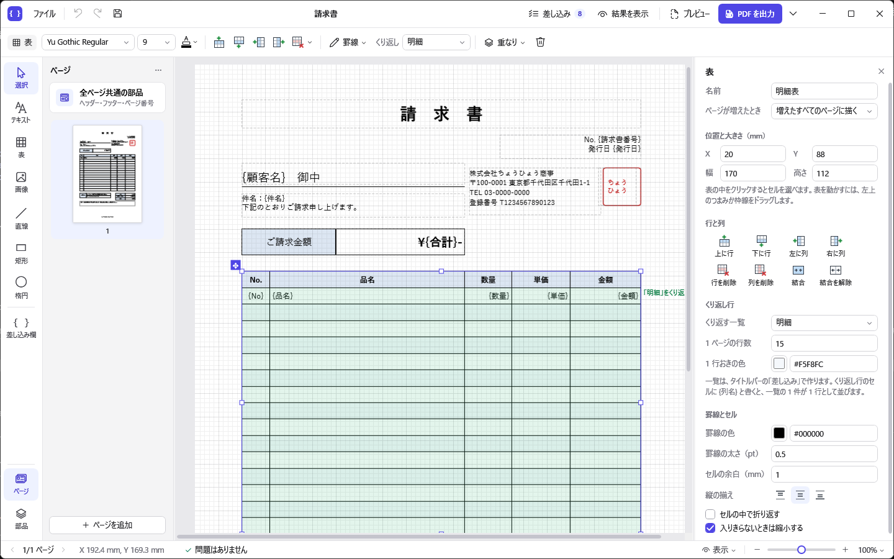

- ページごとに、違うレイアウトを作れます（表紙・本文・名簿など）。用紙の大きさや向きも、ページごとに変えられます。
- ヘッダー・フッターやページ番号のように、すべてのページに描く部品（全ページ共通の部品）を置けます。
- 用紙の上にテキスト・表・直線・矩形・楕円・画像を置き、ドラッグで位置や大きさを決めます。
- デザイン画面の用紙は ChohyoPdf で実際に描いた画像です。禁則処理・折り返し・縮小表示・均等割り付けなども、出力する PDF と同じ見た目で表示されます。
- 文字の一部を上付き・下付きにしたり、ルビを付けたり、テキストを箇条書きにしたりできます。
- 宛名や日付のように PDF を作るたびに変わる文字を、あとから差し込めます（差し込み）。件数が決まっていないデータは、表の行としてくり返せます。出力する C# コードは、その値を引数に受け取って PDF を作るメソッドになります。
- ページ番号や今日の日付（和暦も）は、値を渡さなくても差し込めます。値を C# の式で計算することもできます（例: 1 か月前の月）。

## 目次

1. [ダウンロードと起動](#1-ダウンロードと起動)
2. [はじめての文書](#2-はじめての文書)
3. [画面と操作](#3-画面と操作)
4. [ページ](#4-ページ)
5. [差し込み](#5-差し込み)
6. [一覧の表（行をくり返す表）](#6-一覧の表行をくり返す表)
7. [出力](#7-出力)
8. [オプション](#8-オプション)
9. [デザインファイル](#9-デザインファイル)
10. [制限事項](#10-制限事項)

---

## 1. ダウンロードと起動

### 1.1 動作環境

- Windows 10（バージョン 1809 以降）または Windows 11 の 64 ビット版（x64）
- .NET をインストールする必要はありません（実行に必要なものは ZIP ファイルに入っています）。

### 1.2 ダウンロード

1. [ChohyoPdfDesigner-win-x64.zip](https://github.com/Ringoacid/ChohyoPdf/releases/latest/download/ChohyoPdfDesigner-win-x64.zip) をダウンロードします（約 70 MB）。古いバージョンや変更点は [GitHub の Releases](https://github.com/Ringoacid/ChohyoPdf/releases) にあります。
2. ダウンロードした ZIP ファイルを右クリックし、「すべて展開」で好きな場所に展開します。
3. 展開したフォルダの `ChohyoPdfDesigner.exe` をダブルクリックして起動します。

初めて起動するときに「Windows によって PC が保護されました」と表示されたら、「詳細情報」を押してから「実行」を押してください。ChohyoPdf Designer にはコード署名をしていないため、この確認が表示されます。

- デザインファイル（`.chohyo`）をダブルクリックで開けるようにするには、ファイルを右クリックして「プログラムから開く」→「別のプログラムを選択」で `ChohyoPdfDesigner.exe` を選びます。
- 新しいバージョンを使うときは、新しい ZIP ファイルを展開し直してください。
- アンインストールするときは、展開したフォルダを削除します。設定も消すときは、`%APPDATA%\ChohyoPdfDesigner` フォルダも削除します。

## 2. はじめての文書

案内状を作りながら、基本の操作を順に見ていきます（動画は約 1 分です。GitHub で読んでいるときは、画像を押すと動画を開きます）。

[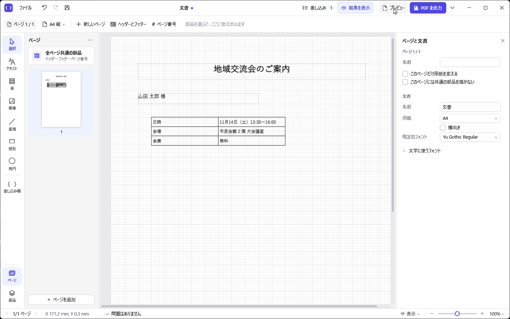](images/designer/tutorial.mp4)

1. 左端のレールで「テキスト」を選び、用紙の上をドラッグしてテキストを置きます。ダブルクリックすると、用紙の上でそのまま文字を入力できます（Ctrl+Enter で確定）。
2. 書式バー（上の 2 段目）で、文字の大きさ・太字・揃えを変えます。
3. レールで「表」を選び、ドラッグして表を置きます。セルをダブルクリックして入力し、Tab で右のセル、F2 で編集を始めます。
4. タイトルバーの「差し込み」で差し込みのウィンドウを開き、「追加」で差し込み項目「氏名」を作ります。確認用の値には「山田 太郎」を入れます。
5. テキストに `{氏名} 様` と書きます。タイトルバーの「結果を表示」を押すと、確認用の値を入れた見た目になります。
6. 「プレビュー」（F5）で、出力する PDF を確かめます。「PDF を出力」で PDF に、横の ▾ の「C# コードを出力」で C# のコードにします。

「ファイル」→「見本から新規作成」で、次の見本も開けます。

| 見本 | 内容 |
| --- | --- |
| 案内状 | 1 ページの手紙。宛名・日時・会場を差し込むので、同じ文面で宛名だけを変えた案内状を何通も作れます |
| 活動報告書 | 表紙・本文・名簿の 3 ページ。ページごとにレイアウトが違い、名簿は参加者の人数に応じてページが増えます |
| 請求書 | 差し込み、品目をくり返す表、セル結合、最後のページだけの合計欄 |

## 3. 画面と操作

### 3.1 画面の構成

左に部品を置く道具、上に選んだ部品の書式、右に詳しい設定を並べています。どこに何があるかは、選んでいるものに合わせて変わります。

| 場所 | 内容 |
| --- | --- |
| タイトルバー | 左に「ファイル」のメニュー、元に戻す・やり直し・上書き保存。中央に文書の名前（保存していない変更があれば点）。右に「差し込み」（差し込みのウィンドウを開く。数字は差し込み項目と一覧の数）、「結果を表示」（差し込み欄に確認用の値を入れて表示）、「プレビュー」、「PDF を出力」（横の ▾ で C# コードの出力） |
| 書式バー（タイトルバーの下） | 選んでいるものの書式。テキストならフォント・大きさ・太字など・上付き・下付き・ルビ・色・揃え・箇条書き、表なら行と列の挿入と削除・罫線・くり返す一覧、表のセルならセルの書式と結合、図形なら塗りつぶしと枠線。2 つ以上選べば揃えるボタン。右端の「重なり」で手前・奥へ移動、ごみ箱で削除。何も選んでいなければ、用紙の大きさと向き・新しいページ・ヘッダーとフッター・ページ番号 |
| 左端のレール | 部品を置く道具（選択・テキスト・表・画像・直線・矩形・楕円）と「差し込み欄」。下の「ページ」「部品」で、左のパネルの中身を切り替えます（もう一度押すとパネルを閉じます） |
| 左のパネル | 「ページ」はページの一覧（縮小画像）。クリックしたページを編集します。上の「全ページ共通の部品」で、すべてのページに描く部品（ヘッダー・フッター・ページ番号）を編集します。下の「ページを追加」と、右上の「…」（複製・削除・並べ替え・名前の変更）。「部品」は編集しているページの部品の一覧（下にあるものほど手前に描く） |
| 中央 | 用紙。レールで道具を選んで用紙の上をドラッグすると、部品を置けます（クリックだけなら既定の大きさで置きます）。右クリックでメニューを開きます。ページをつなげて表示しているときは、すべてのページを縦に並べ、編集しているページを枠で示します |
| 右のインスペクター | 選んだ部品の詳しい設定（名前、位置と大きさ、文字、枠と背景、くり返し行など）。何も選んでいなければ、ページの設定（名前・このページだけの用紙・共通の部品を描くか）と文書の設定（名前・用紙・既定のフォント・太字に使うフォント）。右上の ✕ で閉じ、ステータスバーの「表示」で開きます |
| ステータスバー | 左にページの移動と編集しているページ（「2/3 ページ」）、カーソルの位置（mm）、デザインの問題（差し込み欄の名前の間違いなど。押すと一覧を表示）。右に「表示」（グリッド・部品の枠・ページをつなげて表示・左右のパネル）とズーム（倍率の一覧には「ページ全体を表示」「ページの幅に合わせる」もあります） |
| 差し込みのウィンドウ | 差し込み項目・一覧・組み込みの欄を設定する、別のウィンドウ（タイトルバーの「差し込み」）。「[5. 差し込み](#5-差し込み)」を見てください |

### 3.2 部品を置く・動かす

テキストを置いて文字を入力するところです。

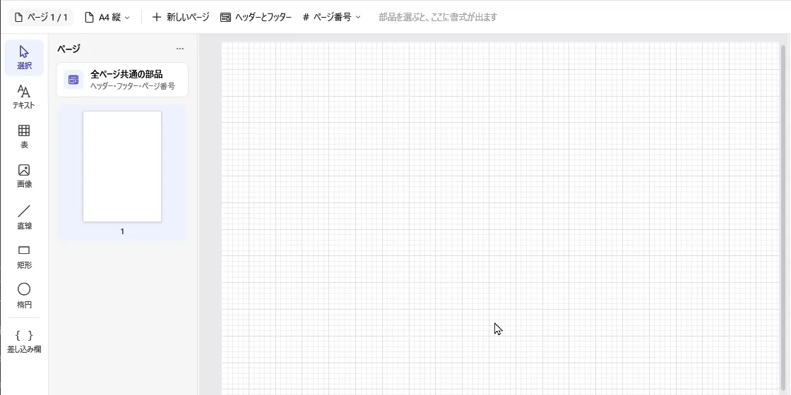

部品はドラッグ（右ボタンでのドラッグでもかまいません）で動かし、まわりのハンドルで大きさを変えます。グリッドに合わせて動きます。ドラッグしている間は、部品の位置と大きさを下のステータスバーに表示します。

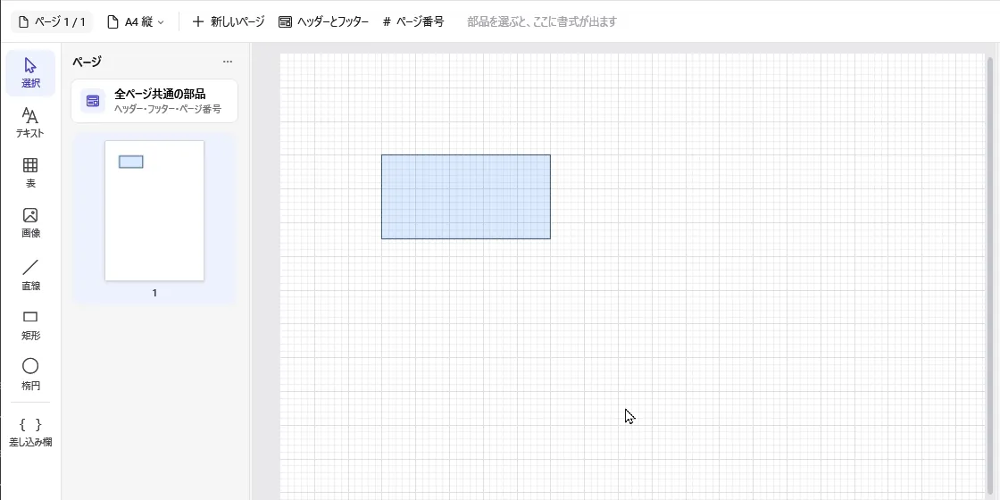

### 3.3 主な操作

| 操作 | 方法 |
| --- | --- |
| ページを増やす | 書式バーの「新しいページ」（何も選んでいないとき）、または左のパネルの「ページを追加」。編集しているページの後ろに空のページを足します。パネルの「…」の「このページを複製」なら、同じ部品を置いたページを足します |
| ページを切り替える | 左のパネルでクリック、ステータスバーの ‹ ›、または Ctrl+PageUp / Ctrl+PageDown。ページをつなげて表示しているときは、用紙の上でページをクリックしても移ります |
| 全ページ共通の部品を編集する | 左のパネルの「全ページ共通の部品」、書式バーの「ヘッダーとフッター」、または用紙の上で薄く見えている共通の部品をダブルクリック。部品のない所をダブルクリックするか、「編集を終える」でページの編集に戻ります |
| 選択 | クリック。Ctrl / Shift を押しながらクリックすると追加で選びます。何もない所からドラッグすると、囲んだ部品を選びます |
| 移動・大きさの変更 | ドラッグ、またはハンドルをドラッグ。右ボタンでドラッグしても動かせます（動かさずに離すとメニューが開きます）。グリッドに合わせて動きます（Alt を押している間は合わせません） |
| 水平・垂直に動かす | Shift を押しながらドラッグ（動かした量の大きいほうの向きにだけ動きます） |
| 元の位置に残してコピーする | Ctrl を押しながらドラッグ。元の部品はそのままで、コピーを動かします（元に戻すは 1 回分） |
| 少しずつ動かす | 矢印キー（グリッドの間隔）、Shift ＋ 矢印キー（0.1 mm） |
| 直線を水平・垂直にする | 直線を描くときや端のハンドルを動かすときに、Shift を押しながらドラッグ |
| 太字・斜体 | Ctrl+B / Ctrl+I（用紙の上で文字を編集しているときも使えます）。テキストが対象で、表のセルは太字だけです |
| 文字を編集する | テキストや表のセルをダブルクリック（または F2、Enter）すると、用紙の上でそのまま編集できます。インスペクターの入力欄でも編集できます |
| 表のセルを選ぶ | 選んである表の中をクリック。ドラッグか Shift ＋ クリックで範囲を選びます。表を動かすには、左上のつまみか枠線をドラッグします |
| 右クリック | 部品の上では、編集・コピー・順序・表の行と列などのメニュー。何もない所では、貼り付け・挿入・ページの追加・表示の切り替えなどのメニュー。「ここに貼り付け」「挿入」は右クリックした位置に置きます |
| 元に戻す・やり直し | Ctrl+Z / Ctrl+Y |
| コピー・切り取り・貼り付け・複製・削除 | Ctrl+C / Ctrl+X / Ctrl+V / Ctrl+D / Delete。ほかのページに切り替えて貼り付けると、部品をページの間で移せます |
| スクロール | マウスホイールで上下、Shift ＋ マウスホイールで左右 |
| 拡大・縮小 | Ctrl ＋ マウスホイール（マウスの位置を中心に拡大・縮小）、Ctrl+＋ / Ctrl+－ / Ctrl+0 |
| プレビュー・PDF 出力・C# コード | F5 / Ctrl+E / Ctrl+G |
| プレビューの拡大・縮小 | プレビューの画面で、Ctrl ＋ マウスホイール、Ctrl+＋ / Ctrl+－ / Ctrl+0、または上のバーの「－」「＋」「幅に合わせる」 |

用紙の上で文字を編集しているときのキーは次のとおりです。

| キー | テキスト | 表のセル |
| --- | --- | --- |
| Enter | 改行 | 確定して下のセルを選ぶ |
| Alt+Enter / Shift+Enter | 改行 | 改行 |
| Ctrl+Enter | 確定 | 確定 |
| Tab / Shift+Tab | タブの文字を入れる（箇条書きでは、行頭のタブで入れ子にする） | 確定して右（左）のセルを選ぶ |
| Esc | 編集を取り消す | 編集を取り消す |

ほかの場所をクリックしても確定します。1 回の編集は、元に戻す（Ctrl+Z）の 1 回分です。表のセルで Enter や Tab を押したあとは、F2 か Enter で次のセルの編集を始めます。

### 3.4 文字の書式

- 書式は、部品を選ぶと出る書式バーで変えます。テキストの縦の揃え・折り返し・行送り・字間・内側の余白は、揃えのボタンの右の「テキストの配置」で変えます。
- 横の揃え（左・中央・右・両端・均等割り付け）と縦の揃え（上・中央・下）は、アイコンのボタンで選びます。表のセルでは、どれも選んでいなければ列（横）と表（縦）の設定に従います。選んでいるボタンをもう一度押すと、選択をやめます。
- 太字・斜体・下線・取り消し線は「B」「I」「U」「abc」のボタンで切り替えます。
- フォントを指定していない部品では、フォントの欄に既定のフォント（インスペクターの「文書」で設定）を表示します。既定のフォントを選ぶと、指定をやめて既定のフォントに従います。
- フォントの一覧は、フォント名をそのフォントで表示します。一覧でマウスを重ねたフォントは、選んでいる部品に仮に適用して用紙に表示します（クリックするまでデザインは変わりません）。どちらもオプションでオフにできます。

### 3.5 上付き・下付き・ルビ

文字の一部だけを上付き・下付きにしたり、ルビ（振り仮名）を付けたりするときは、テキストや表のセルの文字に次のように書きます。

| 書き方 | 描く文字 |
| --- | --- |
| `面積 10 m<sup>2</sup>` | 面積 10 m² |
| `H<sub>2</sub>O` | H₂O |
| `｜東京《とうきょう》`（｜ は全角でも半角でもよい） | 「東京」の上に「とうきょう」 |

- 書式バーの「x²」「x₂」「ルビ」のボタンでも入れられます。用紙の上やインスペクターで文字を編集しているときは選んでいる文字に、編集していないときはテキスト（セル）の文字全体に付けます。もう一度押すと外します。「ルビ」は、選んでいる文字を ｜親文字《》 にして、《》 の中にルビを入力できるようにします。用紙の上で編集しているときの右クリックメニューにも、同じ項目があります。
- 差し込み欄も使えます（例: `{面積} m<sup>2</sup>`、`｜{氏名}《{フリガナ}》`）。差し込んだ値が空なら、ルビは付けません。差し込んだ値の中の記法は、書式にせずにそのまま描きます。
- 閉じていない記法（`<sup>` だけなど）や、｜ のない `東京《とうきょう》` は、書式にせずにそのまま描きます。
- 上付き・下付きは、文字を 0.65 倍にして上下にずらします。ルビは親文字の半分の大きさで、ルビのある行はその分だけ高くなります（[ChohyoPdf 説明書の 3.8 と 3.11](manual.md#38-上付き下付き)）。

### 3.6 箇条書き

テキストを箇条書きにするときは、書式バーの箇条書きのボタン（揃えのボタンの右）か、インスペクターの「箇条書き」で種類を選びます。

- 1 行が 1 項目になります。行の先頭にタブを入れると、1 つ深い項目（入れ子）になります。用紙の上やインスペクターで文字を編集しているときは、Tab キーでタブを入れられます。
- 種類は「箇条書き（・）」と「番号付き（1.）」です。箇条書きでは記号（・ ● ○ ■ など）を、番号付きでは番号の形（1. 1) (1) ① 一、 （一） a. A. i. I.）を選べます。入れ子の項目は、深さごとに決まった記号（・ → ○ → ■）と番号（1. → (1) → ①）になります。
- 項目が長いときは折り返し、2 行目以降は本文の開始位置にそろいます。上付き・下付き・ルビの記法も使えます。
- 揃え・行送り・縮小などの「テキストの配置」の設定は、箇条書きでもそのまま使えます。「入りきらないときは縮小する」では、記号も含めて全体を同じ割合で縮めます。

### 3.7 表の行と列

表を選ぶと、書式バーに行・列の挿入と削除のボタンが出ます。表の中をクリックしてセルを選ぶと、セルの結合と解除のボタンも出ます（インスペクターにも同じボタンがあります）。選んでいるセルを基準に操作します。同じ操作は、表を右クリックしたメニューの「行と列」からもできます。

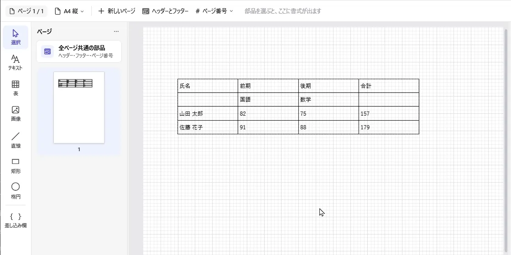

## 4. ページ

文書は 1 ページ以上のページでできています。ページごとに違う部品を置けるので、表紙と本文のように、ページごとにレイアウトを変えられます。

- 部品を何も選んでいないときのインスペクターで、ページの設定を変えられます。
  - ページの名前（例: 表紙）。左のパネルと、出力する C# コードのコメントに使います。
  - 「このページだけ用紙を変える」をオンにすると、そのページだけ用紙の大きさや向きを変えられます（例: 表だけ A4 横）。オフなら文書の用紙です。書式バーの用紙のボタン（例: 「A4 縦」）でも変えられます。
  - 「このページには共通の部品を描かない」をオンにすると、そのページには全ページ共通の部品を描きません。
- `{ページ番号}` と `{総ページ数}` は、文書全体での番号です。「[6. 一覧の表](#6-一覧の表行をくり返す表)」でページが増えたときも、増えたページを数えます。
- ほかのページと同じ部品を置くときは、「複製」でページを足すか、部品をコピーして貼り付けます。すべてのページに描くなら、全ページ共通の部品にします。

### 4.1 ページをつなげて表示

すべてのページを縦に並べて表示し、スクロールして見られます。ステータスバーの「表示」の「ページをつなげて表示」か、オプションで切り替えます（既定はオン）。

- 部品を置いたり動かしたりできるのは、編集しているページ（青い枠のページ）だけです。ほかのページをクリックすると、そのページの編集に移ります。
- 左のパネルでページを選ぶと、そのページまでスクロールします。
- オフにすると、左のパネルで選んだページだけを表示します。

### 4.2 全ページ共通の部品

ヘッダー・フッターやページ番号のように、すべてのページに描く部品です。すべてのページで、ページの部品より奥に描きます。

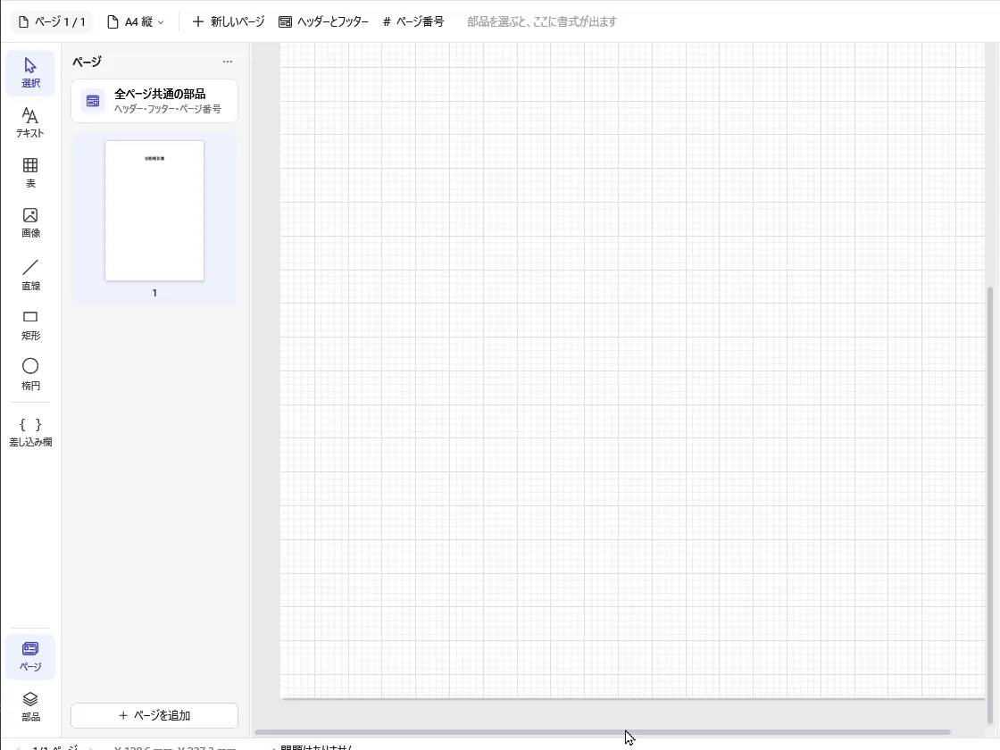

- 左のパネルの「全ページ共通の部品」を押すか、用紙の上で共通の部品をダブルクリックすると、共通の部品の編集に移ります。書式バーには、ページ番号・日付・差し込み欄と「編集を終える」が出ます。書式バーの「ページ番号」を押すと、用紙の下の中央に `{ページ番号} / {総ページ数}` を置きます。編集しているあいだは、ページの部品を薄く表示します。反対に、ページを編集しているときは、共通の部品を薄く表示します。
- 部品の「描くページ」で、文書のどのページに描くかを選べます（すべてのページ・最初のページだけ・最後のページだけ・最初のページ以外）。表紙にページ番号を描かないときは「最初のページ以外」にします。特定のページだけ描かないときは、そのページの「このページには共通の部品を描かない」をオンにします。
- 位置は用紙の左上からの距離です。用紙の大きさが違うページでも同じ位置に描くので、位置が合わないページでは「このページには共通の部品を描かない」にしてください。
- 全ページ共通の部品の表では、行をくり返せません（くり返し行は空の行になります）。

## 5. 差し込み

宛名や日付のように、PDF を作るたびに変わる文字を、あとから入れられるようにする機能です（差し込み印刷と同じ考え方です）。同じデザインで、値だけを変えた PDF を何枚も作れます。使わなければ、デザインしたとおりの PDF ができます。

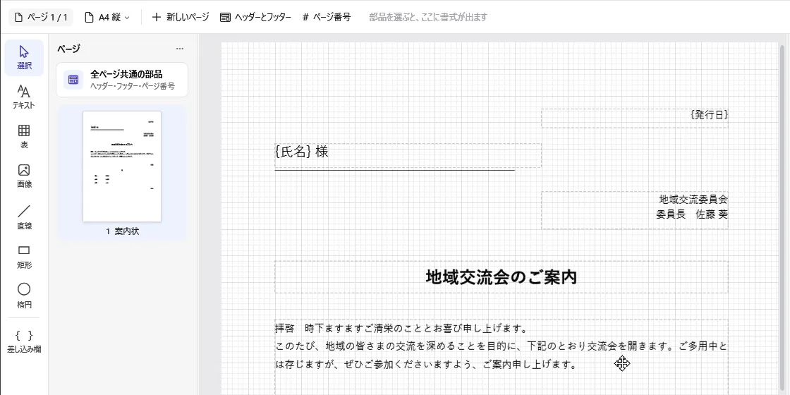

差し込みの設定は、タイトルバーの「差し込み」で開く専用のウィンドウで行います。左で「差し込み項目」「一覧」「組み込みの欄」を切り替えます。どの章も同じ作りで、上に見出しと「使い方」「追加」、その下の左に一覧、右に選んだものの設定を並べます。まだ何もない章には、実際の画面を使った使い方（手順を自動で送るスライド）を表示します。「使い方」を押すと、いつでも見られます。

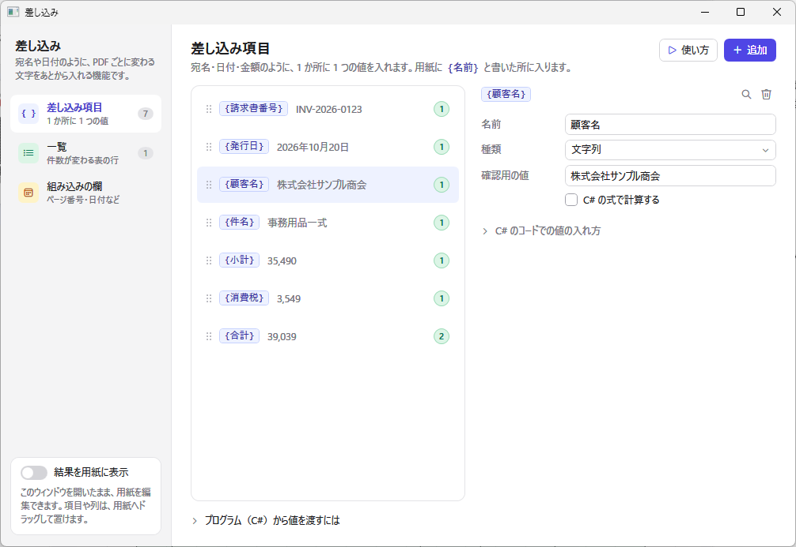

このウィンドウは開いたまま用紙を編集できます（項目や列を用紙へドラッグしたり、「用紙から探す」で部品を選んだりできます）。保存（Ctrl+S）やプレビュー（F5）などのショートカットキーも使えます。

差し込むものは 2 種類あります。

| 種類 | 内容 | デザインでの使い方 | 出力した C# コードでの渡し方 |
| --- | --- | --- | --- |
| 差し込み項目 | 1 か所に 1 つの値（例: 宛名、日付、合計金額） | テキストや表のセルに `{氏名}` と書く | `data.氏名 = "山田 太郎";` |
| 一覧 | 件数が決まっていない値の並び（例: 名簿、品目、成績） | 表の「くり返し行」に一覧を選び、そのセルに `{列の名前}` と書く | `data.参加者.Add(new 参加者Item { 氏名 = "山田 太郎" });` |

たとえば、テキストに `{氏名} 様` と書いて、差し込み項目「氏名」に「山田 太郎」を渡すと、PDF には「山田 太郎 様」と描きます。

差し込みのウィンドウの「一覧」で一覧や列を選ぶと、「C# のコードでの 1 件の追加のしかた」「C# のコードでの名前」を開いて、C# のコードでどう値を入れるかを確かめられます。「差し込み項目」のいちばん下の「プログラム（C#）から値を渡すには」には、データを作って PDF を保存するまでのコードの例があります。クラスやプロパティの名前は、「C# コードを出力」で作るコードと同じです。

### 5.1 差し込み項目を使う

1. 差し込みのウィンドウの「差し込み項目」の「追加」で差し込み項目を作り、名前・種類（文字列・数値・日付）・書式・確認用の値を決めます。
2. テキストや表のセルに `{差し込み項目の名前}` と書きます。インスペクターの「差し込み欄を挿入」、用紙の上で編集しているときの右クリックメニュー、レールの「差し込み欄」からも入れられます。差し込みのウィンドウは開いたまま用紙を編集できるので、差し込み項目を用紙へドラッグして置くこともできます（テキストや表のセルの上に落とすと、そこに足します）。
3. タイトルバーの「結果を表示」を押すと、用紙の上で確認用の値を入れた見た目を確かめられます。

項目の一覧の右の丸い数字は、用紙でその項目を使っている数です（`{名前}` と `{名前:書式}` の数。まだ使っていなければ点線の丸）。「用紙から探す」を押すと、その項目を使っている部品を用紙の上で選びます（今のページになければ、使っているページに移ります）。一覧では、その一覧をくり返している表の数を表示します。

### 5.2 一覧を使う

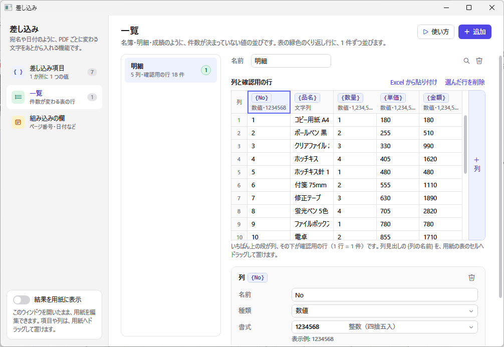

1. 差し込みのウィンドウの「一覧」の「追加」で一覧を作り、列（1 行に並べる値。例: 氏名・所属）を決めます。「列と確認用の行」の表の右端の「＋ 列」で列を足し、列見出しをクリックすると、表の下でその列の名前・種類・書式を変えられます。列見出しの `{列の名前}` を用紙の表のセルへドラッグして置くこともできます。
2. 「この一覧の表を用紙に置く」を押すと、見出しの行に列の名前、くり返し行に `{列の名前}` を入れた表を、編集しているページに置きます（数値の列は右揃え）。自分で作った表の「くり返す一覧」に一覧を選んでも同じです。
3. 「列と確認用の行」の表の、列見出しの下の行に、1 行に 1 件ずつ値を入れます。いちばん下の空の行に入力すると件数が増えます。Excel でコピーした範囲を「Excel から貼り付け」で追加することもできます。
4. タイトルバーの「結果を表示」を押すと、くり返し行に確認用の行が並びます。

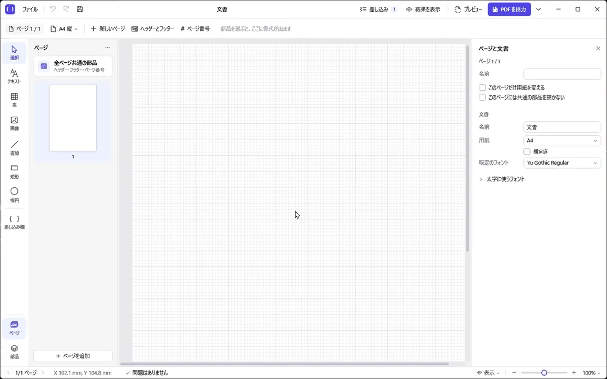

### 5.3 書式

数値と日付の差し込み項目（一覧の列も同じ）は、書式を一覧から選べます。一覧には、確認用の値に書式を付けた見本が表示されます。

| 種類 | 選べる書式の例 |
| --- | --- |
| 数値 | 書式なし（1234567.5）、3 桁区切り（1,234,568）、3 桁区切り・小数 2 桁（1,234,567.50）、円記号（¥1,234,568）、「円」付き（1,234,568円）、マイナスを △ にする（△1,235）、小数 1 桁・2 桁、パーセント（10%）、0 で埋める（007） |
| 日付 | 既定（2026/01/05）、0 を付けない（2026/1/5）、2026年1月5日、2026年1月5日（月）、2026年1月、1月5日、2026-01-05、日付と時刻（2026/01/05 09:30）、時刻（9:30） |

- 一覧にない書式は「その他…」を選んで、.NET の書式指定文字列（カルチャは ja-JP）を入力します。
- 書式を選ばなければ、数値はそのまま（1234 は 1234）、日付は `yyyy/MM/dd` で表示します。
- 1 か所だけ書式を変えたいときは、`{金額:#,0}` のように差し込み欄に書式を書きます。

### 5.4 差し込み欄の書き方

| 書き方 | 意味 |
| --- | --- |
| `{顧客名}` | 差し込み項目「顧客名」の値 |
| `{金額:#,0}` | 書式を付けて差し込む（数値・日付の差し込み項目と、組み込みの差し込み欄） |
| `{ページ番号}` `{今日}` など | 組み込みの差し込み欄（下の表）。値を渡さなくても使えます |
| `{{` `}}` | `{` と `}` そのもの |

名前は、くり返し行では一覧の列、差し込み項目、組み込みの差し込み欄の順に探します。見つからない差し込み欄は、`{名前}` のまま表示し、画面の下に問題として表示します。

### 5.5 組み込みの差し込み欄

値を渡さなくても使える差し込み欄です。

| 書き方 | 内容 | 書式を付けない場合の例 |
| --- | --- | --- |
| `{ページ番号}` | ページ番号（文書全体で 1 から。くり返し行でページが増えたときも数える） | `3` |
| `{総ページ数}` | 総ページ数 | `12` |
| `{今日}` | PDF を作った日 | `2026/10/21` |
| `{現在日時}` | PDF を作った日時 | `2026/10/21 09:05` |
| `{現在時刻}` | PDF を作った時刻 | `9:05` |
| `{和暦}` | PDF を作った日（和暦） | `令和8年10月21日` |
| `{和暦年}` | PDF を作った年（和暦） | `令和8年` |
| `{今年}` | PDF を作った年（数値） | `2026` |
| `{今月}` | PDF を作った月（数値） | `10` |

- どれも「:」のあとに書式を書けます。例: `{ページ番号:000}` → `003`、`{今月:00}` → `03`、`{今日:yyyy年M月d日（ddd）}` → `2026年10月21日（水）`、`{現在時刻:HH時mm分}` → `09時05分`。
- 日付の書式に `gg` を入れると、和暦（元号）で書きます。例: `{今日:ggy年M月d日}` → `令和8年10月21日`、`{今日:ggy年}` → `令和8年`。元年は「令和元年」と書きます。差し込み項目の日付も同じで、書式の一覧から「和暦（令和）の年月日」を選べます。明治より前の日付（値のない日付を含む）は、和暦の書式では空になります。
- 差し込み結果・プレビュー・PDF 出力では、その時の日時を使います。出力した C# コードでは、`Create(data, now)` の `now` で日時を渡せます（`Create(data)` なら今の日時）。

### 5.6 C# の式で計算する差し込み項目

差し込み項目の「C# の式で計算する」をオンにすると、値を渡す代わりに C# の式で計算します。

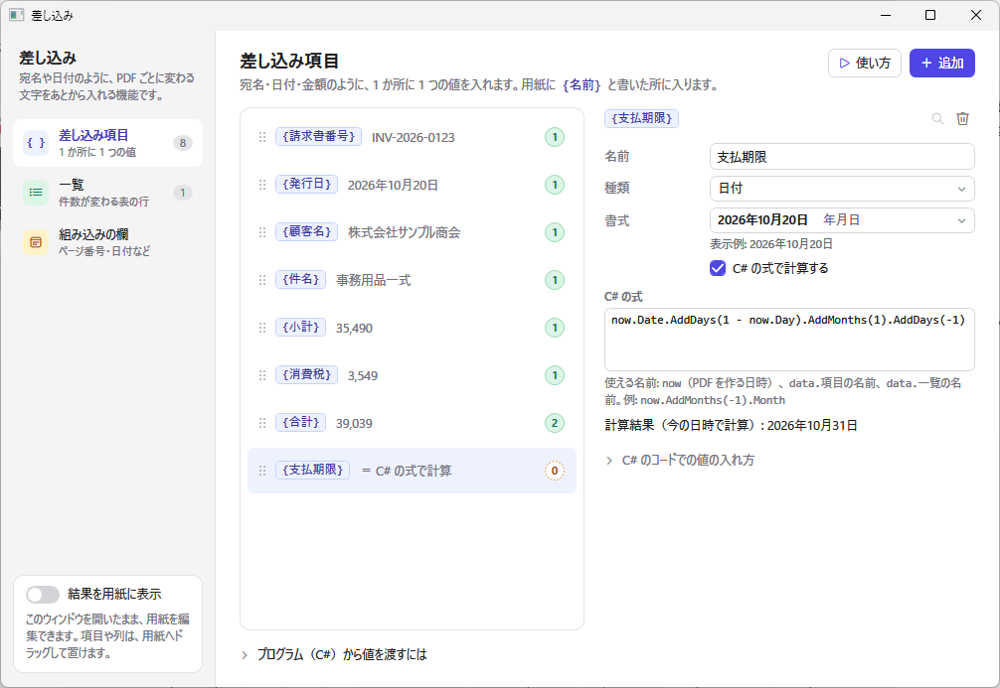

| 例 | 式 |
| --- | --- |
| 1 か月前の月（数値） | `now.AddMonths(-1).Month` |
| 今月の末日（日付） | `now.Date.AddDays(1 - now.Day).AddMonths(1).AddDays(-1)` |
| 締め日の 30 日後（日付） | `data.締め日.AddDays(30)` |
| 一覧の合計（数値） | `data.明細.Sum(x => x.金額)` |
| 敬称を付けた宛名（文字列） | `data.顧客名 + " 様"` |

- 式で使える名前は、`now`（PDF を作る日時）と `data`（差し込むデータ。値を渡す差し込み項目と一覧）です。1 行の式のほか、`return` を使った文も書けます。
- 結果は、差し込み項目の種類（文字列・数値・日付）にして使います。書式も、ほかの差し込み項目と同じように付けられます。
- 式は、出力する C# コードに、そのメソッド（例: `Compute先月`）として入ります。デザイナーでも同じコードを C# 7.3 でコンパイルして計算するので、出力するコードと結果は同じです。差し込みのウィンドウの式の下に、今の日時で計算した結果か、エラーを表示します。
- 式は文書ごとに 1 回計算します。ページ番号は使えません。
- 計算する差し込み項目は、データのクラスには入りません（値は渡しません）。
- **C# の式は、PC の上でプログラムとして動きます。** ほかの人から受け取ったファイルで勝手に動かないように、C# の式のあるファイルを開くときは、実行するかどうかを尋ねます（Office のマクロと同じ考え方です）。「いいえ」を選んだときは、計算する差し込み項目を空にして表示し、あとから書式バーの下に出る「C# の式を実行する」で実行できます。自分で新しく作ったデザインの式は、尋ねずに実行します。

## 6. 一覧の表（行をくり返す表）

表の「くり返す一覧」に一覧を選ぶと、見出しなどの固定の行の下に、一覧の 1 件を 1 行として並べます。デザイン画面では、くり返し行の範囲を緑色で表示します。

- くり返し行の見本のセルに `{列名}` と書きます。すべての行が同じ高さです。
- 1 ページに並べる行の数（「1 ページの行数」）を決めます。データが少なくても、その数だけ罫線の入った空の行を描きます。
- 件数が 1 ページの行数を超えると、表を置いたページを増やして、続きの行を描きます。増えるページ数は、そのページの一覧の表ごとに「件数 ÷ 1 ページの行数」（切り上げ、最低 1）を求めた最大の値です。ほかのページは増えません。
- 増えたページにも、そのページのすべての部品を同じ位置に描きます。一覧の表のあるページでは、部品のプロパティ「ページが増えたとき」で描くページを選ぶと、宛名は最初のページだけ、合計欄は最後のページだけ、「（続き）」の見出しは最初のページ以外、のように描き分けられます。
- 同じ一覧を別のページの表でもくり返すと、どの表も一覧の最初の 1 件から並べます。
- 表の「縮小して全体を表示」がオンなら、セルに収まらない文字を小さくして収めます。「折り返す」がオフなら 1 行で描きます（縮小と組み合わせると、1 行に収まるまで小さくします）。縮小しない設定では、高さに収まらない行は描かず、幅を超えた文字はセルからはみ出して描きます。
- 合計などの値は、データと一緒に差し込み項目（例: `合計`）として渡すか、「[C# の式で計算する差し込み項目](#56-c-の式で計算する差し込み項目)」で計算します（例: `data.明細.Sum(x => x.金額)`）。
- くり返し行では、縦方向のセル結合はできません（横方向はできます）。

## 7. 出力

### 7.1 PDF

「PDF を出力」と「プレビュー」は、差し込みのウィンドウの確認用の値を差し込んだ PDF を作ります。一覧の件数が多ければ、ページを増やした PDF になります。

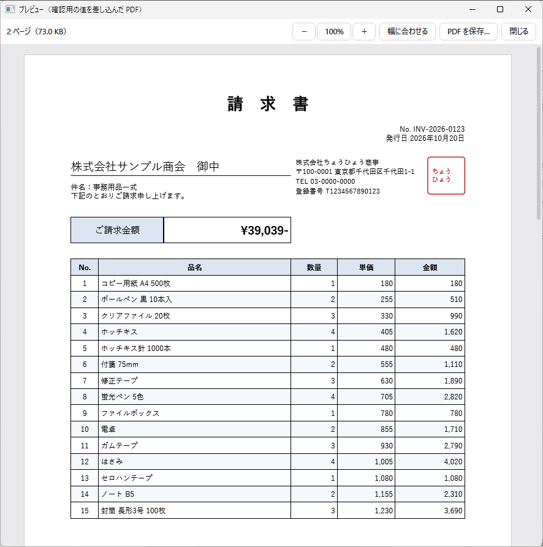

### 7.2 C# コード

「C# コードを出力」（「PDF を出力」の横の ▾、または Ctrl+G）は、ChohyoPdf だけを使って同じ PDF を作るコードを出力します。デザイナーの PDF 出力と、出力したコードで作った PDF は、同じデータからは同じ内容になります（テストでバイト単位の一致を確かめています）。

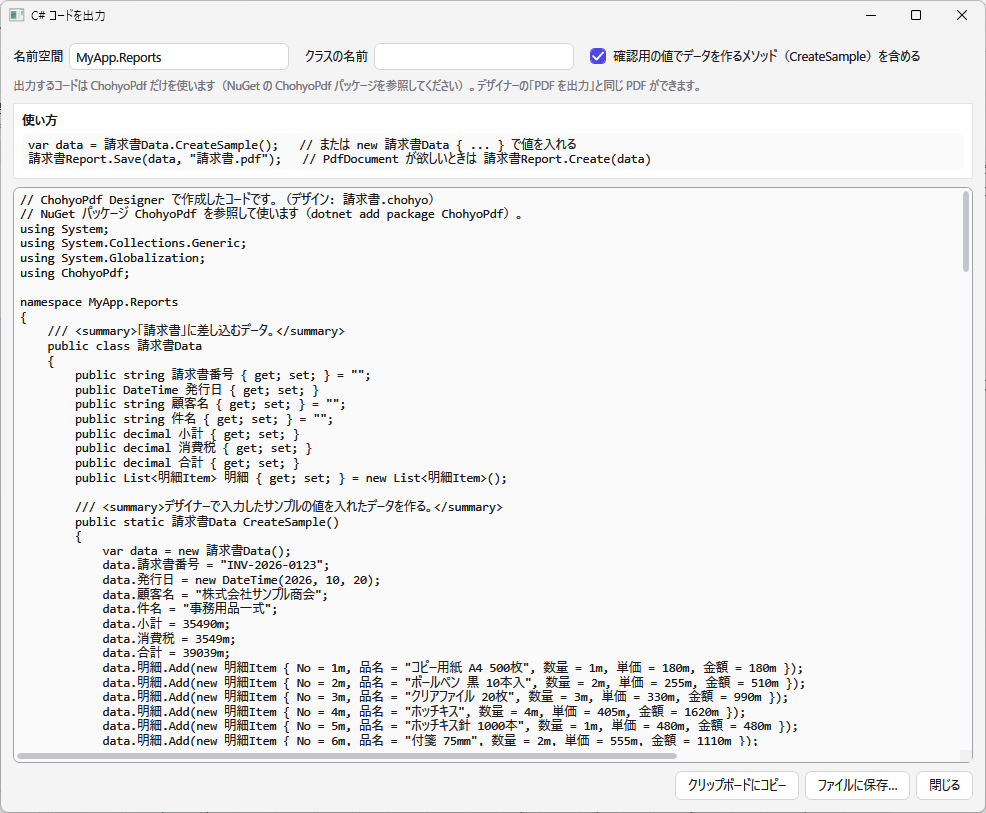

出力するコードには、次のものが含まれます。

- 差し込むデータのクラス（例: `請求書Data`）と、一覧の 1 行のクラス（例: `明細Item`）
- PDF を作るクラス（例: `請求書Report`）。`Create(data)` は `PdfDocument` を返し、`Save(data, path)` はファイルに保存します。ページごとに、そのページの部品を描くコードが並びます。全ページ共通の部品は `DrawCommon` メソッドで描きます
- 確認用の値でデータを作る `CreateSample()`（出力するときに省けます）
- 組み込みの日付（`{今日}` など）か C# の式を使うときは、日時を受け取る `Create(data, now)`。`Create(data)` は今の日時で作ります

```csharp
var data = new 請求書Data { 顧客名 = "株式会社サンプル商会", 発行日 = DateTime.Today, 合計 = 39039m };
data.明細.Add(new 明細Item { No = 1m, 品名 = "コピー用紙", 数量 = 1m, 単価 = 180m, 金額 = 180m });
請求書Report.Save(data, "請求書.pdf");
```

- 出力したコードを使うプロジェクトには、NuGet パッケージ ChohyoPdf を追加します（`dotnet add package ChohyoPdf`）。
- 出力したコードは C# 7.3 以降でコンパイルでき、null 許容参照型を有効にしても警告は出ません。.NET Framework 4.8（C# 7.3）でも、デザイナーと同じ内容の PDF ができることを確かめています。ただし、和暦の書式（`gg`）は Windows の元号の情報を使うため、.NET Framework では Windows の更新によって結果が変わることがあります（令和には、2019 年 5 月以降の更新が必要です）。
- フォントは `PdfFont.FromSystem` で、コードを実行する PC から探します。同じフォントが入っていない PC では例外になります。
- 画像は `ImageFolder` プロパティ（既定は実行ファイルのフォルダ）からの相対パスで読み込みます。

## 8. オプション

「ファイル」→「オプション」で、次の設定を変えられます。設定は `%APPDATA%\ChohyoPdfDesigner\settings.json` に保存します。

| 設定 | 既定 | 内容 |
| --- | --- | --- |
| ページをつなげて表示する | オン | すべてのページを縦に並べて表示します（ステータスバーの「表示」でも切り替えられます） |
| フォント名をそのフォントで表示する | オン | フォントの一覧で、名前と見本をそのフォントで表示します |
| マウスを重ねたフォントを、デザイン画面でプレビューする | オン | フォントの一覧でマウスを重ねたフォントを、選んでいる部品に仮に適用して表示します。ページを描き直すため、動作が重くなることがあります |

## 9. デザインファイル

デザインは JSON 形式のファイル（拡張子 `.chohyo`）に保存します。座標と大きさの単位は mm、文字サイズと線の太さはポイントです。画像のパスは、デザインファイルのフォルダからの相対パスで保存します。

ページを持たない以前の形式（形式のバージョン 1）のファイルも開けます。部品は 1 ページ目に入り、保存すると新しい形式（バージョン 2）になります。

デザインファイルを起動時の引数に渡すと、そのファイルを開いて起動します（`ChohyoPdfDesigner.exe 請求書.chohyo`）。

## 10. 制限事項

- ChohyoPdf の座標指定の描画（`PdfGraphics`）を使う文書向けです。文章を自動で流し込むレイアウト（`Document`）は作れません。
- 全ページ共通の部品の位置は、用紙の左上からの距離です（用紙の下端や右端からの位置では置けません）。
- C# の式は、文書ごとに 1 回だけ計算します。ページごとに違う値（ページ番号を使う計算など）は作れません。
- 差し込み項目の名前を変えても、テキストに書いた差し込み欄の名前は変わりません。
- 縦書きなど、ChohyoPdf が対応していない機能は使えません（[ChohyoPdf 説明書の「対応していない機能」](manual.md#107-対応していない機能)を参照）。
