<!-- このファイルは docs/tools/build_docs.py で生成しています。編集は manual.template.md に行ってください。 -->

# ChohyoPdf 説明書

ChohyoPdf は、日本語の帳票や文書を PDF で出力するための C# ライブラリです。この説明書では、サンプルコードと出力結果の画像を並べて、主な機能の使い方を説明します。

掲載しているコードはすべて [docs/examples](examples/ChohyoPdf.DocExamples) にあり、そのまま実行できます。画像は、そのコードで出力した PDF を画像にしたものです。

## 目次

1. [はじめに](#1-はじめに)
2. [単位と座標](#2-単位と座標)
3. [文字と段落](#3-文字と段落)
4. [ページの設定とページ送り](#4-ページの設定とページ送り)
5. [表](#5-表)
6. [画像](#6-画像)
7. [図形とグラフ](#7-図形とグラフ)
8. [座標を指定して描く帳票](#8-座標を指定して描く帳票)
9. [まとまったサンプル](#9-まとまったサンプル)
10. [困ったときは](#10-困ったときは)
11. [API の一覧](#11-api-の一覧)

---

## 1. はじめに

### 1.1 動作環境とライセンス

- 対応フレームワークは .NET Framework 4.6.2 以降、.NET Standard 2.0、.NET 8、.NET 10 です。.NET 9 では .NET 8 向けの DLL が、.NET Core 3.1 や .NET 5〜7 など .NET Standard 2.0 に対応した環境では .NET Standard 2.0 向けの DLL が使われます。
- ライセンスは MIT です。商用のアプリケーションにも組み込めます。
- 他のパッケージには依存しません。

### 1.2 プロジェクトへの追加

[NuGet](https://www.nuget.org/packages/ChohyoPdf) からプロジェクトに追加します。

```
dotnet add package ChohyoPdf
```

Visual Studio では、［NuGet パッケージの管理］で「ChohyoPdf」を検索してもインストールできます。

コードの先頭には `using ChohyoPdf;` を書きます。

### 1.3 2 種類の API

ChohyoPdf には、用途の違う 2 種類の API があります。フォント・画像・色のクラスは、どちらの API でも共通です。

| API | 向いている用途 | 主なクラス |
| --- | --- | --- |
| 自動レイアウト | 報告書・請求書の明細など、量によってページ数が変わる文書 | `Document`、`Section`、`Paragraph`、`Table` |
| 座標指定 | 申込書・伝票・ラベルなど、決まった位置に印字する帳票 | `PdfDocument`、`PdfPage`、`PdfGraphics` |

自動レイアウトでは、段落や表を順に追加するだけで、折り返しと改ページをライブラリが行います。座標指定では、ページ上の位置を数値で指定して文字や図形を描きます。2 つを組み合わせることもできます（[8.5](#85-自動レイアウトの結果に描き足す)）。

### 1.4 フォントの準備

PDF に日本語を表示するには、フォントを読み込んで文書に埋め込みます。ChohyoPdf は使った文字の形だけを埋め込むので、ファイルサイズは数十 KB 程度に収まります。

この説明書のサンプルでは、次のコードで用意した `font`（游ゴシック）と `mincho`（游明朝）を使います。

```csharp
// 游ゴシック（Windows 標準）。太字は専用のフォントを対応付ける
var font = PdfFont.FromSystem("Yu Gothic Regular");
font.BoldVariant = PdfFont.FromSystem("Yu Gothic Bold");

// 游明朝
var mincho = PdfFont.FromSystem("Yu Mincho Regular");
```

`PdfFont.FromSystem` は、OS のフォントフォルダから名前でフォントを探します。「游ゴシック」のような日本語名でも探せます。フォントの読み込み方は [10.1](#101-フォントが見つからない) にもまとめています。

- 使えるのは、TrueType 形式のフォント（.ttf と、複数のフォントをまとめた .ttc）です。Windows の游ゴシック・游明朝・メイリオ・MS ゴシック・MS 明朝、Google Fonts の Noto Sans JP / Noto Serif JP（TTF 版）、IPAex フォントなどが使えます。
- .otf のうち、CFF 形式のフォント（Source Han Sans、Noto Sans CJK の OTF 版など）は読み込めません（[10.3](#103-フォントを読み込めない)）。
- 可変フォントは、フォントの既定の太さで描かれます（[10.2](#102-文字が細い太さが違う)）。`FromSystem` は、同じ名前の可変フォントと太さごとのフォントがあれば、太さごとのフォントを使います。
- 太字のフォントは `BoldVariant` に対応付けます。対応付けていなければ、文字の輪郭を太らせて描きます（疑似太字）。
- 1 つの `PdfFont` は、複数の文書で使い回せます。文書ごとに読み込み直す必要はありません。`PdfImage` も同じです。

### 1.5 最初の PDF

自動レイアウトで、見出しと本文だけの PDF を作ります。

```csharp
var doc = new Document(font, 10.5);          // 既定のフォントと文字サイズ
var section = doc.AddSection();              // A4 縦・余白 20 mm

section.AddParagraph("はじめての PDF").SetFontSize(18).SetBold().SetSpaceAfter(6);
section.AddParagraph(
    "ChohyoPdf で作った文書です。長い文章は本文の幅に合わせて自動的に折り返され、" +
    "ページの終わりまで来ると続きが次のページに送られます。" +
    "句読点や閉じかっこが行の先頭に来ないように、禁則処理も行います。");

doc.Save("hello.pdf");
```

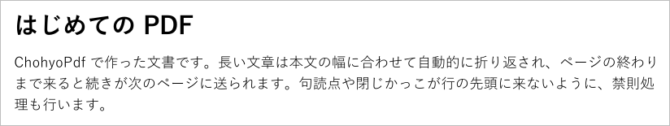

座標指定の API では、ページを追加して `PdfGraphics` に描きます。

```csharp
var pdf = new PdfDocument();
var page = pdf.AddPage(PageSize.A6.Landscape);   // 148 × 105 mm
var g = page.Graphics;

g.DrawRectangle(new PdfPen(PdfColor.Navy, 1), Unit.Mm(8), Unit.Mm(8), Unit.Mm(132), Unit.Mm(89));
g.DrawText("座標を指定して描く", Unit.Mm(14), Unit.Mm(14), new TextStyle(font, 16));
g.DrawCircle(null, PdfColor.FromHex("#F4B183"), Unit.Mm(50), Unit.Mm(62), Unit.Mm(20));
g.DrawRectangle(null, PdfColor.FromHex("#9DC3E6"), Unit.Mm(80), Unit.Mm(42), Unit.Mm(45), Unit.Mm(40));

pdf.Save("hello-graphics.pdf");
```

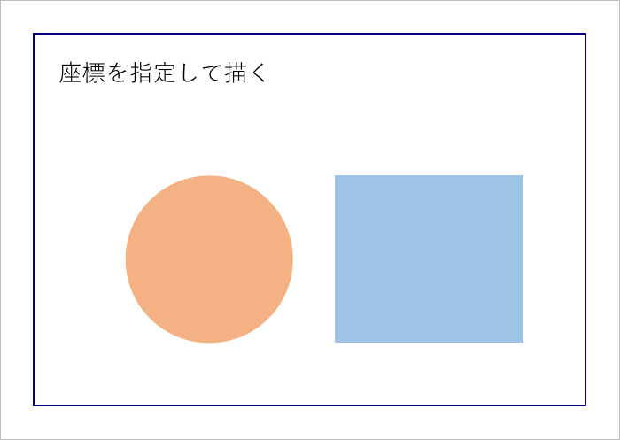

---

## 2. 単位と座標

長さの単位は **ポイント**（1/72 インチ、約 0.353 mm）です。ミリメートルで指定するときは `Unit.Mm()` で変換します。

| メソッド | 変換 |
| --- | --- |
| `Unit.Mm(10)` | 10 mm → 28.35 pt |
| `Unit.Cm(1)` | 1 cm → 28.35 pt |
| `Unit.Inch(1)` | 1 インチ → 72 pt |
| `Unit.ToMm(72)` | 72 pt → 25.4 mm |

座標の原点はページの **左上** で、x は右に、y は下に向かって大きくなります。文字を描く位置は、文字の上端の座標で指定します。

```csharp
var pdf = new PdfDocument();
var page = pdf.AddPage(new PageSize(Unit.Mm(120), Unit.Mm(80)));
var g = page.Graphics;
var small = new TextStyle(font, 7) { Color = PdfColor.Gray };

// 10 mm ごとの方眼
for (int mm = 0; mm <= 120; mm += 10)
{
    g.DrawLine(new PdfPen(PdfColor.LightGray, 0.3), Unit.Mm(mm), 0, Unit.Mm(mm), page.Height);
    if (mm > 0) g.DrawText(mm.ToString(), Unit.Mm(mm) + 1, 1, small);
}
for (int mm = 10; mm <= 80; mm += 10)
{
    g.DrawLine(new PdfPen(PdfColor.LightGray, 0.3), 0, Unit.Mm(mm), page.Width, Unit.Mm(mm));
    g.DrawText(mm.ToString(), 1, Unit.Mm(mm) + 1, small);
}

var red = new TextStyle(font, 9) { Color = PdfColor.Red };
g.DrawText("(0, 0)", Unit.Mm(2), Unit.Mm(3), red);
g.DrawText("x →", Unit.Mm(12), Unit.Mm(6), red);
g.DrawText("y ↓", Unit.Mm(2), Unit.Mm(13), red);

// (40 mm, 30 mm) に幅 50 mm・高さ 25 mm の矩形
g.DrawRectangle(new PdfPen(PdfColor.Blue, 1), PdfColor.Blue.WithAlpha(0.1), Unit.Mm(40), Unit.Mm(30), Unit.Mm(50), Unit.Mm(25));
g.DrawCircle(null, PdfColor.Blue, Unit.Mm(40), Unit.Mm(30), 2);
g.DrawText("(Unit.Mm(40), Unit.Mm(30))", Unit.Mm(42), Unit.Mm(32), new TextStyle(font, 8) { Color = PdfColor.Blue });

pdf.Save("coordinates.pdf");
```

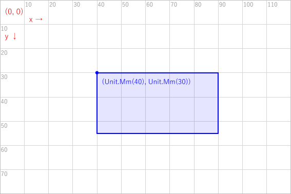

文字の大きさもポイントで指定します。Word の「10.5 ポイント」と同じ大きさです。

---

## 3. 文字と段落

### 3.1 文字の装飾

`Paragraph.AddText` に `TextStyle` を渡すと、その部分だけ書式を変えられます。`TextStyle` のうち指定しなかった項目は、段落や文書の設定を引き継ぎます。

```csharp
var doc = new Document(font, 10.5);
var s = doc.AddSection();

s.AddParagraph().AddText("大きさ　")
    .AddText("8pt ", new TextStyle { FontSize = 8 })
    .AddText("12pt ", new TextStyle { FontSize = 12 })
    .AddText("18pt", new TextStyle { FontSize = 18 });
s.AddParagraph().AddText("太字と斜体　")
    .AddBold("太字").AddText(" / ")
    .AddText("斜体", new TextStyle { Italic = true }).AddText(" / ")
    .AddText("太字の斜体", new TextStyle { Bold = true, Italic = true });
s.AddParagraph().AddText("線　")
    .AddText("下線", new TextStyle { Underline = true }).AddText(" / ")
    .AddText("取り消し線", new TextStyle { Strikeout = true });
s.AddParagraph().AddText("色　")
    .AddText("赤 ", new TextStyle { Color = PdfColor.Red })
    .AddText("#2E75B6 ", new TextStyle { Color = PdfColor.FromHex("#2E75B6") })
    .AddText("マーカー", new TextStyle { BackgroundColor = PdfColor.FromHex("#FFE699") });
s.AddParagraph().AddText("字間　")
    .AddText("ひろげる", new TextStyle { CharacterSpacing = 5 }).AddText(" / ")
    .AddText("つめる", new TextStyle { CharacterSpacing = -1.5 });
s.AddParagraph().AddText("フォント　")
    .AddText("游ゴシック / ").AddText("游明朝", new TextStyle { Font = mincho });
s.AddParagraph().AddText("リンク　").AddLink("example.com を開く", "https://example.com/");

// 段落全体にまとめて指定することもできる
s.AddParagraph("段落全体を紺色の 14pt にする").SetFontSize(14).SetColor(PdfColor.Navy).SetSpaceBefore(6);

doc.Save("text-decoration.pdf");
```

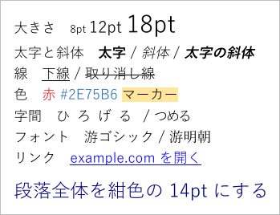

- 太字は、`PdfFont.BoldVariant` に太字のフォントを設定していればそのフォントで描きます。設定していなければ、文字の輪郭を太らせて描きます（疑似太字）。
- 斜体の日本語フォントはほとんどないので、通常は文字を傾けて描きます（疑似斜体）。
- `AddLink` で作ったリンクは、PDF ビューアーでクリックすると URL を開きます。
- 上付き・下付きは [3.8](#38-上付き下付き) を参照してください。

### 3.2 揃え

`SetAlignment` で、段落の揃えを指定します。

```csharp
var doc = new Document(font, 10.5);
var s = doc.AddSection();
string text = "ChohyoPdf は、日本語の帳票を作るための PDF ライブラリです。" +
              "Visual Studio や Visual Studio Code から、NuGet パッケージとして参照できます。";
var frame = new PdfPen(PdfColor.LightGray, 0.5);

foreach (var align in new[] { TextAlignment.Left, TextAlignment.Center, TextAlignment.Right, TextAlignment.Justify })
{
    s.AddParagraph(align.ToString()).SetFontSize(8).SetColor(PdfColor.Gray);
    s.AddParagraph(text).SetAlignment(align).SetBorder(frame, new Thickness(4))
        .SetIndent(0, 0, Unit.Mm(50)).SetSpaceAfter(6);
}

// 均等割り付けは最終行も両端に揃える。短い項目名をそろえるときに使う
s.AddParagraph("Distribute").SetFontSize(8).SetColor(PdfColor.Gray);
foreach (string label in new[] { "氏名", "住所", "電話番号" })
    s.AddParagraph(label).SetAlignment(TextAlignment.Distribute).SetBorder(frame, new Thickness(4))
        .SetIndent(0, 0, Unit.Mm(145));

doc.Save("text-alignments.pdf");
```

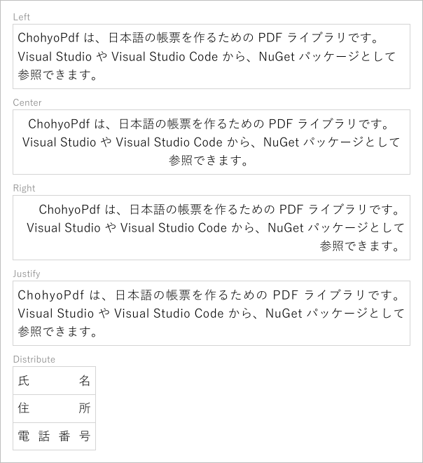

| 値 | 動作 |
| --- | --- |
| `Left` | 左揃え（既定） |
| `Center` | 中央揃え |
| `Right` | 右揃え |
| `Justify` | 両端揃え。最終行以外の行の右端をそろえます |
| `Distribute` | 均等割り付け。最終行も含めて、文字の間隔を広げて両端にそろえます |

### 3.3 行送りとインデント

行送り（行の上端から次の行の上端までの距離）は、文字の大きさに対する倍率で指定します。既定値は 1.5 倍です。`LineSpacingRule.Exactly` を指定すると固定の高さに、`AtLeast` を指定すると最小の高さになります。

```csharp
var doc = new Document(font, 10.5);
var s = doc.AddSection();
string text = "行送りは文字の大きさに対する倍率で指定します。既定値は 1.5 倍です。" +
              "固定の高さ（ポイント）で指定することもできます。";
var frame = new PdfPen(PdfColor.LightGray, 0.5);

s.AddParagraph("行送り 1.0").SetFontSize(8).SetColor(PdfColor.Gray);
s.AddParagraph(text).SetLineSpacing(1.0).SetBorder(frame, new Thickness(4)).SetSpaceAfter(6);
s.AddParagraph("行送り 2.0").SetFontSize(8).SetColor(PdfColor.Gray);
s.AddParagraph(text).SetLineSpacing(2.0).SetBorder(frame, new Thickness(4)).SetSpaceAfter(6);
s.AddParagraph("行送り 固定 14pt").SetFontSize(8).SetColor(PdfColor.Gray);
s.AddParagraph(text).SetLineSpacing(14, LineSpacingRule.Exactly).SetBorder(frame, new Thickness(4)).SetSpaceAfter(12);

s.AddParagraph("字下げ（1 行目だけ 1 文字下げる）").SetFontSize(8).SetColor(PdfColor.Gray);
s.AddParagraph(text).SetIndent(0, firstLine: 10.5).SetBorder(frame, new Thickness(4)).SetSpaceAfter(6);
s.AddParagraph("左右のインデント（20 mm）").SetFontSize(8).SetColor(PdfColor.Gray);
s.AddParagraph(text).SetIndent(Unit.Mm(20), 0, Unit.Mm(20)).SetBorder(frame, new Thickness(4)).SetSpaceAfter(6);
s.AddParagraph("ぶら下げインデント（2 行目以降を下げる）").SetFontSize(8).SetColor(PdfColor.Gray);
s.AddParagraph("※　" + text).SetIndent(21, firstLine: -21).SetBorder(frame, new Thickness(4));

doc.Save("line-spacing.pdf");
```


`SetIndent(left, firstLine, right)` の `firstLine` は、1 行目だけに加える量です。負の値を指定すると、1 行目が左に出るぶら下げインデントになります。

### 3.4 折り返しと禁則処理

段落は本文の幅で自動的に折り返します。折り返すときは、次の規則に従います。

- 句読点・閉じかっこ・小書きの仮名（ゃ、っ など）・長音記号は、行の先頭に置きません。
- 開きかっこは、行の末尾に置きません。
- 英単語や数字は、単語の途中で改行しません。
- 規則を守れないときは、前の文字ごと次の行へ送ります（追い出し）。

```csharp
var pdf = new PdfDocument();
var g = pdf.AddPage(new PageSize(Unit.Mm(170), Unit.Mm(48))).Graphics;
var style = new TextStyle(font, 12);
var options = new TextBoxOptions { LineSpacingRule = LineSpacingRule.Exactly, LineSpacing = 18 };
var grid = new PdfPen(PdfColor.FromHex("#BDD7EE"), 0.5);

// 1 行 7 文字のマス目に重ねて描き、行末が空く位置を見る
string[] texts =
{
    "吾輩は猫である。名前はまだ無い。",
    "長い文章です（注釈付き）。新しいコンピューターを買った。",
};
for (int i = 0; i < texts.Length; i++)
{
    double x = Unit.Mm(8 + i * 45), y = Unit.Mm(8);
    for (int row = 0; row < 5; row++)
        for (int col = 0; col < 7; col++)
            g.DrawRectangle(grid, x + col * 12, y + row * 18, 12, 18);
    g.DrawTextBox(texts[i], new PdfRect(x, y, 12 * 7 + 0.5, 18 * 5), style, options);
}

// 英単語は単語の途中で改行しない
var box = new PdfRect(Unit.Mm(100), Unit.Mm(8), Unit.Mm(60), 18 * 5);
g.DrawRectangle(grid, box.X, box.Y, box.Width, box.Height);
g.DrawTextBox("Long words such as typography are never split. 日本語と English が混ざっても同じです。",
    box, style, options);

pdf.Save("line-breaking.pdf");
```

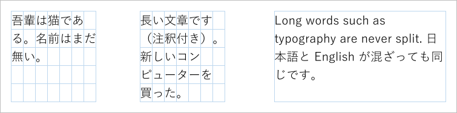

左の例では、1 行目に 7 文字入りますが、8 文字目の「。」が行の先頭に来ないよう、「る」も 2 行目に送っています。中央の例では、「（」が行の末尾に来ないよう 1 行目を 6 文字で改行しています。3 行目は、「ピュー」の小書きの仮名と長音記号が行の先頭に来ないよう、5 文字で改行しています。

この例は座標指定の `DrawTextBox` で描いていますが、自動レイアウトの段落でも同じ規則で折り返します。

### 3.5 特殊な文字と代替フォント

サロゲートペアで表す漢字（𠮷、𩸽 など）や、丸数字などの記号も、フォントにあればそのまま描けます。フォントにない文字は、`FallbackFonts` に指定したフォントで描きます。

```csharp
var doc = new Document(font, 12);
// 游ゴシックにない文字（チェスの駒など）は、代替フォントで描く
doc.DefaultTextStyle.FallbackFonts = new[] { PdfFont.FromSystem("Segoe UI Symbol") };
var s = doc.AddSection();

s.AddParagraph("サロゲートペアの漢字：𠮷野家の𠮷、𩸽（ほっけ）");
s.AddParagraph("記号：①②③ ㈱ ℡ ※ 〒 ♪ ← → ↑ ↓");
s.AddParagraph("代替フォント：♔ ♕ ♖ ♗ ♘ ♙");
s.AddParagraph("半角カナ・全角英数：ｱｲｳｴｵ ＡＢＣ１２３");

doc.Save("special-characters.pdf");
```

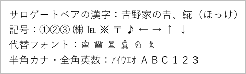

代替フォントにもない文字は、フォントの「.notdef」グリフ（多くのフォントでは空白か四角）で描きます。

異体字セレクタ（IVS。漢字のあとに付けて、細かい字形の違いを指定する文字）は無視し、基底の文字の字形で描きます。

### 3.6 背景と枠

段落に背景色と枠線を付けられます。注意書きの囲みなどに使えます。

```csharp
var doc = new Document(font, 10.5);
var s = doc.AddSection();

s.AddParagraph("ご注意").SetBold().SetColor(PdfColor.FromHex("#C55A11"));
s.AddParagraph("背景色と枠線を付けた段落です。内側の余白は Thickness で指定します。" +
               "段落がページをまたぐときも、背景と枠はページごとに描きます。")
    .SetBackground(PdfColor.FromHex("#FBE5D6"), new Thickness(8, 6))
    .SetBorder(new PdfPen(PdfColor.FromHex("#ED7D31"), 1))
    .SetSpaceAfter(12);

s.AddParagraph("背景色だけの段落。コードや補足の囲みに使えます。")
    .SetBackground(PdfColor.FromGray(0.94), new Thickness(8, 6))
    .SetSpaceAfter(12);

s.AddHorizontalLine(new PdfPen(PdfColor.Gray, 0.5));
s.AddParagraph("水平線（AddHorizontalLine）で区切ることもできます。");

doc.Save("paragraph-boxes.pdf");
```

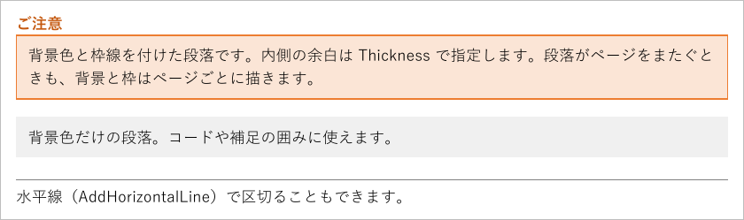

### 3.7 名前付きスタイル

同じ書式を何度も使うときは、名前付きスタイルに登録します。

```csharp
var doc = new Document(mincho, 10.5);                 // 本文は游明朝
doc.DefaultParagraphFormat.Alignment = TextAlignment.Justify;
doc.DefaultParagraphFormat.FirstLineIndent = 10.5;    // 全段落を 1 文字字下げ
doc.DefaultParagraphFormat.SpaceAfter = 4;

doc.Styles["見出し1"] = new ParagraphStyle(
    new TextStyle { Font = font, FontSize = 15, Bold = true, Color = PdfColor.Navy },
    new ParagraphFormat { FirstLineIndent = 0, SpaceBefore = 10, SpaceAfter = 6, KeepWithNext = true });
doc.Styles["見出し2"] = new ParagraphStyle(
    new TextStyle { Font = font, FontSize = 12, Bold = true },
    new ParagraphFormat { FirstLineIndent = 0, SpaceBefore = 8, SpaceAfter = 4, KeepWithNext = true });
doc.Styles["注記"] = new ParagraphStyle(
    new TextStyle { Font = font, FontSize = 8.5, Color = PdfColor.DarkGray },
    new ParagraphFormat { FirstLineIndent = 0, LeftIndent = 10.5 });

var s = doc.AddSection();
s.AddParagraph("1. はじめに", "見出し1");
s.AddParagraph("名前付きスタイルを登録すると、段落ごとに書式を並べなくても、見出しや注記の見た目をそろえられます。" +
               "スタイルを書き換えれば、そのスタイルを使うすべての段落に反映されます。");
s.AddParagraph("1.1 本文の書式", "見出し2");
s.AddParagraph("本文は游明朝の両端揃えで、1 文字字下げしています。見出しと注記は游ゴシックにしています。");
s.AddParagraph("※ 注記スタイルの段落です。小さめの灰色の文字になります。", "注記");
s.AddParagraph("※ 段落で直接指定した値は、スタイルより優先されます。", "注記").SetColor(PdfColor.Red);

doc.Save("named-styles.pdf");
```

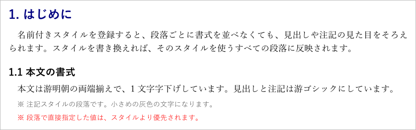

書式は、次の順に引き継がれます。後に書いたものほど優先されます。

文書の既定値（`DefaultTextStyle`、`DefaultParagraphFormat`）→ 表 → 行 → セル → 名前付きスタイル → 段落 → 文字列（`AddText` のスタイル）

`TextStyle` と `ParagraphFormat` のプロパティは、null のままにしておくと上の階層の値を引き継ぎます。

### 3.8 上付き・下付き

`AddSuperscript` と `AddSubscript` で、上付き文字と下付き文字を追加できます。冪（べき）の指数、化学式、注釈の番号などに使います。

```csharp
var doc = new Document(font, 10.5);
var s = doc.AddSection();

// 上付き・下付きは、文字を 0.65 倍に縮小してベースラインを上下にずらす
s.AddParagraph("アインシュタインの式 E = mc").AddSuperscript("2").AddText(" と、水の分子式 H").AddSubscript("2").AddText("O。");
s.AddParagraph("注釈の番号は上付きで示す").AddSuperscript("※1").AddText("。面積は 5 m").AddSuperscript("2").AddText("、化学式は C").AddSubscript("6").AddText("H").AddSubscript("12").AddText("O").AddSubscript("6").AddText("。");

// TextStyle.BaselineShift を使えば、色や下線と組み合わせたり、段落全体に指定したりできる
s.AddParagraph().AddText("赤い上付き")
    .AddText("2", new TextStyle { BaselineShift = BaselineShift.Superscript, Color = PdfColor.Red })
    .AddText(" と下線付きの下付き")
    .AddSubscript("n", new TextStyle { Underline = true });

// 座標指定の描画でも使える
var pdf = doc.Render();
var g = pdf.Pages[0].Graphics;
var style = new TextStyle(font, 14);
double x = Unit.Mm(20), y = Unit.Mm(55);
x += g.DrawText("x", x, y, style);
x += g.DrawText("2", x, y, new TextStyle(font, 14) { BaselineShift = BaselineShift.Superscript });
x += g.DrawText(" + y", x, y, style);
g.DrawText("2", x, y, new TextStyle(font, 14) { BaselineShift = BaselineShift.Superscript });

pdf.Save("superscript-subscript.pdf");
```

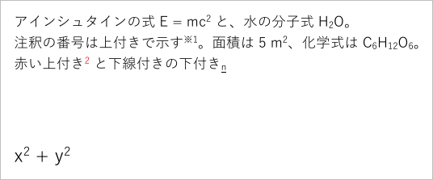

- 文字の大きさを 0.65 倍にして、ベースラインを上付きは文字サイズの約 1/3 上へ、下付きは約 1/8 下へずらして描きます。
- 行の高さと、行の中のベースラインの位置は、上付き・下付きを含まない行と同じです。上付きや下付きを入れても、行の間隔は変わりません。
- 下線と取り消し線は、縮小した文字とずらしたベースラインに合わせて引きます。
- `TextStyle.BaselineShift`（`BaselineShift.Superscript` / `Subscript` / `None`）で指定します。`AddText` に渡すスタイルや段落全体のスタイルに設定できます。親が上付きのとき、`None` を指定すると通常の位置に戻ります。
- `PdfGraphics.DrawText` や `DrawTextBox` に渡す `TextStyle` にも指定できます。文字の一部だけを上付き・下付きにした段落を座標を指定して描くときは、`DrawBlocks`（[8.6](#86-段落と箇条書きを描く)）を使います。
- フォントの上付き・下付き専用のグリフ（OpenType の `sups` / `subs`）は使いません。通常のグリフを縮小して描きます。

### 3.9 タブ位置とリーダー

文字列中のタブ文字（`\t`）や `AddTab()` は、次のタブ位置まで進みます。右揃えのタブ位置と点線のリーダー（導線）を組み合わせると、目次のような「項目………… 12」の並びを作れます。

```csharp
var doc = new Document(font, 10.5);
var s = doc.AddSection();
double width = s.PageSetup.ContentWidth;          // 本文の幅

s.AddParagraph("目次").SetFontSize(16).SetBold().SetSpaceAfter(6);
string[] titles = { "はじめに", "インストール", "文字と段落", "表", "座標を指定して描く帳票" };
int[] pages = { 1, 3, 5, 12, 20 };
for (int i = 0; i < titles.Length; i++)
{
    // 本文の右端に右揃えのタブを置き、点線（リーダー）でつなぐ
    s.AddParagraph((i + 1) + ". " + titles[i])
        .AddTabStop(width, TabAlignment.Right, TabLeader.Dots)
        .AddTab().AddText(pages[i].ToString())
        .SetLineSpacing(1.8);
}

// 見積書のような、項目・数量・金額の並び（段落の書式として登録しておくと使い回せる）
var fmt = new ParagraphFormat();
fmt.AddTabStop(Unit.Mm(80), TabAlignment.Right);                       // 数量
fmt.AddTabStop(Unit.Mm(110), TabAlignment.Decimal);                    // 小数点をそろえる
fmt.AddTabStop(width, TabAlignment.Right, TabLeader.Line);            // 金額（実線でつなぐ）
doc.Styles["見積"] = new ParagraphStyle(null, fmt);

s.AddParagraph("見積").SetFontSize(16).SetBold().SetSpaceBefore(18).SetSpaceAfter(6);
s.AddParagraph("品名\t数量\t単価\t金額", "見積").SetBold();
s.AddParagraph("ノート PC\t2\t98,000.50\t196,001", "見積");
s.AddParagraph("モニター\t10\t23,800.5\t238,005", "見積");
s.AddParagraph("ケーブル\t100\t480\t48,000", "見積");

// タブ位置を決めない段落の \t は、既定のタブ間隔ごとに進む
s.AddParagraph("既定の間隔（36 ポイント）").SetFontSize(8).SetColor(PdfColor.Gray).SetSpaceBefore(18);
s.AddParagraph("A\tB\tC\tD").SetDefaultTabStop(36);

doc.Save("tab-stops.pdf");
```

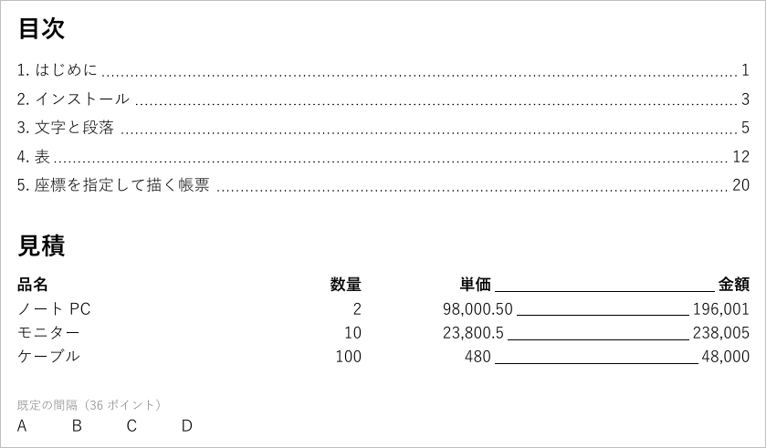

タブ位置は `AddTabStop(位置, 揃え, リーダー)` で追加します。`Paragraph` のほか、段落の書式（`ParagraphFormat`）や文書の既定値（`DefaultParagraphFormat`）、名前付きスタイルにも指定できます。

| 揃え（`TabAlignment`） | 動作 |
| --- | --- |
| `Left` | タブ位置から右へ文字を並べます（既定） |
| `Center` | タブ位置が文字列の中心になります |
| `Right` | タブ位置が文字列の右端になります |
| `Decimal` | 小数点（`.` または `．`）がタブ位置になります。小数点がなければ `Right` と同じです |

| リーダー（`TabLeader`） | 動作 |
| --- | --- |
| `None` | 何も描きません（既定） |
| `Dots` | 点線（丸い点） |
| `Dashes` | 破線 |
| `Line` | 実線 |

動作の細かい規則は次のとおりです。

- タブ位置は、段落の本文領域の左端（左インデントの位置）からの距離をポイントで指定します。本文の右端に置きたいときは、`PageSetup.ContentWidth` から左右のインデントを引いた値を指定します。
- タブ文字は、現在位置より右にある最初のタブ位置まで進みます。すでにタブ位置を通り過ぎているときは、その次のタブ位置へ進みます。
- 最後のタブ位置より右では、既定のタブ間隔（`DefaultTabStop`、指定しなければ 36 ポイント）の整数倍の位置まで進みます。`DefaultTabStop` だけを指定して、タブ位置を決めない使い方もできます。
- 1 行目をぶら下げインデントにして左に出しているときは、左インデントの位置にもタブ位置があるものとして扱います。「1.」のあとのタブで本文の左端にそろえるときに使えます。
- 右揃え・中央揃え・小数点揃えのタブ位置は、タブの後ろから次のタブ（または改行）までの文字列の幅で、タブの幅を決めます。文字列がタブ位置の手前に収まらないときは、タブの幅は 0 になり、文字はそのまま続けて並びます。
- タブ位置が行の右端を超えるとき、右揃えのタブ位置は行の右端に寄せます。左揃えなどのタブ位置は、タブの後ろの文字を次の行へ送ります。
- タブ位置に従うタブを含む行は、両端揃え・均等割り付けにしません（左揃えで描きます）。
- `TabStops` または `DefaultTabStop` を指定していない段落では、タブ文字は空白 4 文字分の幅になります。
- リーダーは、タブの文字に指定した文字色で描きます。点線と破線の位置は、タブ位置を基準に決めます。段落や行が違っても、同じタブ位置なら点の位置が縦にそろいます。
- `TabStops` を指定すると、親（文書の既定値や名前付きスタイル）のタブ位置を置き換えます。追加はされません。
- 表のセルの中では、セルの余白の内側の左端が基準になります。

座標指定の `DrawTextBox` では、`TextBoxOptions.TabStops` と `DefaultTabStop` で同じように指定できます（位置は矩形の左端から）。`DrawText` はタブ位置に対応していないので、折り返さないときは `Wrap = false` の `DrawTextBox` を使ってください。

### 3.10 箇条書きと番号付きリスト

`AddBulletList()` で箇条書き、`AddNumberedList()` で番号付きリストを追加し、`AddItem("文字列")` で項目を足します。`Section`・表のセル・ヘッダー/フッターなど、ブロックを入れられる場所ならどこにでも置けます。座標を指定して描くときは `DrawBlocks`（[8.6](#86-段落と箇条書きを描く)）を使います。項目は 1 行目に記号が付き、2 行目以降の行頭は本文の開始位置にそろいます（ぶら下げインデント）。

```csharp
var doc = new Document(font, 10.5);
var s = doc.AddSection();

s.AddParagraph("持ち物").SetBold().SetFontSize(14).SetSpaceAfter(4);

// 記号を指定しなければ、入れ子のレベルごとに ・ → ○ → ■ になる
var list = s.AddBulletList();
list.AddItem("筆記用具");
list.AddItem("受験票と身分証明書。長い項目は折り返され、2 行目以降の行頭は本文の開始位置にそろいます。");
list.AddItem("昼食");
var drinks = list.AddSubList();                  // 最後の項目（昼食）の子リスト
drinks.AddItem("お弁当");
drinks.AddItem("飲み物");
drinks.AddSubList().AddItem("水筒（容量は問いません）");
list.AddItem("上履き");

// 記号は任意の文字列で、色や大きさを本文と別に指定できる
s.AddParagraph("注意事項").SetBold().SetFontSize(14).SetSpaceBefore(14).SetSpaceAfter(4);
var notes = s.AddBulletList("●");
notes.MarkerStyle = new TextStyle { Color = PdfColor.FromHex("#C0392B"), FontSize = 8 };
notes.ItemSpacing = 3;                           // 項目の間隔
notes.AddItem("集合時間の 10 分前までに会場へ入ってください。");
notes.AddItem("電子機器の電源は切ってください。");
notes.AddItem("体調が悪いときは、すぐに係員へ伝えてください。");

// 項目に複数のブロックを入れる（記号は最初の段落の 1 行目にだけ付く）
s.AddParagraph("連絡先").SetBold().SetFontSize(14).SetSpaceBefore(14).SetSpaceAfter(4);
var contacts = s.AddBulletList("–");
var item = contacts.AddItem();
item.AddParagraph("事務局").SetBold();
item.AddParagraph("平日 9:00〜17:00 に受け付けています。");
contacts.AddItem("メール: info@example.com");

doc.Save("bullet-lists.pdf");
```

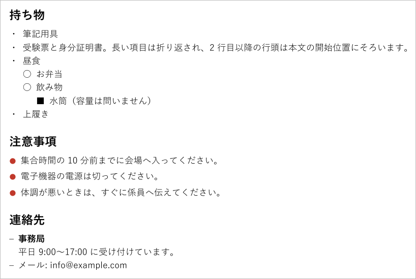

```csharp
var doc = new Document(font, 10.5);
var s = doc.AddSection();

s.AddParagraph("手順").SetBold().SetFontSize(14).SetSpaceAfter(4);

// 番号の書式を指定しなければ、入れ子のレベルごとに 1. → (1) → ① になる
var steps = s.AddNumberedList();
steps.AddItem("書類を準備する");
steps.AddItem("窓口で受付をする");
var sub = steps.AddSubList();
sub.AddItem("番号札を受け取る");
sub.AddItem("呼ばれるまで待つ");
sub.AddSubList().AddItem("待ち時間は 30 分ほどです");
steps.AddItem("内容を確認して署名する");

// 書式（PageNumberFormat）、前後の文字列、開始番号を指定する
s.AddParagraph("契約条項").SetBold().SetFontSize(14).SetSpaceBefore(14).SetSpaceAfter(4);
var clauses = s.AddNumberedList(PageNumberFormat.Kanji, suffix: "、");
clauses.AddItem("甲は、乙に対し、本件業務を委託する。");
clauses.AddItem("乙は、前条の業務を善良な管理者の注意をもって行う。");
var detail = clauses.AddSubList(ListKind.Numbered);
detail.NumberFormat = PageNumberFormat.Kanji;
detail.Prefix = "（";
detail.Suffix = "）";
detail.AddItem("業務の範囲は、別紙に定めるとおりとする。");
detail.AddItem("業務の期間は、契約の日から 1 年間とする。");

var letters = s.AddNumberedList(PageNumberFormat.LowerLetter, startNumber: 1, prefix: "(", suffix: ")");
letters.SpaceBefore = 8;
letters.AddItem("a から始まる");
letters.AddItem("次の項目は b");

// 番号を右揃えにすると、9. → 10. のように桁が増えても右端がそろう
s.AddParagraph("右揃えの番号").SetBold().SetFontSize(14).SetSpaceBefore(14).SetSpaceAfter(4);
var right = s.AddNumberedList(startNumber: 8);
right.MarkerAlignment = HorizontalAlignment.Right;
right.MarkerStyle = new TextStyle { Bold = true };
for (int i = 8; i <= 11; i++) right.AddItem("項目 " + i);

doc.Save("numbered-lists.pdf");
```

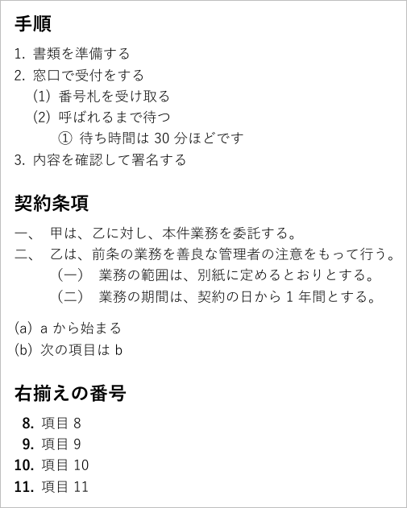

| 設定（`ListBlock`） | 動作 |
| --- | --- |
| `Bullet` | 箇条書きの記号（任意の文字列）。`null` なら入れ子のレベルごとの既定（・ → ○ → ■） |
| `NumberFormat` / `Prefix` / `Suffix` | 番号の書式（`PageNumberFormat` と同じ）と、番号の前後に付ける文字列。`null` なら、レベルごとの既定（1. → (1) → ①） |
| `StartNumber` / `ListBlockItem.Number` | 最初の項目の番号と、項目ごとの番号の指定（指定した項目の次からは、その番号に続く） |
| `MarkerWidth` / `MarkerGap` | 記号の列の幅と、記号と本文の間隔（ポイント）。`MarkerWidth` が `null` なら、リストの中で一番幅の広い記号に合わせる |
| `MarkerAlignment` | 記号の列の中での位置（既定は左揃え）。`Right` にすると、9. → 10. でも右端がそろう |
| `MarkerStyle` | 記号の文字スタイル（色・フォント・太字・文字サイズ） |
| `Indent` / `ItemSpacing` | リスト全体の左の字下げと、項目の間隔（ポイント） |
| `Style` / `Format` | リスト全体の文字スタイルと段落書式（`ListBlockItem.Style` / `Format` で項目ごとに上書き） |
| `SpaceBefore` / `SpaceAfter` / `KeepWithNext` / `PageBreakBefore` | リスト全体の前後の間隔や改ページ（表や画像と同じ） |

- 項目の中に子リストを入れると入れ子になります。最後の項目に入れるなら `list.AddSubList()`、そうでなければ `ListBlockItem.AddList()` / `AddBulletList()` / `AddNumberedList()` を使います。記号を指定しなければレベルごとの既定が使われ、4 レベル目以降は 1 レベル目に戻ります。
- 項目に段落を 1 つだけ入れるなら `AddItem("文字列")`（段落を返します）、複数のブロック（段落・表・画像・子リストなど）を入れるなら `AddItem()`（`ListBlockItem` を返します。`Section` と同じ `Add〜` メソッドが使えます）。記号は項目の最初のブロックが段落ならその 1 行目に、そうでなければ項目の上端に付きます。空の項目にも記号が付きます。
- 番号の書式は `PageNumberFormat`（アラビア数字・ローマ数字・英字・全角数字・丸数字・漢数字）をそのまま使います。書式を指定したとき、番号の後ろは `.` が既定です（丸数字は何も付けません）。「一、」「（一）」「(a)」のような形は `Prefix` / `Suffix` で作ります。
- 項目は段落と同じように折り返され、ページをまたいで分割されます。記号は項目の 1 行目にだけ付き、番号はページをまたいでも連続します。
- 記号の文字スタイルは、項目の最初の段落の文字スタイル（文字サイズ・色・太字など）に `MarkerStyle` を重ねたものです。下線・取り消し線・マーカー・上付き下付きは、`MarkerStyle` で指定しない限り記号には付きません。記号と本文のベースラインはそろいます。
- スタイルは、文書の既定値 → 表 → 行 → セル → リスト（`Style` / `Format`） → 項目 → 名前付きスタイル → 段落の順に上書きされます。項目の位置はリストが決めるので、`DefaultParagraphFormat` の `FirstLineIndent` と `LeftIndent`、および段落前の改ページは、リストの中では引き継ぎません（そのほかの揃え・行送り・段落間隔は引き継ぎます）。
- リストの中の改ページ（`AddPageBreak()`）と、段落の `PageBreakBefore` は無視されます。リスト全体の前で改ページするときは、`ListBlock.PageBreakBefore` を使います。
- 見出し（`SetOutline`）、アンカー、文書内リンク、ページ参照は、項目の中の段落にも使えます。

### 3.11 ルビ（振り仮名）

`AddRuby("親文字", "ルビ")` で、ルビ（振り仮名）付きの文字列を追加できます。ルビは親文字の中央にそろえて、親文字の半分の大きさで描きます。

```csharp
var doc = new Document(font, 12);
var s = doc.AddSection();
s.AddParagraph("ルビ（振り仮名）").SetFontSize(18).SetBold().SetSpaceAfter(6);

// 親文字とルビを組で追加する。ルビの文字サイズは親文字の半分で、親文字の中央にそろう
s.AddParagraph("私は")
    .AddRuby("東京", "とうきょう")
    .AddText("の")
    .AddRuby("下町", "したまち")
    .AddText("で生まれました。");

// 親文字の 1 文字ごとにルビを付ける（モノルビ）。組ごとに改行できる
s.AddParagraph("モノルビ: ").AddMonoRuby("東京", new[] { "とう", "きょう" }).AddText("、")
    .AddMonoRuby("振り仮名", new[] { "ふ", "", "がな", "" });

// 「｜親文字《ルビ》」の記法でまとめて書ける（「｜」を省くと、直前の漢字が親文字になる）
s.AddParagraph().AddRubyMarkup("記法: 吾輩《わがはい》は猫《ねこ》である。｜Tokyo《とうきょう》、大阪府《おお|さか|ふ》。");

// ルビが親文字より長いときは、親文字の文字の間を均等に空けてルビの幅に合わせる
s.AddParagraph("長いルビ: ").AddRuby("漢字", "かんじのよみがな").AddText("と、短いルビ: ").AddRuby("東京都", "と");

// ルビの色や文字サイズ、親文字の装飾
var rubyStyle = new TextStyle { Color = PdfColor.FromHex("#C0392B") };
s.AddParagraph("装飾: ")
    .AddRuby("重要", "じゅうよう", new TextStyle { Bold = true, Underline = true }, rubyStyle)
    .AddText("、")
    .AddRuby("注意", "ちゅうい", new TextStyle { Color = PdfColor.Blue }, new TextStyle { Color = PdfColor.Blue, FontSize = 4 });

// 段落全体のルビの色は Paragraph.RubyStyle で決められる。両端揃えでも、折り返しでも、組は離れない
var p = s.AddParagraph().SetAlignment(TextAlignment.Justify).SetRubyStyle(new TextStyle { Color = PdfColor.Gray });
p.AddRubyMarkup("吾輩《わがはい》は猫《ねこ》である。名前《なまえ》はまだ無い。どこで生《うま》れたか頓《とん》と見当《けんとう》がつかぬ。"
    + "何《なん》でも薄暗《うすぐら》いじめじめした所《ところ》でニャーニャー泣《な》いていた事《こと》だけは記憶《きおく》している。");

// 行送りを固定値（Exactly）にすると、ルビがあっても行の高さは変わらない
s.AddParagraph("固定値の行送り: ").SetLineSpacing(22, LineSpacingRule.Exactly)
    .AddRuby("漢字", "かんじ").AddText("の行も、").AddRuby("次", "つぎ").AddText("の行も同じ間隔。");

doc.Save("ruby.pdf");
```

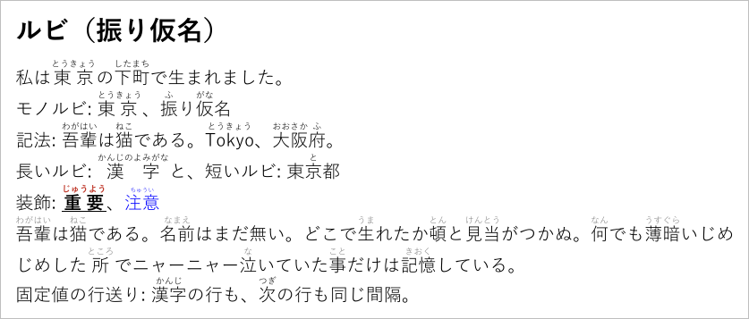

| 書き方 | 内容 |
| --- | --- |
| `AddRuby("東京", "とうきょう")` | 親文字全体に 1 つのルビを付ける（グループルビ）。第 3・第 4 引数で、親文字のスタイルとルビのスタイルを指定できる |
| `AddMonoRuby("東京", new[] { "とう", "きょう" })` | 親文字を 1 文字ずつ区切り、同じ順番のルビを付ける（モノルビ）。ルビを付けない文字は空文字列にする |
| `AddRuby(new[] { "東京", "下町" }, new[] { "とうきょう", "したまち" })` | 親文字とルビの組を、配列で順番に追加する |
| `AddRubyMarkup("｜東京《とうきょう》")` | 「｜親文字《ルビ》」の記法（青空文庫と同じ）で、普通の文字列とルビ付きの文字列をまとめて追加する |

記法は次のとおりです。「《」「》」「｜」「|」は記号として扱うので、これらの文字そのものを入れたいときは `AddText` で追加します。形式が正しくないとき（「》」がない、親文字がない、モノルビの数が合わないなど）は `ArgumentException` になります。

- `｜親文字《ルビ》`: 「｜」（全角または半角の縦線）から「《」までが親文字。親文字には漢字以外も指定できます（`｜Tokyo《とうきょう》`）。
- `東京《とうきょう》`: 「｜」がなければ、「《」の直前に続く漢字（々・〆・〇を含む）が親文字になります。
- `東京《とう|きょう》`: ルビの中を「|」で区切り、区切りの数が親文字の文字数と同じなら、モノルビになります。

#### ルビの配置と大きさ

- ルビの文字サイズは、親文字の半分です。ルビのスタイル（色・フォント・文字サイズ・太字など）は、親文字のスタイルを引き継いだうえで、`Paragraph.RubyStyle`（`SetRubyStyle()`）→ `AddRuby` の `rubyStyle` の順に上書きします。下線・取り消し線・背景色・上付き下付き・字間は引き継がず、ルビには付きません。
- ルビが親文字より短いときは、ルビを親文字の幅の中央にそろえます（ルビの文字の間は広げません）。
- ルビが親文字より長いときは、親文字の文字の間と前後を同じ量だけ空けて、親文字の幅をルビの幅に合わせます。前後の文字にルビをはみ出させることはありません。
- 親文字とルビの組は、途中で改行しません。禁則処理は、組を 1 つの単位として行います。1 行に収まらないほど長い組は、1 行にそのまま置きます。
- 両端揃え・均等割り付けでは、組の中の文字の間は空けず、組と組の間だけを広げます。タブ・太字・下線・上付きなどと組み合わせられます。下線・取り消し線・背景色は、親文字（広げた幅を含む）だけに引きます。
- ルビがある行は、行の上端からベースラインまでの距離がルビの高さに足りないときだけ、足りない分だけ行が高くなります。行間に余裕があるとき（行送りが大きいときなど）は、行の高さは変わりません。ルビがない行の高さも変わりません。行送りが「最小値」（`AtLeast`）のときも同じです。「固定値」（`Exactly`）では行の高さを変えず、ルビは行の上にはみ出して描くので、ルビが入る余白を行送りで確保してください。
- 見出し（`SetOutline`）に使うと、しおりと目次には親文字だけが入ります。
- PDF のテキスト抽出・検索では、ルビを本文に含めません。ルビの描画に空の `ActualText` を付けているので、`ActualText` に対応するソフト（MuPDF で確認）では親文字だけが抽出されます。対応しないソフト（poppler・pypdf で確認）では、各組の親文字の直後にルビが続く順（「東京とうきょう」）で抽出されます。
- ルビは段落（`Paragraph`）だけで使えます。`PdfGraphics.DrawText` / `DrawTextBox` には、ルビを付ける方法はありません。座標を指定して描くときは、段落を `DrawBlocks`（[8.6](#86-段落と箇条書きを描く)）で描きます。

---

## 4. ページの設定とページ送り

### 4.1 用紙と余白

用紙の大きさと余白は、セクションごとに `PageSetup` で指定します。既定値は A4 縦、余白は上下左右 20 mm です。

```csharp
var doc = new Document(font, 12);
var s = doc.AddSection(new PageSetup
{
    Size = PageSize.A5.Landscape,                    // A5 横
    Margins = Thickness.FromMm(15, 12, 15, 12),      // 左, 上, 右, 下
});

// 本文の領域（ContentArea）を破線で示す
s.PageBackground = (g, ctx) =>
{
    var area = ctx.ContentArea;
    g.DrawRectangle(PdfPen.Dashed(PdfColor.Gray, 0.5, 3, 2), area.X, area.Y, area.Width, area.Height);
};

s.AddParagraph("A5 横・余白は左右 15 mm、上下 12 mm").SetBold();
s.AddParagraph($"本文の幅 {Unit.ToMm(s.PageSetup.ContentWidth):0} mm × 高さ {Unit.ToMm(s.PageSetup.ContentHeight):0} mm");

doc.Save("page-setup.pdf");
```

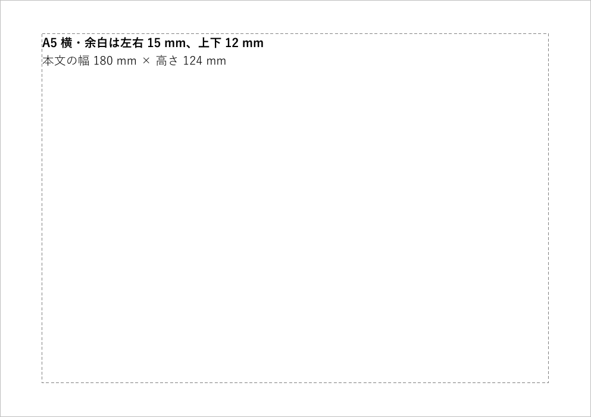

用意している用紙サイズは、`A3`、`A4`、`A5`、`A6`、`B4`、`B5`（JIS）、`Letter`、`Legal`、`Postcard`（はがき）、`EnvelopeChou3`（長形 3 号）です。`.Landscape` で横向きになります。その他の大きさは `PageSize.FromMm(幅, 高さ)` で作れます。

### 4.2 ヘッダーとフッター

`Section.Header` と `Section.Footer` には、本文と同じように段落や表を追加できます。`AddPageNumber()` はページ番号、`AddPageCount()` は総ページ数に置き換わります。

```csharp
var doc = new Document(font, 10.5);
var s = doc.AddSection();
s.PageSetup.Margins = Thickness.FromMm(20, 25, 20, 22);   // ヘッダー/フッターの分だけ余白を広げる

s.Header.AddParagraph("社内報告書　2026 年 10 月").SetFontSize(8).SetColor(PdfColor.Gray)
    .SetAlignment(TextAlignment.Right);
s.Header.AddHorizontalLine(new PdfPen(PdfColor.Gray, 0.5));

s.Footer.AddParagraph().SetAlignment(TextAlignment.Center).SetFontSize(9)
    .AddPageNumber().AddText(" / ").AddPageCount().AddText(" ページ");

s.AddParagraph("ヘッダーとフッター").SetFontSize(16).SetBold().SetSpaceAfter(6);
for (int i = 0; i < 12; i++)
    s.AddParagraph(Filler(8)).SetSpaceAfter(6);

doc.Save("header-footer.pdf");
```

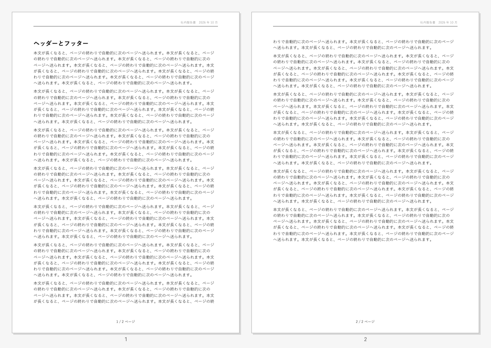

- ヘッダーは用紙の上端から `PageSetup.HeaderDistance`（既定 8 mm）、フッターは下端から `FooterDistance`（既定 8 mm）の位置に置きます。
- ヘッダーとフッターの高さによって、本文の位置は変わりません。上下の余白は、ヘッダーとフッターが収まる大きさにしてください。
- 各セクションの 1 ページ目だけヘッダーを出さないときは、`Header.ShowOnFirstPage = false` にします。
- 奇数・偶数ページや 1 ページ目で内容を変えるときは、[4.7](#47-奇数偶数ページと先頭ページのヘッダーフッター) を見てください。ページ番号の書式や開始番号は [4.8](#48-ページ番号の書式と開始番号) で指定します。

### 4.3 改ページ

`AddPageBreak()` を置いた位置、または `SetPageBreakBefore()` を指定した段落の前で改ページします。

```csharp
var doc = new Document(font, 10.5);
var s = doc.AddSection();

s.AddParagraph("第 1 章").SetFontSize(18).SetBold();
s.AddParagraph("1 ページ目の本文です。");
s.AddPageBreak();                                         // ここで改ページ

s.AddParagraph("第 2 章").SetFontSize(18).SetBold();
s.AddParagraph("2 ページ目の本文です。");

s.AddParagraph("第 3 章").SetFontSize(18).SetBold().SetPageBreakBefore();   // 段落の前で改ページ
s.AddParagraph("3 ページ目の本文です。");

doc.Save("page-breaks.pdf");
```

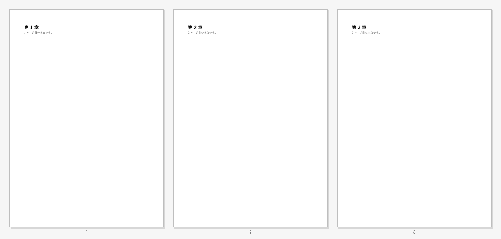

ページの先頭にある改ページは無視します。白紙のページが続くのを防ぐためです。ただし、本文の最後に改ページを置くと、最後のページが白紙になります。

### 4.4 見出しを次の段落と同じページに置く

ページの最後に見出しだけが残ると読みにくくなります。見出しに `SetKeepWithNext()` を指定すると、次の段落と同じページに置きます。`SetKeepTogether()` を指定した段落は、途中で分割しません。

```csharp
var doc = new Document(font, 10.5);
var s = doc.AddSection();

// ページの下のほうまで本文が詰まっている状態を、灰色の箱で表す
s.AddDrawing(s.PageSetup.ContentHeight - 70, (g, r) =>
{
    g.FillRectangle(PdfColor.FromGray(0.93), 0, 0, r.Width, r.Height);
    g.DrawText("（ここまで本文があるとします）", r.Width / 2, r.Height / 2, new TextStyle(font, 14), TextAlignment.Center);
});

// 見出しだけがページの最後に残らないよう、次の段落と同じページに置く
s.AddParagraph("2. 次の章の見出し").SetFontSize(14).SetBold().SetKeepWithNext();
// 段落を途中で分割しない
s.AddParagraph(Filler(5)).SetKeepTogether();

doc.Save("keep-with-next.pdf");
```

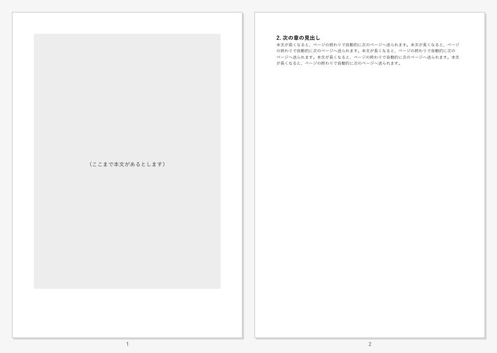

1 ページ目の下には見出しが入る余白がありますが、続く段落が入りきらないため、見出しも 2 ページ目に送っています。

このほか、段落の 1 行目だけがページの最後に残ったり、最後の 1 行だけが次のページに送られたりしないよう、改ページの位置を調整します（`ParagraphFormat.WidowControl`、既定で有効）。

### 4.5 セクション

用紙の向きやヘッダーを途中で変えるときは、セクションを分けます。セクションは必ず新しいページから始まります。

```csharp
var doc = new Document(font, 10.5);

// 表紙（フッターなし）
var cover = doc.AddSection();
cover.AddSpacer(Unit.Mm(90));
cover.AddParagraph("年次報告書").SetFontSize(28).SetBold().SetAlignment(TextAlignment.Center);
cover.AddParagraph("2026 年度").SetFontSize(14).SetAlignment(TextAlignment.Center);

// 本文（セクションごとのページ番号）
var body = doc.AddSection();
body.Footer.AddParagraph().SetAlignment(TextAlignment.Center)
    .AddText("- ").AddField(FieldType.SectionPageNumber).AddText(" -");
body.AddParagraph("本文").SetFontSize(16).SetBold();
body.AddParagraph(Filler(10));

// 横向きのページ（幅の広い表など）
var wide = doc.AddSection(new PageSetup { Size = PageSize.A4.Landscape });
wide.AddParagraph("横向きのセクション").SetFontSize(16).SetBold();
wide.AddParagraph("セクションごとに用紙の大きさ・向き・余白、ヘッダーとフッターを変えられます。");

doc.Save("sections.pdf");
```

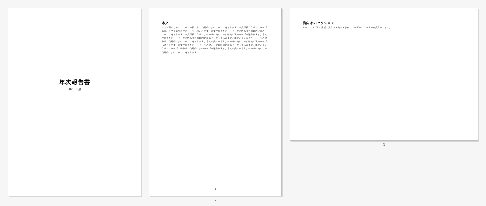

`FieldType.SectionPageNumber` を使うと、セクションの中でのページ番号（表紙を数えないページ番号など）を表示できます。

### 4.6 透かしとページの装飾

`PageBackground` は本文の下に、`PageForeground` は本文の上に、全ページ共通の図形を描きます。帳票の枠、ロゴ、透かしなどに使います。

```csharp
var doc = new Document(font, 10.5);
var s = doc.AddSection();

// 本文の下に描く：ページ上端の帯
s.PageBackground = (g, ctx) =>
{
    g.FillRectangle(PdfColor.FromHex("#1F4E79"), 0, 0, ctx.PageSize.Width, Unit.Mm(10));
    g.DrawText("ACME 株式会社", Unit.Mm(20), Unit.Mm(3), new TextStyle(font, 9) { Color = PdfColor.White });
};

// 本文の上に描く：半透明の透かし
s.PageForeground = (g, ctx) =>
{
    double cx = ctx.PageSize.Width / 2, cy = ctx.PageSize.Height / 2;
    g.SaveState();
    g.RotateAt(-30, cx, cy);                         // 反時計回りに 30 度
    g.DrawText("社外秘", cx, cy - 45, new TextStyle(font, 90) { Color = PdfColor.Red.WithAlpha(0.2) },
        TextAlignment.Center);
    g.RestoreState();
};

s.AddParagraph("透かしとページの装飾").SetFontSize(16).SetBold().SetSpaceAfter(6);
for (int i = 0; i < 6; i++) s.AddParagraph(Filler(6)).SetSpaceAfter(6);

doc.Save("watermark.pdf");
```

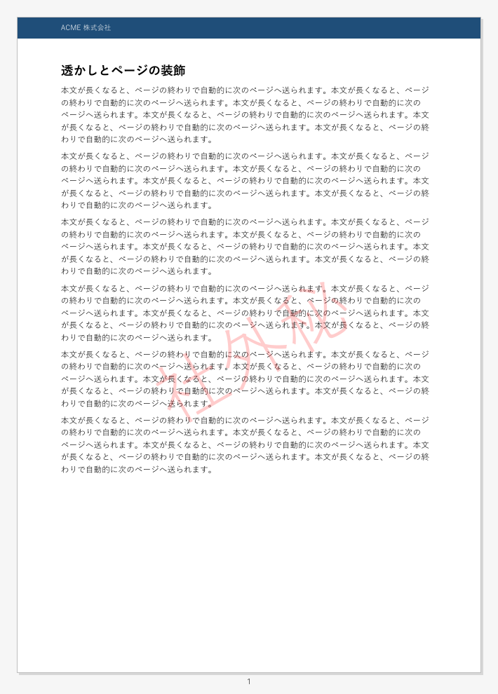

2 つ目の引数 `PageContext` からは、通しページ番号（`PageNumber`）、表示用のページ番号（`DisplayPageNumber`、文字列は `PageNumberText`）、奇数・偶数（`IsOddPage` / `IsEvenPage`）、総ページ数（`PageCount`）、用紙の大きさ（`PageSize`）、本文の領域（`ContentArea`）を取得できます。

### 4.7 奇数・偶数ページと先頭ページのヘッダー/フッター

両面印刷の冊子のように、ページの左右でヘッダーの位置や内容を変えるときは `Section.DifferentOddEven = true` にして、偶数ページ用の `EvenHeader` / `EvenFooter` を使います。奇数ページには、これまでどおり `Header` / `Footer` が使われます。セクションの 1 ページ目だけ別にするときは `DifferentFirstPage = true` にして、`FirstPageHeader` / `FirstPageFooter` を使います。

```csharp
var doc = new Document(font, 10.5);
var s = doc.AddSection();
s.PageSetup.Margins = Thickness.FromMm(20, 25, 20, 22);

s.DifferentFirstPage = true;     // セクションの 1 ページ目だけ別のヘッダー/フッター
s.DifferentOddEven = true;       // 偶数ページは EvenHeader / EvenFooter を使う

// 1 ページ目: 表題のみ
s.FirstPageHeader.AddParagraph("社内報告書").SetFontSize(14).SetBold().SetAlignment(TextAlignment.Center);

// 奇数ページ（ヘッダー/フッターは右寄せ）
s.Header.AddParagraph("2026 年度 年次報告書").SetFontSize(8).SetColor(PdfColor.Gray)
    .SetAlignment(TextAlignment.Right);
s.Footer.AddParagraph().SetFontSize(9).SetAlignment(TextAlignment.Right).AddPageNumber();

// 偶数ページ（左寄せ）
s.EvenHeader.AddParagraph("株式会社サンプル").SetFontSize(8).SetColor(PdfColor.Gray)
    .SetAlignment(TextAlignment.Left);
s.EvenFooter.AddParagraph().SetFontSize(9).SetAlignment(TextAlignment.Left).AddPageNumber();

s.AddParagraph("両面印刷向けのヘッダーとフッター").SetFontSize(16).SetBold().SetSpaceAfter(6);
for (int i = 0; i < 30; i++)
    s.AddParagraph(Filler(8)).SetSpaceAfter(6);

doc.Save("odd-even-headers.pdf");
```

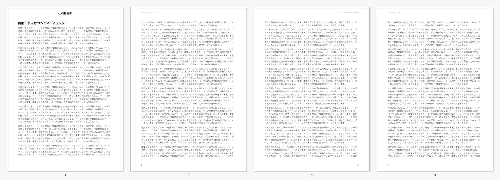

- 1 ページ目用（`DifferentFirstPage`）は、奇数・偶数の切り替えより優先されます。
- 奇数か偶数かは、文書全体の通しページ番号（`PageContext.PageNumber`）で決まります。セクションをまたいでも続けて数え、`PageNumberStart` で表示用の番号を変えても影響しません（用紙の表と裏は物理的なページの順番で決まるためです）。
- 切り替えを有効にしたのに、使うヘッダー/フッターに何も追加していないページには、何も表示しません（通常のヘッダー/フッターには切り替わりません）。
- `Header.ShowOnFirstPage = false` の動作は変わりません。これは `Header` / `EvenHeader` などのセクションの 1 ページ目に表示するかの指定で、`FirstPageHeader` / `FirstPageFooter` では使われません。

### 4.8 ページ番号の書式と開始番号

`Section.PageNumberFormat` で書式、`Section.PageNumberStart` で、そのセクションの最初のページの番号を指定します。どちらも指定しない（`null`）と、前のセクションから引き継ぎます（最初のセクションはアラビア数字の 1 から）。前付けをローマ数字、本文を 1 から、という使い方ができます。

```csharp
var doc = new Document(font, 10.5);

// 前付け（目次）: ローマ数字の小文字
var front = doc.AddSection();
front.PageNumberFormat = PageNumberFormat.LowerRoman;
front.Footer.AddParagraph().SetAlignment(TextAlignment.Center).AddPageNumber();
front.AddParagraph("目次").SetFontSize(16).SetBold();
front.AddParagraph("（前付けのページ番号は i, ii, … で表示します）");

// 本文: 1 から数え直し、アラビア数字。総ページ数は物理的なページ数（4）のまま
var body = doc.AddSection();
body.PageNumberStart = 1;
body.PageNumberFormat = PageNumberFormat.Arabic;
body.Footer.AddParagraph().SetAlignment(TextAlignment.Center)
    .AddPageNumber().AddText(" / 全 ").AddPageCount().AddText(" ページ");
body.AddParagraph("第 1 章").SetFontSize(16).SetBold();
body.AddParagraph("本文は 1 ページ目から数えます。");
body.AddPageBreak();
body.AddParagraph("第 2 章").SetFontSize(16).SetBold();
body.AddParagraph("開始番号を指定しなかったセクションは、前のセクションの続きから数えます。");

// 付録: 書式だけ変える（番号は続き）。フィールドごとの書式指定や、通しページ番号も使える
var appendix = doc.AddSection();
appendix.PageNumberFormat = PageNumberFormat.CircledNumber;
appendix.Footer.AddParagraph().SetAlignment(TextAlignment.Center)
    .AddPageNumber().AddText("　（通しページ ").AddField(FieldType.PhysicalPageNumber, PageNumberFormat.Kanji).AddText("）");
appendix.AddParagraph("付録").SetFontSize(16).SetBold();
appendix.AddParagraph("丸数字、漢数字、全角数字、英字などの書式を選べます。");

doc.Save("page-number-formats.pdf");
```

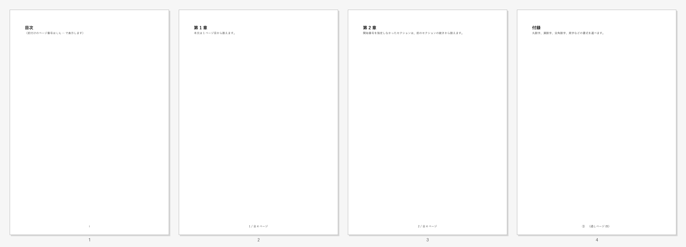

| 書式（`PageNumberFormat`） | 表示 | 範囲外のとき |
| --- | --- | --- |
| `Arabic` | 1, 2, 3 | 常にアラビア数字 |
| `LowerRoman` / `UpperRoman` | i, ii, iii / I, II, III | 1〜3999 以外はアラビア数字 |
| `LowerLetter` / `UpperLetter` | a, b, …, z, aa, bb, … / A, B, … | 1 未満はアラビア数字（27 以降は同じ文字を繰り返す） |
| `FullWidthArabic` | １, ２, ３ | なし |
| `CircledNumber` | ①〜⑳ | 1〜20 以外はアラビア数字 |
| `Kanji` | 一, 二, …, 十, 十一, 二十, 百二十三 | 0〜9999 以外はアラビア数字（0 は「〇」） |

- `AddPageNumber()` と `FieldType.PageNumber` は、表示用のページ番号をセクションの書式で表示します。`AddPageNumber(PageNumberFormat.Kanji)` や `AddField(FieldType.PageCount, PageNumberFormat.UpperRoman)` のように、フィールドごとに書式を指定することもできます。
- `FieldType.SectionPageNumber` と `SectionPageCount` もセクションの書式に従います。`FieldType.PageCount`（総ページ数）は、書式を指定しない限りアラビア数字で、開始番号の指定に関係なく物理的なページ数を表示します。
- 開始番号に関係なく、文書全体での物理的なページの順番を表示するときは `FieldType.PhysicalPageNumber` を使います。
- `PageBackground` / `PageForeground` の `PageContext` では、`DisplayPageNumber`、`PageNumberText`（書式を適用した文字列）、`PageNumberFormat` で表示用のページ番号を取得できます。
- 番号を書式の文字列にするだけなら、`PageNumberFormatter.Format(4, PageNumberFormat.UpperRoman)`（→ `IV`）を使います。低レベル層（`PdfGraphics`）でページ番号を描くときも、同じ表記になります。

### 4.9 しおり（アウトライン）

段落に見出しレベルを付けると、PDF のしおり（アウトライン）が作られます。見出しレベルは、段落の書式の `ParagraphFormat.OutlineLevel`（1〜9。1 が最上位）で指定します。名前付きスタイルに指定しておくと、スタイルを使うだけで見出しになります。`Paragraph.SetOutline(レベル)` で段落ごとに指定することもできます。

```csharp
var doc = new Document(font, 10.5);
doc.ShowBookmarkPane = true;   // PDF を開いたときにしおりの欄を表示する

// 見出しレベルは名前付きスタイルで指定できる（段落の SetOutline(レベル) でもよい）
doc.Styles["見出し1"] = new ParagraphStyle(
    new TextStyle { FontSize = 16, Bold = true },
    new ParagraphFormat { OutlineLevel = 1, SpaceBefore = 12, SpaceAfter = 6, KeepWithNext = true });
doc.Styles["見出し2"] = new ParagraphStyle(
    new TextStyle { FontSize = 12.5, Bold = true },
    new ParagraphFormat { OutlineLevel = 2, SpaceBefore = 8, SpaceAfter = 4, KeepWithNext = true });

var s = doc.AddSection();
s.AddParagraph("第 1 章　製品の概要", "見出し1");
s.AddParagraph("1.1 特長", "見出し2");
s.AddParagraph(Filler(6));
s.AddParagraph("1.2 仕様", "見出し2");
s.AddParagraph(Filler(6));
s.AddParagraph("第 2 章　使い方", "見出し1").SetPageBreakBefore();
s.AddParagraph("2.1 準備", "見出し2");
s.AddParagraph(Filler(6));

// しおりの文字列は、段落の文字列と別にもできる
s.AddParagraph("付録 A", "見出し1").SetPageBreakBefore().OutlineTitle = "付録 A　用語集";
s.AddParagraph(Filler(3));

doc.Save("bookmarks.pdf");
```

- しおりの入れ子は、見出しレベルの大小で決まります。レベルが飛んでも（1 の次に 3）、直前の浅い見出しの子になります。
- しおりの文字列は、段落の文字列です（フィールドは含めず、改行とタブは空白 1 つにまとめます）。`Paragraph.OutlineTitle` で別の文字列にできます。
- `Document.CreateBookmarks`（既定 `true`）を `false` にするとしおりを作りません。見出しレベルを指定した段落がなければ、しおりは作られません。
- `Document.ShowBookmarkPane = true` にすると、PDF を開いたときにしおりの欄を表示します（`/PageMode /UseOutlines`）。しおりが 1 つもなければ何も変わりません。
- しおりの文字列は UTF-16BE の PDF テキスト文字列として保存します。移動先は、見出しの段落の上端です。
- 見出しとして数えるのは、セクションの本文（表のセルの中を含む）の段落だけです。ヘッダー/フッターの段落は数えません。

座標指定の `PdfDocument` / `PdfPage` からも、ページと位置を指定してしおりを追加できます。

```csharp
var pdf = new PdfDocument();
var cover = pdf.AddPage();
var body = pdf.AddPage();
var appendix = pdf.AddPage();
cover.Graphics.DrawText("表紙", 72, 100, new TextStyle(font, 20));
body.Graphics.DrawText("本文", 72, 100, new TextStyle(font, 20));
appendix.Graphics.DrawText("付録", 72, 100, new TextStyle(font, 20));

// ページと、ページ上端からの位置（ポイント）を指定する
pdf.AddBookmark("表紙", cover);
var chapter = pdf.AddBookmark("本文", body, 100);
chapter.AddChild("1.1 はじめに", body, 100);
chapter.AddChild("1.2 おわりに", body, 400);
appendix.AddBookmark("付録");      // PdfPage.AddBookmark もある
pdf.ShowBookmarkPane = true;

// 文書内リンク: 矩形をクリックすると、別のページの指定位置へ移動する
var link = new PdfRect(72, 140, 120, 20);
cover.Graphics.DrawText("本文へ", link.X, link.Y + 14, new TextStyle(font, 12) { Color = PdfColor.FromRgb(0, 0, 238), Underline = true });
cover.AddLink(link, body, 100);

pdf.Save("bookmarks-lowlevel.pdf");
```

- `PdfDocument.AddBookmark(題, ページ, y)` は最上位のしおりを、`PdfBookmark.AddChild()` は子のしおりを追加します。`PdfPage.AddBookmark(題, y)` は、そのページへ移動するしおりを追加します。`y` はページ上端からの距離（ポイント）です。
- `PdfBookmark.IsOpen`（既定 `true`）で、子を開いた状態で表示するかを指定します。
- `PdfPage.AddLink(矩形, 移動先のページ, y)` と `PdfGraphics.AddLink(矩形, 移動先のページ, y)` は、矩形をクリックしたときに別のページの指定位置へ移動する文書内リンクを追加します。

### 4.10 文書内リンクとページ参照

段落にアンカー（名前）を付けると、そこへ移動するリンクと、そのページの番号を表示するフィールドを置けます。

```csharp
var doc = new Document(font, 10.5);
var s = doc.AddSection();
s.Footer.AddParagraph().SetAlignment(TextAlignment.Center).AddPageNumber();

// 段落にアンカー（名前）を付ける。リンクとページ参照は、名前で指す
s.AddParagraph("ご利用ガイド").SetFontSize(16).SetBold().SetAnchor("top");
s.AddParagraph().AddText("詳しくは ").AddInternalLink("第 3 章（設定）", "settings")
    .AddText("（")
    .AddPageRef("settings")        // アンカーがあるページの番号（後ろのページでもよい）
    .AddText(" ページ）を参照してください。");
s.AddParagraph(Filler(10));

s.AddPageBreak();
s.AddParagraph("第 2 章　基本操作").SetFontSize(14).SetBold();
s.AddParagraph(Filler(10));

s.AddPageBreak();
s.AddParagraph("第 3 章　設定").SetFontSize(14).SetBold().SetAnchor("settings");
// 段落の途中の位置にもアンカーを置ける
s.AddParagraph("この段落の途中に").AddAnchor("note").AddText("アンカーがあります。");
s.AddParagraph().AddInternalLink("先頭へ戻る", "top").AddText("　／　")
    .AddInternalLink("段落の途中のアンカーへ", "note");

doc.Save("internal-links.pdf");
```

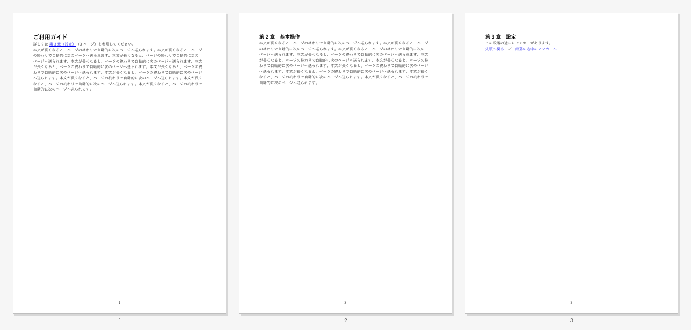

| メソッド | 動作 |
| --- | --- |
| `Paragraph.SetAnchor(名前)` | 段落の先頭（複数のページにまたがるときは最初のページの先頭）にアンカーを付けます |
| `Paragraph.AddAnchor(名前)` | 段落の途中の位置に、文字を描かないアンカーを置きます（`AnchorRun`） |
| `Paragraph.AddInternalLink(文字列, アンカー名)` | アンカーへ移動するリンク付きのテキスト（既定は青い下線）。`TextRun.LinkAnchor` と同じです |
| `Paragraph.AddPageRef(アンカー名)` | アンカーがあるページの番号。`FieldType.PageRef` と `FieldRun.Anchor` で指定することもできます |

- 移動先は、アンカーの位置が画面の上端に来るように指定します（PDF の `/Dest [ページ /XYZ …]`）。後ろのページのアンカー（前方参照）も指せます。
- ページ参照の表示は、そのアンカーがあるページが属するセクションの書式です（前付けがローマ数字なら、ローマ数字）。`AddPageRef(アンカー名, PageNumberFormat.Kanji)` のように、書式だけ変えることもできます。
- アンカー名は、セクションの本文内で一意にします。重複した名前や、存在しないアンカー名への参照は、`Render()`（`Save()` や `ToArray()` を含む）で `InvalidOperationException` になります。ヘッダー/フッターの段落に付けたアンカーは、飛び先になりません。
- ページ参照を使うと、後ろのページにあるアンカーのページ番号が分かるまでレイアウトを繰り返します（[4.11](#411-目次)）。

### 4.11 目次

`AddTableOfContents()` は、見出しレベルを持つ段落（[4.9](#49-しおりアウトライン)）から目次を自動で作ります。各行は、見出しの文字列、点線のリーダー、ページ番号で、行全体が見出しへの文書内リンクになります。

```csharp
var doc = new Document(font, 10.5);
doc.ShowBookmarkPane = true;
doc.Styles["見出し1"] = new ParagraphStyle(
    new TextStyle { FontSize = 15, Bold = true },
    new ParagraphFormat { OutlineLevel = 1, SpaceBefore = 10, SpaceAfter = 6, KeepWithNext = true, PageBreakBefore = true });
doc.Styles["見出し2"] = new ParagraphStyle(
    new TextStyle { FontSize = 12, Bold = true },
    new ParagraphFormat { OutlineLevel = 2, SpaceBefore = 8, SpaceAfter = 4, KeepWithNext = true });
doc.Styles["目次見出し"] = new ParagraphStyle(
    new TextStyle { FontSize = 18, Bold = true }, new ParagraphFormat { SpaceAfter = 12, Alignment = TextAlignment.Center });
doc.Styles["目次1"] = new ParagraphStyle(new TextStyle { Bold = true }, new ParagraphFormat { SpaceBefore = 4 });

// 前付け: ローマ数字。目次と序文
var front = doc.AddSection();
front.PageNumberFormat = PageNumberFormat.LowerRoman;
front.Footer.AddParagraph().SetAlignment(TextAlignment.Center).AddPageNumber();
var toc = front.AddTableOfContents("目次", maxLevel: 2);   // レベル 2 までを載せる
toc.TitleStyleName = "目次見出し";                          // 目次の見出しのスタイル
toc.LevelStyleNames[1] = "目次1";                           // レベルごとのスタイル
toc.IndentPerLevel = 18;                                    // レベルが 1 つ深いごとのインデント
front.AddParagraph("序文", "見出し1");
front.AddParagraph(Filler(8));

// 本文: 1 から数え直す。目次の番号は、見出しのページに表示される番号になる
var body = doc.AddSection();
body.PageNumberStart = 1;
body.PageNumberFormat = PageNumberFormat.Arabic;
body.Footer.AddParagraph().SetAlignment(TextAlignment.Center).AddPageNumber();
for (int chapter = 1; chapter <= 8; chapter++)
{
    body.AddParagraph("第 " + chapter + " 章", "見出し1");
    for (int section = 1; section <= 2; section++)
    {
        body.AddParagraph(chapter + "." + section + " 節の見出し", "見出し2");
        body.AddParagraph(Filler(14));
    }
}

doc.Save("table-of-contents.pdf");
```

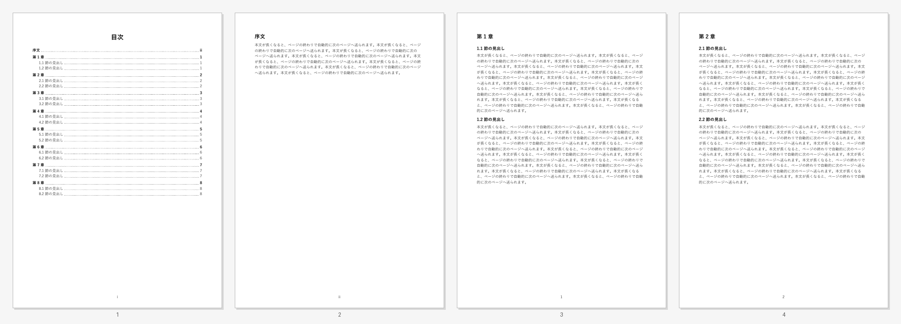

| 設定（`TableOfContents`） | 動作 |
| --- | --- |
| `Title` / `TitleStyleName` / `TitleStyle` / `TitleFormat` | 目次の見出しの文字列とスタイル（`Title` が `null` なら見出しなし）。`TitleOutlineLevel` を指定すると、目次の見出しもしおりに入れます |
| `MinLevel` / `MaxLevel` | 目次に入れる見出しレベルの範囲（既定 1〜3） |
| `IndentPerLevel` | レベルが 1 つ深いごとの左インデント（既定 14 ポイント。`null` ならスタイルに従う） |
| `Leader` | 見出しとページ番号の間のリーダー（既定は点線） |
| `ShowPageNumbers` / `Hyperlinks` | ページ番号の表示、行のリンク（どちらも既定 `true`） |
| `PageNumberFormat` | ページ番号の書式。`null`（既定）なら、見出しのあるページのセクションの書式 |
| `EntryStyleName` / `LevelStyleNames` / `EntryStyle` / `EntryFormat` | 目次の各行のスタイル。名前付きスタイルを全体またはレベルごとに指定します |

- 目次は、目次より前にある見出しも後ろにある見出しも載せます。目次自体が複数ページになっても、ページ番号は見出しのページと一致します。
- ページ番号は、前付けをローマ数字、本文を 1 から数え直す構成でも、見出しのページに表示される番号になります。
- ページ番号を確定するために、見出しのページが変わらなくなるまでレイアウトを繰り返します（上限 10 回。確定しなければ `InvalidOperationException`）。そのため、目次やページ参照を使う文書は、レイアウトに通常の数倍の時間がかかります。繰り返しの間は、`PageBackground` / `PageForeground` と `AddDrawing` の描画処理を呼ばず、最後の 1 回だけ呼びます。
- 見出しを数えるのは、セクションの本文（表のセルの中を含む）の段落だけです。ヘッダー/フッターの段落は数えません。

### 4.12 段組み

`PageSetup.ColumnCount` に 2 以上を指定すると、セクションの本文を段組み（2 段組みなど）で組みます。本文は 1 段目の下端まで流れたら 2 段目の上へ、最後の段の下端まで来たら次のページの 1 段目へ進みます。

```csharp
var doc = new Document(font, 10.5);
doc.Styles["見出し"] = new ParagraphStyle(
    new TextStyle { FontSize = 12, Bold = true },
    new ParagraphFormat { OutlineLevel = 1, SpaceBefore = 8, SpaceAfter = 3, KeepWithNext = true });

// 1 段の表題。段数を変えるときはセクションを分ける（セクションは新しいページから始まる）
var title = doc.AddSection();
title.AddParagraph("社内報 2026 年秋号").SetFontSize(22).SetBold().SetAlignment(TextAlignment.Center).SetSpaceAfter(6);
title.AddParagraph("総務部").SetAlignment(TextAlignment.Center);

// 2 段組みの本文。段の幅は等分で、段の間に境界線を引ける
var s = doc.AddSection();
s.PageSetup.ColumnCount = 2;
s.PageSetup.ColumnSpacing = Unit.Mm(10);                                  // 段間（既定は 8 mm）
s.PageSetup.ColumnSeparator = new PdfPen(PdfColor.Gray, 0.5);             // 境界線（null なら引かない）
s.Header.AddParagraph("社内報 2026 年秋号").SetFontSize(8).SetColor(PdfColor.Gray).SetAlignment(TextAlignment.Right);
s.Footer.AddParagraph().SetFontSize(9).SetAlignment(TextAlignment.Center).AddPageNumber();   // ヘッダー/フッターは用紙の幅のまま

for (int i = 1; i <= 4; i++)
{
    s.AddParagraph("記事 " + i, "見出し");
    s.AddParagraph(Filler(5)).SetAlignment(TextAlignment.Justify).SetSpaceAfter(4);
}

// 表やリストも段の幅で組まれる
var table = s.AddTable();
table.AddColumns(2, 1);
table.AddHeaderRow("行事", "日付");
table.AddRow("運動会", "10/12");
table.AddRow("文化祭", "11/03");
table.AddRow("忘年会", "12/20");

s.AddParagraph("お知らせ", "見出し");
var list = s.AddBulletList();
list.AddItem("駐車場の利用は事前に申請してください。");
list.AddItem("会議室の予約は総務部まで。");

s.AddColumnBreak();      // ここから次の段（最後の段なら次のページ）
s.AddParagraph("編集後記", "見出し");
s.AddParagraph(Filler(4)).SetAlignment(TextAlignment.Justify);

doc.Save("columns.pdf");
```

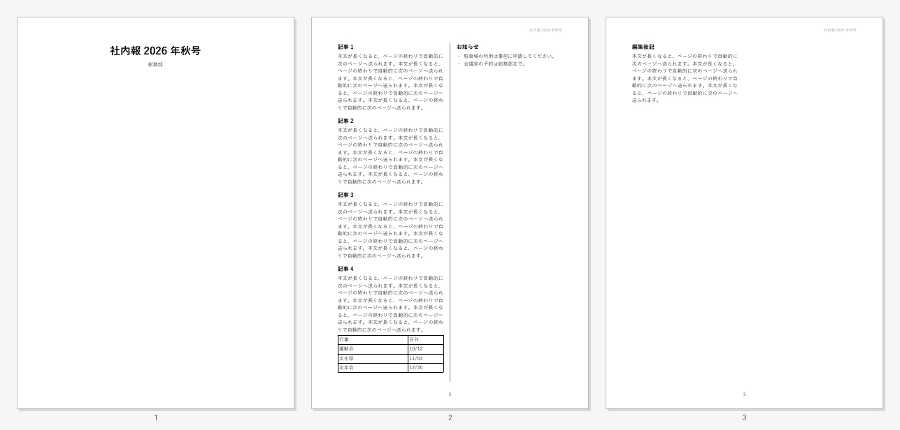

| 設定・メソッド | 動作 |
| --- | --- |
| `PageSetup.ColumnCount` | 段数（既定 1 = 段組みなし。1 未満は `ArgumentOutOfRangeException`） |
| `PageSetup.ColumnSpacing` | 段と段の間隔（既定 8 mm） |
| `PageSetup.ColumnSeparator` | 段の間に引く境界線（`PdfPen`。既定 `null` で引かない）。段の間隔の中央に、本文領域の高さいっぱいに引きます。内容のある段の間だけに引き、最後のページで内容のない段との間には引きません |
| `PageSetup.ColumnWidth` | 1 つの段の幅（読み取り専用）。段の幅は等分で、`(本文の幅 − 段間 × (段数 − 1)) / 段数` です |
| `AddColumnBreak()` | 段区切り。これ以降を次の段の上から始めます（最後の段なら次のページの 1 段目）。段組みでないセクションでは改ページと同じで、段の先頭にある段区切りは無視します |

- 改ページ（`AddPageBreak()` と、段落などの `PageBreakBefore`）は、段ではなく次のページへ進みます。2 段目の先頭にあるときも、1 段目に内容があれば次のページへ進みます。
- 段落は段の下端で分割され、2 段目に続きます（段落の分割位置の調整、`KeepWithNext`、`KeepTogether` は、段の下端でもページの下端と同じように働きます）。表は段の幅で組まれ、段をまたいで行が続くときは見出し行が各段の先頭で繰り返されます。画像、リスト、目次（`AddTableOfContents()`）、ルビ、アンカーや文書内リンクも、段の幅で組まれます。
- **段の幅に収まらない内容**: 画像は `ScaleToFit`（既定 `true`）なら段の幅に縮めます（`false` にすると指定したサイズのまま隣の段にはみ出します）。固定幅（`AddColumn(幅)`）の列の合計が段の幅を超える表は、固定幅の比率を保ったまま段の幅に収まるよう縮めます（段組みでないセクションでは、指定した幅のままはみ出します）。`AddDrawing()` の図は、幅が段の幅を超えると段の幅に縮めます（描画処理に渡される矩形の幅も段の幅になります）。
- ヘッダー/フッター、`PageBackground` / `PageForeground` は、段組みの影響を受けず、本文領域全体の幅のままです。`PageContext.ContentArea` の意味も変わらず、すべての段をまとめた領域です。段ごとの領域（ページ座標）は `PageContext.ColumnAreas`（左の段から順）、段数は `PageContext.ColumnCount` で取得できます。

```csharp
var doc = new Document(font, 10.5);
var s = doc.AddSection();
s.PageSetup.ColumnCount = 3;
s.PageSetup.ColumnSpacing = Unit.Mm(6);

// PageContext.ContentArea は段組みでもすべての段をまとめた領域のまま。段ごとの領域は ColumnAreas に入る
s.PageBackground = (g, ctx) =>
{
    var frame = PdfPen.Dashed(PdfColor.Gray, 0.5);
    foreach (var area in ctx.ColumnAreas)
        g.DrawRectangle(frame, area.X, area.Y, area.Width, area.Height);
};

s.AddParagraph($"段の幅は {Unit.ToMm(s.PageSetup.ColumnWidth):0.0} mm").SetBold();
s.AddParagraph(Filler(14)).SetAlignment(TextAlignment.Justify);
s.AddColumnBreak();
s.AddParagraph("3 つ目の段へ").SetBold();
s.AddParagraph(Filler(10)).SetAlignment(TextAlignment.Justify);

doc.Save("column-areas.pdf");
```

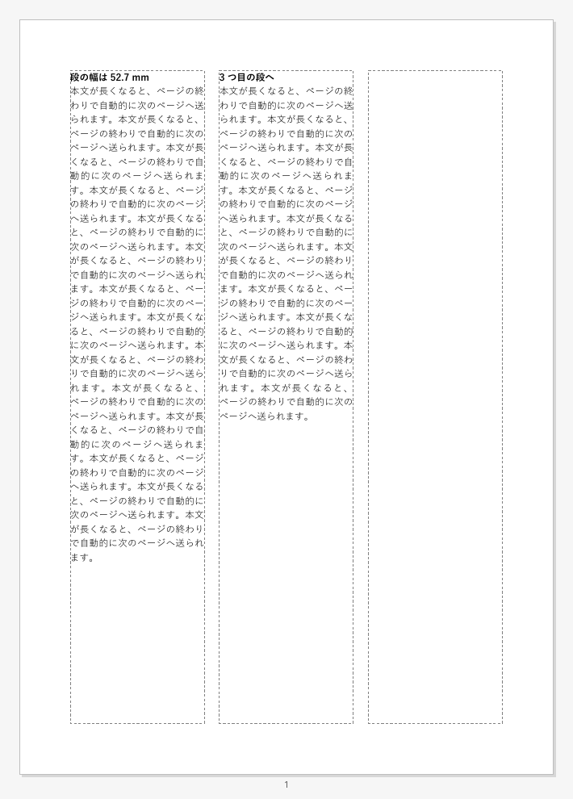

- 段数を変えられるのはセクションの区切りだけです。1 段の表題のあとに 2 段の本文を置くときは、セクションを分けます（セクションは新しいページから始まります）。同じページの途中で段数を切り替えることはできません。
- 最後のページの段の高さをそろえる（バランスさせる）機能はありません。最後のページは、1 段目から順に下端まで詰めます。
- しおりの位置、アンカー、文書内リンクの飛び先、目次のページ番号は、見出しが実際に描かれた段の位置（ページと、ページ上端からの縦位置）が使われます。PDF の移動先は縦位置だけを指定するので、2 段目の見出しへ移動すると、2 段目の見出しの高さが表示の上端に来ます。

### 4.13 脚注

`Paragraph.AddFootnote("脚注の文字列")` で、その位置に脚注を付けます。本文には上付きの番号が入り、同じ番号の脚注は、参照のあるページの本文領域の下端（短い区切り線の下）に置かれます。脚注の分だけ、本文の高さは自動で減ります。

```csharp
var doc = new Document(font, 10.5);
doc.Styles["見出し"] = new ParagraphStyle(
    new TextStyle { FontSize = 13, Bold = true },
    new ParagraphFormat { SpaceBefore = 8, SpaceAfter = 4, KeepWithNext = true });

// 脚注の書式は文書全体で指定する（既定は本文の 0.85 倍の文字サイズ）。区切り線も変えられる
doc.FootnoteStyle = new TextStyle { Color = PdfColor.FromHex("#444444") };
doc.FootnoteFormat = new ParagraphFormat { LineSpacing = 1.15 };
doc.FootnoteSeparator = new PdfPen(PdfColor.Gray, 0.5);       // null なら線を引かない
doc.FootnoteSeparatorLength = Unit.Mm(40);                    // 既定は本文の幅の 3 分の 1

var s = doc.AddSection();
s.AddParagraph("調査の概要", "見出し");

// AddFootnote("文字列") で、その位置に脚注を付ける。本文に上付きの番号が入り、同じ番号の脚注がページの下に置かれる
s.AddParagraph("この調査は、2026 年 4 月から 9 月にかけて実施した。")
    .AddFootnote("調査の対象は、国内に本社を置く従業員 50 人以上の企業。")
    .AddText("回答数は 1,248 社で、回収率は 41.6 %だった。")
    .AddFootnote("回収率は、発送数に対する有効回答の割合。");

// 引数なしの AddFootnote() は脚注の本文を返す。段落やリストを複数入れられる
var note = s.AddParagraph("業種の分類には、日本標準産業分類を用いた。").AddFootnote();
note.AddParagraph("日本標準産業分類（総務省）の大分類による。ただし、次の業種はまとめて集計した。");
var merged = note.AddBulletList();
merged.AddItem("電気・ガス・熱供給・水道業");
merged.AddItem("情報通信業");

// 表のセルやリストの項目にも付けられる
var table = s.AddTable();
table.AddColumns(2, 1);
table.AddHeaderRow("業種", "回答数");
var row = table.AddRow();
row.Cells[0].AddParagraph("製造業").AddFootnote("食料品・繊維・化学などを含む。");
row.Cells[1].AddParagraph("412");
table.AddRow("小売業", "236");

s.AddParagraph("結果", "見出し");
s.AddParagraph(Filler(14));

doc.Save("footnotes.pdf");
```

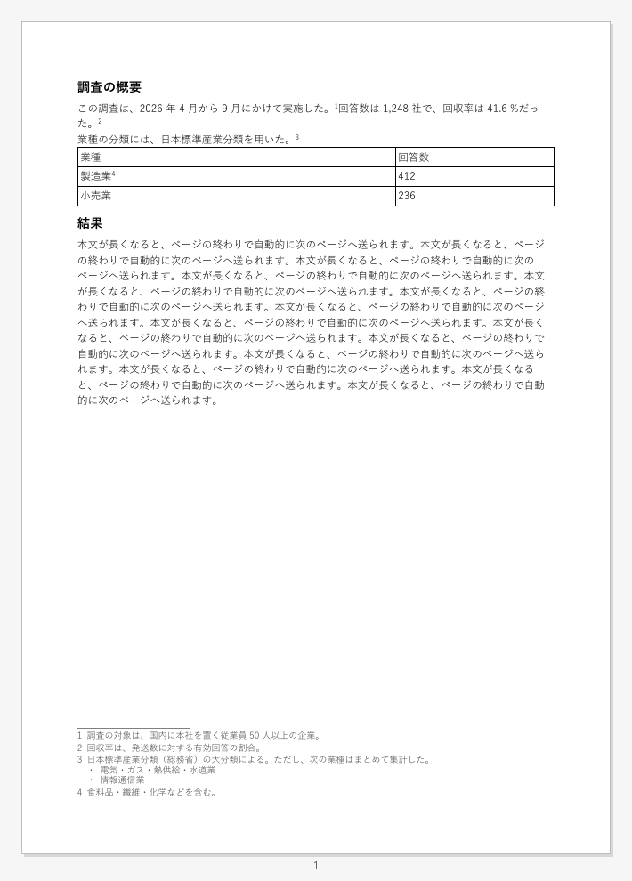

| 設定・メソッド | 動作 |
| --- | --- |
| `Paragraph.AddFootnote(text, style)` | 文字列だけの脚注を付ける（段落を返すので、続けて `AddText` などを呼べます） |
| `Paragraph.AddFootnote()` | 脚注の本文（`Footnote`）を返す。`Section` と同じ `AddParagraph()`、`AddBulletList()` などで、複数の段落やリストを入れられます |
| `Document.FootnoteStyle` / `FootnoteFormat` | 脚注の本文の文字スタイルと段落書式。文書全体に指定します。既定は本文の 0.85 倍の文字サイズ（0.5 ポイント単位）、行送り 1.2 倍、字下げと段落間隔なしで、表のセルやリストの設定は引き継ぎません。脚注の段落に `StyleName` や `Format` を指定すると、それが優先されます |
| `Document.FootnoteNumberFormat` | 番号の書式（`PageNumberFormat`。既定はアラビア数字） |
| `Document.FootnoteSymbols` | 番号の代わりに使う記号の列（例: `"*"`, `"†"`, `"‡"`）。使い切ると `"**"`, `"††"` のように重ねます |
| `Section.FootnoteNumbering` | `Continuous`（既定）は前のセクションからの続き番号、`Restart` はこのセクションの最初の脚注を 1 に戻します |
| `Document.FootnoteSeparator` / `FootnoteSeparatorLength` / `FootnoteSpacing` | 区切り線のペン（既定は黒の 0.5 ポイント。`null` なら線を引かない）、その長さ（既定は本文の幅の 3 分の 1）、脚注と脚注の間の空き（既定 2 ポイント） |

```csharp
var doc = new Document(font, 10.5);

// 番号の書式: 数字の書式（PageNumberFormat）か、記号の列。記号を使い切ると "**", "††" のように重ねる
doc.FootnoteSymbols = new[] { "*", "†", "‡" };

var first = doc.AddSection();
first.AddParagraph("第 1 章").SetBold();
first.AddParagraph("最初の注。").AddFootnote("記号の脚注（1 つ目）。");
first.AddParagraph("次の注。").AddFootnote("記号の脚注（2 つ目）。");

// 既定では前のセクションからの続き番号。Restart にすると、このセクションから 1 に戻る
var second = doc.AddSection();
second.FootnoteNumbering = FootnoteNumbering.Restart;
second.AddParagraph("第 2 章").SetBold();
second.AddParagraph("章が替わったので、番号が振り直される。").AddFootnote("この章の最初の脚注。");

doc.Save("footnote-numbers.pdf");
```

- 参照記号と脚注の番号は、文書の並びの順（表は行ごとに左から右）に自動で振られます。レイアウトの前に決まるので、目次によるレイアウトの繰り返しやページ数の変化で変わることはありません。
- 参照のある行がそのページに入るなら、その脚注も同じページに入ります。入らないときは、参照を含む行ごと次のページへ送ります。段落が複数ページにまたがるときは、参照のある行があるページに脚注を置きます。
- 段組みのセクションでは、脚注はページの全幅（全段をまたぐ）の下端に置き、脚注の分だけ、すべての段の高さが減ります。段の境界線も脚注の上までになります。1 段目が下端まで埋まっているときは、2 段目に脚注のある行を置けないので、その行を次のページへ送ります。
- 表のセルの脚注は、行ごとに数えます。脚注のある行が入らなければ、行ごと次のページへ送ります（`AllowBreakAcrossPages` の行は、入る分だけを分割します）。見出し行（`RepeatHeaderRows`）にある脚注は、最初の 1 回だけ置きます。
- 脚注の本文の段落は、見出しとしては数えません（しおりと目次に入りません）。ページ参照（`AddPageRef`）や文書内リンクは使えます。見出しの段落に付けた脚注の番号は、しおりと目次の文字列に含まれません。
- **使えない場所**: ヘッダー/フッターの段落と、脚注の本文の中（脚注の入れ子）で `AddFootnote` を使うと、レイアウト時に `InvalidOperationException` になります。`PageBackground` / `PageForeground`、`PdfGraphics.DrawText` / `DrawTextBox`、目次の行、ルビには、脚注を付ける方法がありません。文末脚注（後注）には対応していません。
- 1 ページに収まらないほど長い脚注は、次のページの脚注領域へ続けず、ページの下にはみ出して描きます。

---

## 5. 表

### 5.1 表の基本

列を定義してから行を追加します。`AddHeaderRow` で追加した見出し行は、表が次のページに続くときに繰り返し表示されます。

```csharp
var doc = new Document(font, 10.5);
var s = doc.AddSection();

var t = s.AddTable();
t.AddColumns(1, 4, 1.2, 2);                          // 列幅の比率
t.HeaderBackground = PdfColor.FromHex("#DDEBF7");
t.HeaderStyle = new TextStyle { Bold = true };
t.AddHeaderRow("No.", "品名", "数量", "金額");
t.AddRow("1", "ノートパソコン 14 インチ", "2", "396,000");
t.AddRow("2", "液晶モニター 27 インチ（高さ調整スタンド付き、ケーブル類一式を含む）", "4", "168,000");
t.AddRow("3", "USB-C ドック", "4", "52,800");

doc.Save("table-basic.pdf");
```

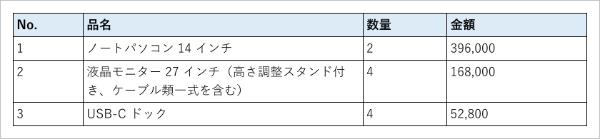

セルに入りきらない文字列は、セルの中で折り返します。行の高さは、いちばん高いセルに合わせて広がります。

### 5.2 列幅と揃え

列幅は、固定幅（`AddColumn`）と比率（`AddRelativeColumn`、`AddColumns`）で指定します。固定幅の列を除いた残りの幅を、比率で分け合います。セルの内容に合わせる列（`AddAutoColumn`）もあります（[5.8 列の幅を内容に合わせる](#58-列の幅を内容に合わせる)）。

```csharp
var doc = new Document(font, 10.5);
var s = doc.AddSection();

var t = s.AddTable();
t.AddColumn(Unit.Mm(15)).Alignment = TextAlignment.Center;     // 固定幅・中央揃え
t.AddRelativeColumn(3);                                         // 残りを 3 : 1 で分ける
var amount = t.AddRelativeColumn(1);
amount.Alignment = TextAlignment.Right;                         // 金額は右揃え
amount.Background = PdfColor.FromHex("#FFF2CC");                // 列の背景色
t.AddHeaderRow("コード", "内容", "金額");
t.AddRow("A01", "固定幅 15 mm の列", "1,200");
t.AddRow("A02", "比率 3 の列", "34,500");
t.AddRow("A03", "比率 1 の列は右揃え", "678,900");

s.AddSpacer(12);

// 列がすべて固定幅なら、表の幅は列幅の合計になる。Alignment で位置を決める
var small = s.AddTable();
small.Alignment = HorizontalAlignment.Center;
small.AddColumn(Unit.Mm(30));
small.AddColumn(Unit.Mm(30)).Alignment = TextAlignment.Right;
small.AddHeaderRow("項目", "値");
small.AddRow("中央に配置", "60 mm");

doc.Save("table-columns.pdf");
```

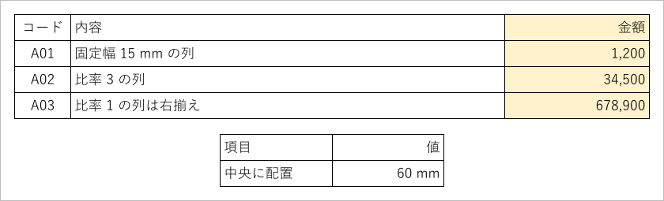

### 5.3 セルの結合

`Cell.Merge(列数, 行数)` で、右と下のセルを結合します。結合で隠れるセルには何も入れず、`AddRow` では `null` を渡します。

```csharp
var doc = new Document(font, 10.5);
var s = doc.AddSection();

var t = s.AddTable();
t.AddColumns(1.2, 1.5, 1, 1, 1, 1);
t.VerticalAlignment = VerticalAlignment.Middle;
t.HeaderBackground = PdfColor.FromHex("#E2EFDA");

// 見出し 2 行：結合されて隠れるセルには null を渡す
var h1 = t.AddHeaderRow("地域", "店舗", "上期", null!, "下期", null!);
h1[0].Merge(1, 2);                                   // 縦に 2 行
h1[1].Merge(1, 2);
h1[2].Merge(2);                                      // 横に 2 列
h1[4].Merge(2);
t.AddHeaderRow(null!, null!, "売上", "利益", "売上", "利益");
foreach (var row in t.Rows) foreach (var c in row.Cells) c.Alignment = TextAlignment.Center;

var r1 = t.AddRow("東日本", "札幌", "120", "18", "135", "21");
r1[0].Merge(1, 2);
t.AddRow(null!, "仙台", "98", "12", "101", "15");
var r3 = t.AddRow("西日本", "大阪", "210", "35", "198", "30");
r3[0].Merge(1, 3);
t.AddRow(null!, "広島", "75", "9", "80", "11");
t.AddRow(null!, "福岡", "130", "20", "142", "24");
var total = t.AddRow("合計", null!, "633", "94", "656", "101");
total[0].Merge(2).SetAlignment(TextAlignment.Center);
total.Background = PdfColor.FromGray(0.92);
total.Style = new TextStyle { Bold = true };

doc.Save("table-merge.pdf");
```

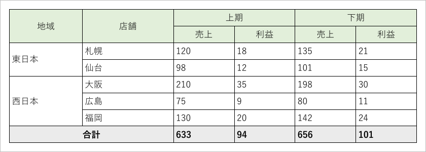

### 5.4 罫線と背景色

罫線は、表全体の既定値（`Table.Borders`）とセルの辺ごとの指定（`Cell.Borders`）で決まります。セルで指定した辺が優先されます。

```csharp
var doc = new Document(font, 10.5);
var s = doc.AddSection();

// 色付きの罫線と縞模様
var t = s.AddTable();
t.AddColumns(2, 1, 1);
t.Borders = new BorderLine(PdfColor.FromHex("#8EA9DB"), 0.5);
t.AlternateRowBackground = PdfColor.FromHex("#EEF3FB");
t.HeaderBackground = PdfColor.FromHex("#4472C4");
t.HeaderStyle = new TextStyle { Color = PdfColor.White, Bold = true };
t.CellPadding = new Thickness(6, 4);
t.AddHeaderRow("項目", "4 月", "5 月");
for (int i = 1; i <= 5; i++) t.AddRow("項目 " + i, (i * 120).ToString(), (i * 135).ToString());
var sum = t.AddRow("合計", "1,800", "2,025");
foreach (var c in sum.Cells) c.Borders.Top = new BorderLine(PdfColor.FromHex("#1F3864"), 1.5);

s.AddSpacer(16);

// 横線だけの表（縦の罫線なし）
var plain = s.AddTable();
plain.AddColumns(1, 3);
plain.Borders = null;                                // 既定の罫線をなくす
var head = plain.AddHeaderRow("日付", "内容");
foreach (var c in head.Cells) c.Borders.Bottom = BorderLine.Thick;
foreach (var (date, text) in new[] { ("10/1", "キックオフ"), ("10/8", "設計レビュー"), ("10/15", "結合テスト") })
{
    var row = plain.AddRow(date, text);
    foreach (var c in row.Cells) c.Borders.Bottom = BorderLine.Dashed(PdfColor.Gray);
}

doc.Save("table-borders.pdf");
```

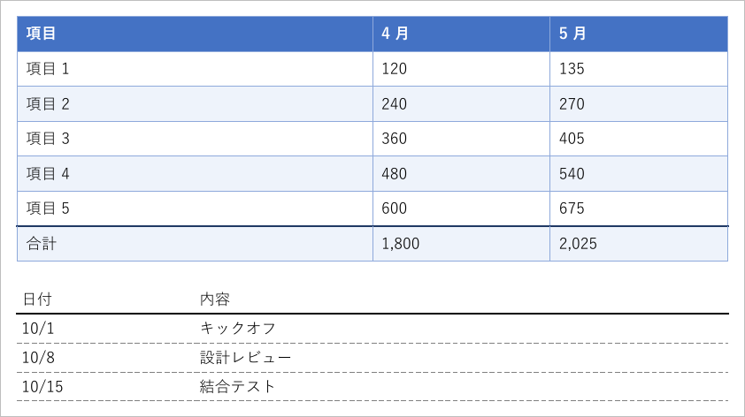

| 指定 | 内容 |
| --- | --- |
| `BorderLine.Thin` | 黒の細線（0.5 pt）。表の既定値 |
| `BorderLine.Thick` | 黒の太線（1.5 pt） |
| `BorderLine.Dashed(色, 太さ)` | 破線 |
| `BorderLine.None` | 罫線なし（その辺だけ消す） |
| `new BorderLine(色, 太さ)` | 任意の色と太さ |

背景色は、セル（`Cell.Background`）、行（`Row.Background`）、見出し行の背景色（`HeaderBackground`）または縞模様（`AlternateRowBackground`）、列（`Column.Background`）の順に優先されます。

### 5.5 複数ページにまたがる表

行が多い表は、自動的に次のページへ続きます。見出し行は各ページの先頭に繰り返します。

```csharp
var doc = new Document(font, 10.5);
var s = doc.AddSection();
s.Footer.AddParagraph().SetAlignment(TextAlignment.Center).AddPageNumber().AddText(" / ").AddPageCount();

var t = s.AddTable();
t.AddColumns(1, 4, 2);
t.HeaderBackground = PdfColor.FromHex("#DDEBF7");
t.AlternateRowBackground = PdfColor.FromGray(0.96);
t.AddHeaderRow("No.", "品名", "金額");                // 改ページ後も各ページの先頭に表示
for (int i = 1; i <= 70; i++)
    t.AddRow(i.ToString(), "商品 " + i, (i * 1280).ToString("#,0") + " 円").Cells[2].Alignment = TextAlignment.Right;

doc.Save("table-long.pdf");
```

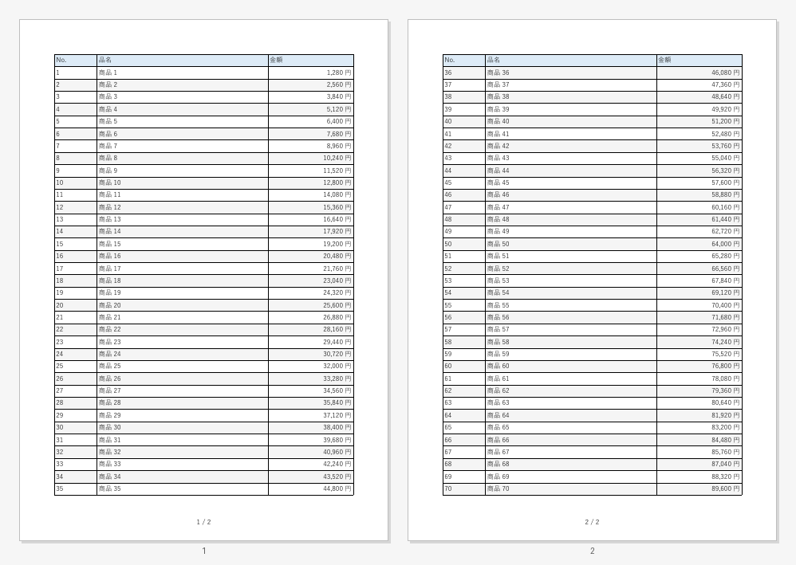

### 5.6 ページの終わりでの行の分割

ページの最後に行が入りきらないとき、既定では行ごと次のページへ送ります。`Row.AllowBreakAcrossPages = true` にすると、行をページの終わりで分割し、残りを次のページに続けます。

```csharp
var doc = new Document(font, 10.5);
var s = doc.AddSection();
s.AddDrawing(s.PageSetup.ContentHeight - 110, (g, r) =>
    g.FillRectangle(PdfColor.FromGray(0.93), 0, 0, r.Width, r.Height));

var t = s.AddTable();
t.AddColumns(1, 5);
t.HeaderBackground = PdfColor.FromHex("#DDEBF7");
t.AddHeaderRow("No.", "内容");
t.AddRow("1", "短い行");
// 既定では、収まらない行は行ごと次のページへ送る。true にするとページ末尾で分割する
t.AddRow("2", Filler(12)).AllowBreakAcrossPages = true;

doc.Save("table-row-split.pdf");
```

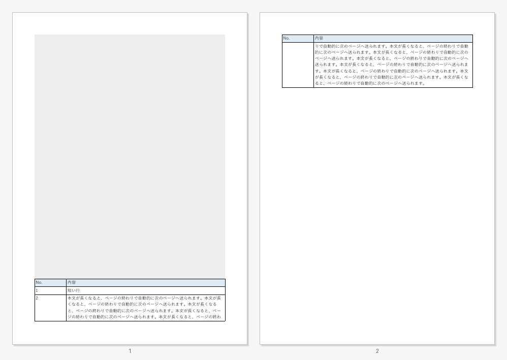

1 ページに収まらないほど高い行は、この設定にかかわらず分割します。

### 5.7 セルの中身

セルには、段落・画像・図・表を入れられます。垂直方向の揃えは、表・行・セルのそれぞれで指定できます。

```csharp
var doc = new Document(font, 10.5);
var s = doc.AddSection();
var logo = PdfImage.FromFile("logo.png");

var t = s.AddTable();
t.AddColumns(1, 2.2, 1.6);
t.AddHeaderRow("画像", "段落を複数", "表の入れ子");

var row = t.AddRow();
row.VerticalAlignment = VerticalAlignment.Middle;
row[0].AddImage(logo, width: Unit.Mm(22)).Alignment = HorizontalAlignment.Center;

row[1].AddParagraph("ChohyoPdf").SetBold().SetFontSize(13);
row[1].AddParagraph("セルには段落・画像・図・表を入れられます。").SetSpaceAfter(4);
row[1].AddParagraph().AddText("文字の").AddText("装飾", new TextStyle { Color = PdfColor.Red, Bold = true }).AddText("もそのまま使えます。");

var inner = row[2].AddTable();
inner.AddColumns(1, 1);
inner.Borders = new BorderLine(PdfColor.Gray, 0.3);
inner.AddRow("A", "1");
inner.AddRow("B", "2");

var r2 = t.AddRow("上", "中央", "下");
r2.Height = Unit.Mm(15);                             // 最小の高さ
r2[0].VerticalAlignment = VerticalAlignment.Top;
r2[1].VerticalAlignment = VerticalAlignment.Middle;
r2[2].VerticalAlignment = VerticalAlignment.Bottom;
r2[1].Background = PdfColor.FromHex("#FCE4D6");
r2[2].Padding = new Thickness(12, 2);                // セルごとの内側の余白

doc.Save("table-rich-cells.pdf");
```

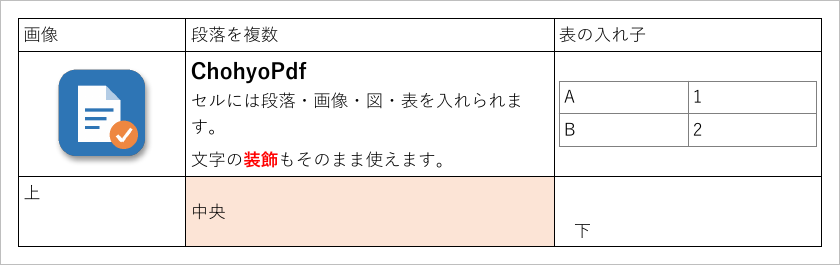

### 5.8 列の幅を内容に合わせる

`AddAutoColumn()` で追加した列（`Column.AutoFit` が `true` の列）は、セルの内容に合わせて幅が決まります。表全体を内容に合わせるときは `Table.AutoFitColumns = true` にします（幅を指定していない列がすべて内容に合わせる列になり、固定幅の列はそのままです）。

```csharp
var doc = new Document(font, 10.5);
var s = doc.AddSection();

// 内容に合わせる列（AddAutoColumn）だけの表は、表の幅も内容に合わせて狭くなる
s.AddParagraph("列の幅を内容に合わせる").SetBold().SetSpaceAfter(4);
var t = s.AddTable();
t.AddAutoColumns(3);                                   // AddAutoColumn() を 3 回呼ぶのと同じ
t.Columns[2].Alignment = TextAlignment.Right;
t.HeaderBackground = PdfColor.FromHex("#DDEBF7");
t.AddHeaderRow("コード", "品名", "金額");
t.AddRow("A-01", "ノートパソコン", "198,000");
t.AddRow("A-02", "液晶モニター", "84,000");
t.AddRow("B-10", "USB-C ドック", "13,200");

// 内容が表の幅に収まらないときは、最大の幅に比例して縮める。
// 折り返せない単位（欧文の単語、禁則処理で分けられない文字）より狭くはならない
s.AddParagraph("収まらないときは縮めて折り返す").SetBold().SetSpaceBefore(14).SetSpaceAfter(4);
var wide = s.AddTable();
wide.AddAutoColumns(3);
wide.AddHeaderRow("No.", "概要", "備考");
wide.AddRow("1", "日本語の長い説明文は、表の幅に収まらなくなるとセルの中で折り返されます。短い列は、折り返せる限界の幅を下回りません。", "ok");
wide.AddRow("2", "見積書の備考欄のように、行によって文字数が大きく違う列にも使えます。", "要確認：納期と数量");

// 固定幅や比率の列と混ぜられる。固定幅を除いた残りから、内容に合わせる列が先に幅を取り、残りを比率の列で分ける
s.AddParagraph("固定幅・比率の列との組み合わせ").SetBold().SetSpaceBefore(14).SetSpaceAfter(4);
var mixed = s.AddTable();
mixed.AddColumn(Unit.Mm(12)).Alignment = TextAlignment.Center;    // 固定幅
mixed.AddAutoColumn();                                             // 内容に合わせる
mixed.AddRelativeColumn(1);                                        // 残りを比率で分ける
mixed.AddHeaderRow("No.", "区分", "メモ");
mixed.AddRow("1", "見積", "残りの幅いっぱいに広がる列。内容に合わせる列は、この列の最小の幅を残して幅を取る。");
mixed.AddRow("2", "請求", "短いメモ");

// 表全体を内容に合わせるなら AutoFitColumns（固定幅を指定した列は、そのまま）
s.AddParagraph("表全体を内容に合わせる").SetBold().SetSpaceBefore(14).SetSpaceAfter(4);
var all = s.AddTable();
all.AutoFitColumns = true;
all.Alignment = HorizontalAlignment.Center;
all.AddRelativeColumn();                                           // 比率は使われず、内容に合わせる
all.AddRelativeColumn();
all.AddHeaderRow("項目", "値");
all.AddRow("用紙", "A4 縦");
all.AddRow("余白", "20 mm");

doc.Save("table-auto-width.pdf");
```

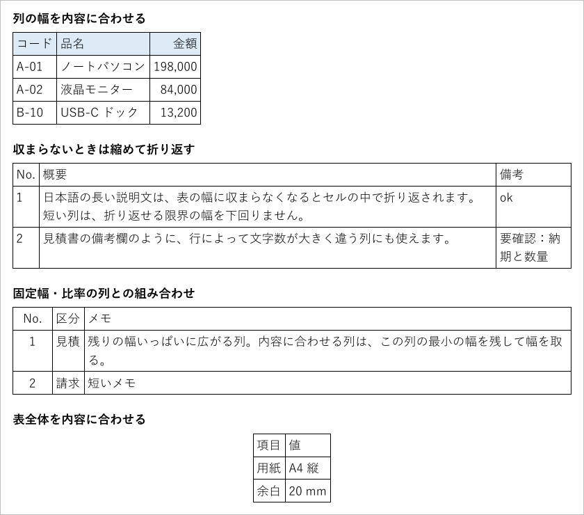

幅は、HTML の自動表レイアウトに近い方法で決めます。

1. 列ごとに、すべてのセルの内容から **最小幅**（折り返せない最長の単位。欧文の単語や、禁則処理で分けられない文字のまとまり）と **最大幅**（折り返さないときの幅）を調べます。セルの内側の余白と、左右の罫線の太さの半分も加えます。
2. 固定幅の列の幅を除いた残りの幅に最大幅の合計が収まれば、各列を最大幅にします。表の幅は内容の幅になり、本文の幅より狭ければ `Table.Alignment` に従って配置します。
3. 収まらなければ、最大幅に比例して縮めます。最小幅を下回る列は最小幅にして、残りを配り直します。最小幅の合計も収まらないときは、最小幅を同じ比率で縮めて表を本文（段組みでは段）の幅に収めます。このとき、長い欧文の単語は文字の途中で折り返されます。
4. 比率の列（`AddRelativeColumn`）と混ぜると、内容に合わせる列が最大幅を先に取り、残りを比率の列が比率で分けます。比率の列は、その列の最小幅より狭くなりません。残りが足りないときは、比率の列を最小幅にして、残りを内容に合わせる列に配ります。
5. 横に結合したセル（`Cell.Merge`）は、結合した列の合計が足りない分を、内容に合わせる列に最大幅の比で振り分けます（結合の小さいセルから順に処理します）。

計測の対象は、行の数にかかわらず表のすべての行です（ページをまたぐ表でも、列の幅はページごとに変わりません）。セルの中の入れ子の表・リスト・画像・ルビも計測します。幅を指定していない図形（`AddDrawing`）は幅 0、タブ位置は反映せず、タブは既定の幅（空白 4 文字分）として数えます。ページ番号などのフィールドは、最初に計測したページでの文字列で数えます。

`Column.AutoFit` が `true` の列では、`Width` と `RelativeWidth` の値は使いません。

---

## 6. 画像

### 6.1 画像の配置

対応している形式は JPEG と PNG です。

- JPEG は、データを変換せずにそのまま埋め込みます。CMYK の JPEG も使えます。
- PNG は、全カラータイプ、16 bit、インターレース、透過に対応しています。

```csharp
var doc = new Document(font, 10.5);
var s = doc.AddSection();
var photo = PdfImage.FromFile("photo.jpg");          // JPEG
var logo = PdfImage.FromFile("logo.png");            // 透過 PNG

s.AddParagraph($"photo.jpg：{photo.PixelWidth} × {photo.PixelHeight} px").SetFontSize(9);
s.AddImage(photo, width: Unit.Mm(80));               // 幅を指定すると高さは縦横比から決まる
s.AddParagraph("中央・右寄せ").SetFontSize(9).SetSpaceBefore(8);
s.AddImage(logo, width: Unit.Mm(25)).Alignment = HorizontalAlignment.Center;
s.AddImage(logo, height: Unit.Mm(12)).Alignment = HorizontalAlignment.Right;

doc.Save("image-basic.pdf");
```


幅と高さを両方とも省略すると、画像に記録された解像度（記録がなければ 96 dpi）から大きさを決めます。本文の幅や残りの高さより大きい画像は、縦横比を保ったまま縮小します（`ImageBlock.ScaleToFit`、既定で有効）。

同じ `PdfImage` を何度配置しても、PDF に埋め込むデータは 1 つです。

JPEG に EXIF の向き（Orientation）があるときの扱いは、[6.4 写真の向き（EXIF）](#64-写真の向きexif)を参照してください。

### 6.2 透過 PNG

PNG の透明な部分は、そのまま透明になります。

```csharp
var pdf = new PdfDocument();
var g = pdf.AddPage(new PageSize(Unit.Mm(150), Unit.Mm(60))).Graphics;
var logo = PdfImage.FromFile("logo.png");
var photo = PdfImage.FromFile("photo.jpg");

// 市松模様の上に置くと、透明な部分と影の半透明が分かる
for (int y = 0; y < 12; y++)
    for (int x = 0; x < 30; x++)
        if ((x + y) % 2 == 0) g.FillRectangle(PdfColor.FromGray(0.85), x * Unit.Mm(5), y * Unit.Mm(5), Unit.Mm(5), Unit.Mm(5));

g.DrawImage(logo, Unit.Mm(10), Unit.Mm(10), Unit.Mm(40), Unit.Mm(40));
g.DrawImage(photo, Unit.Mm(60), Unit.Mm(10), Unit.Mm(64), Unit.Mm(40));
g.DrawImage(logo, Unit.Mm(105), Unit.Mm(25), Unit.Mm(30), Unit.Mm(30));   // 写真に重ねる

pdf.Save("image-transparency.pdf");
```


### 6.3 枠に合わせる

枠の大きさに合わせて画像を描くには、`DrawImage` に幅と高さを渡す方法と、`DrawImageFit` を使う方法があります。

```csharp
var pdf = new PdfDocument();
var g = pdf.AddPage(new PageSize(Unit.Mm(170), Unit.Mm(62))).Graphics;
var photo = PdfImage.FromFile("photo.jpg");
var pen = PdfPen.Dashed(PdfColor.Red, 0.5, 2, 2);
var label = new TextStyle(font, 8);
double w = Unit.Mm(45), h = Unit.Mm(40), top = Unit.Mm(14);

g.DrawText("DrawImage（枠いっぱいに伸ばす）", Unit.Mm(8), Unit.Mm(6), label);
g.DrawImage(photo, Unit.Mm(8), top, w, h);
g.DrawRectangle(pen, Unit.Mm(8), top, w, h);

g.DrawText("DrawImageFit（縦横比を保って中央に）", Unit.Mm(62), Unit.Mm(6), label);
g.DrawImageFit(photo, Unit.Mm(62), top, w, h);
g.DrawRectangle(pen, Unit.Mm(62), top, w, h);

g.DrawText("DrawImageFit（縦長の枠）", Unit.Mm(116), Unit.Mm(6), label);
g.DrawImageFit(photo, Unit.Mm(126), top, Unit.Mm(25), h);
g.DrawRectangle(pen, Unit.Mm(126), top, Unit.Mm(25), h);

pdf.Save("image-fit.pdf");
```

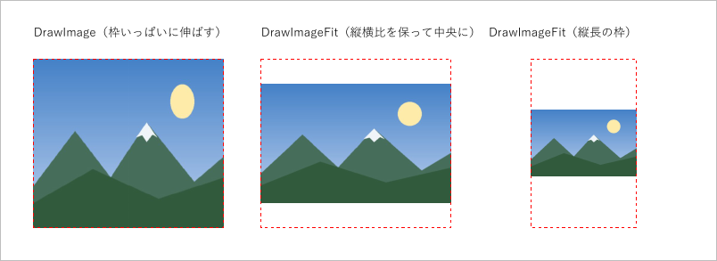

`DrawImage(image, x, y)` のように大きさを省略すると、画像の解像度どおりの大きさで描きます。

### 6.4 写真の向き（EXIF）

スマートフォンやデジタルカメラの写真は、画素を横向きのまま保存し、「回転して表示する」という向き（EXIF の Orientation。1〜8）を記録していることがあります。`PdfImage` は、JPEG の APP1（Exif）からこの向きを読み取り、**既定で反映します**。TIFF ヘッダーのバイト順は、リトルエンディアン（`II`）とビッグエンディアン（`MM`）のどちらにも対応します。

```csharp
var doc = new Document(font, 10.5);
var s = doc.AddSection();

// スマートフォンの写真は、画素が横向きのまま保存され、「回転して表示する」という EXIF の向き（Orientation）が付いていることが多い。
// photo-exif.jpg は、画素を縦長（400 × 640）に保存し、向き 6（時計回りに 90 度）を付けたもの
var upright = PdfImage.FromFile("photo-exif.jpg");              // 既定: 向きを反映する
var asStored = PdfImage.FromFile("photo-exif.jpg", false);      // false: 向きを無視して、画素の向きのまま

s.AddParagraph("向きを反映する（既定）").SetBold().SetSpaceAfter(2);
s.AddParagraph($"EXIF の向き {upright.ExifOrientation}、{upright.PixelWidth} × {upright.PixelHeight} px").SetFontSize(9);
s.AddImage(upright, width: Unit.Mm(80));

s.AddParagraph("向きを無視する").SetBold().SetSpaceBefore(12).SetSpaceAfter(2);
s.AddParagraph($"EXIF の向き {asStored.ExifOrientation}（反映していない）、{asStored.PixelWidth} × {asStored.PixelHeight} px").SetFontSize(9);
s.AddImage(asStored, height: Unit.Mm(50));

doc.Save("image-orientation.pdf");
```

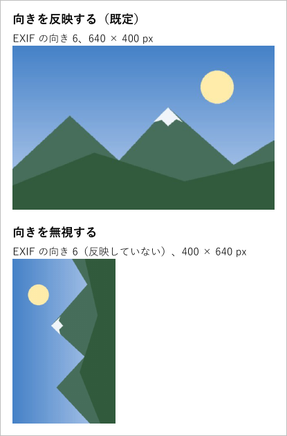

- 画素のデータ（DCTDecode）は再エンコードせず、そのまま埋め込みます。回転と反転は、描画時の変換行列で行います（向き 1〜8 のすべてに対応）。
- 向きを反映した画像は、`PdfImage.Width` / `Height` / `PixelWidth` / `PixelHeight` / `DpiX` / `DpiY` が、向きを直した後の画像のものになります（向き 5〜8 では縦と横が入れ替わります）。`AddImage` の大きさの計算や `DrawImageFit` も、この向きの縦横比で行います。
- 向きを無視するには、`PdfImage.FromFile(path, false)`、`PdfImage.FromStream(stream, false)`、`PdfImage.FromBytes(data, false)` のように、第 2 引数に `false` を渡します。保存されている画素の向きのまま描画します。
- 記録されていた向きは `PdfImage.ExifOrientation`（なければ 1）、描画に反映しているかは `PdfImage.OrientationApplied` で分かります。
- EXIF がない JPEG、PNG、`FromRawPixels` で作った画像、向きの値や EXIF の構造が不正なときは、向きを 1（そのまま）として扱います。
- EXIF 以外の向きの情報（XMP や PNG の eXIf チャンク）は読み取りません。

---

## 7. 図形とグラフ

### 7.1 基本の図形

`PdfGraphics` の図形メソッドは、線の指定（`PdfPen`）と塗りつぶしの色（`PdfColor`）を受け取ります。どちらかに `null` を渡すと、線だけ、または塗りだけになります。

```csharp
var pdf = new PdfDocument();
var g = pdf.AddPage(new PageSize(Unit.Mm(170), Unit.Mm(85))).Graphics;
var pen = new PdfPen(PdfColor.FromHex("#1F4E79"), 1.5);
var fill = PdfColor.FromHex("#BDD7EE");
var label = new TextStyle(font, 8);
double c = Unit.Mm(40);                              // 1 マスの大きさ

void Label(int col, int row, string text) =>
    g.DrawText(text, Unit.Mm(10) + col * c + Unit.Mm(15), Unit.Mm(5) + row * c + Unit.Mm(33), label, TextAlignment.Center);

double X(int col) => Unit.Mm(10) + col * c;
double Y(int row) => Unit.Mm(5) + row * c;

g.DrawLine(pen, X(0), Y(0) + Unit.Mm(25), X(0) + Unit.Mm(30), Y(0) + Unit.Mm(5));
g.DrawLine(PdfPen.Dashed(PdfColor.Red, 1, 4, 2), X(0), Y(0) + Unit.Mm(28), X(0) + Unit.Mm(30), Y(0) + Unit.Mm(28));
Label(0, 0, "DrawLine / 破線");
g.DrawRectangle(pen, fill, X(1), Y(0) + Unit.Mm(5), Unit.Mm(30), Unit.Mm(22));
Label(1, 0, "DrawRectangle");
g.DrawRoundedRectangle(pen, fill, X(2), Y(0) + Unit.Mm(5), Unit.Mm(30), Unit.Mm(22), Unit.Mm(5));
Label(2, 0, "DrawRoundedRectangle");
g.DrawEllipse(pen, fill, X(3), Y(0) + Unit.Mm(5), Unit.Mm(30), Unit.Mm(22));
Label(3, 0, "DrawEllipse");

g.DrawPie(pen, fill, X(0) + Unit.Mm(15), Y(1) + Unit.Mm(15), Unit.Mm(13), -90, 270);   // 真上から時計回りに 270 度
Label(0, 1, "DrawPie");
g.DrawPolygon(pen, fill, X(1) + Unit.Mm(15), Y(1) + Unit.Mm(2), X(1) + Unit.Mm(30), Y(1) + Unit.Mm(28), X(1), Y(1) + Unit.Mm(28));
Label(1, 1, "DrawPolygon");
var path = new PdfPath()
    .MoveTo(X(2), Y(1) + Unit.Mm(25))
    .CurveTo(X(2) + Unit.Mm(5), Y(1) - Unit.Mm(5), X(2) + Unit.Mm(25), Y(1) + Unit.Mm(40), X(2) + Unit.Mm(30), Y(1) + Unit.Mm(5));
g.DrawPath(path, pen, null);
Label(2, 1, "PdfPath（ベジェ曲線）");
g.DrawPolyline(PdfPen.Dotted(PdfColor.FromHex("#C55A11"), 2), X(3), Y(1) + Unit.Mm(25), X(3) + Unit.Mm(10), Y(1) + Unit.Mm(5),
    X(3) + Unit.Mm(20), Y(1) + Unit.Mm(20), X(3) + Unit.Mm(30), Y(1) + Unit.Mm(3));
Label(3, 1, "DrawPolyline / 点線");

pdf.Save("shapes.pdf");
```

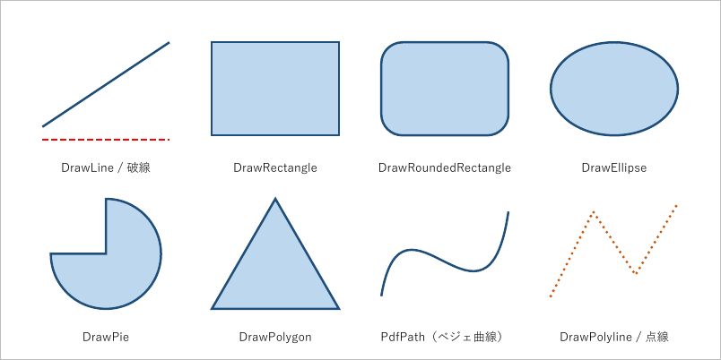

角度は度で指定します。0 度が右（3 時の方向）で、時計回りが正です。

### 7.2 色と透明度

```csharp
var pdf = new PdfDocument();
var g = pdf.AddPage(new PageSize(Unit.Mm(170), Unit.Mm(62))).Graphics;
var label = new TextStyle(font, 8);

// 半透明（WithAlpha）の円を重ねる
g.DrawCircle(null, PdfColor.FromRgb(255, 0, 0).WithAlpha(0.5), Unit.Mm(25), Unit.Mm(22), Unit.Mm(14));
g.DrawCircle(null, PdfColor.FromRgb(0, 176, 80).WithAlpha(0.5), Unit.Mm(40), Unit.Mm(22), Unit.Mm(14));
g.DrawCircle(null, PdfColor.FromRgb(0, 112, 192).WithAlpha(0.5), Unit.Mm(32.5), Unit.Mm(35), Unit.Mm(14));
g.DrawText("WithAlpha(0.5)", Unit.Mm(32.5), Unit.Mm(53), label, TextAlignment.Center);

// グレー・RGB・CMYK
for (int i = 0; i <= 10; i++)
    g.FillRectangle(PdfColor.FromGray(i / 10.0), Unit.Mm(70 + i * 8), Unit.Mm(8), Unit.Mm(8), Unit.Mm(10));
g.DrawText("FromGray(0.0) … FromGray(1.0)", Unit.Mm(70), Unit.Mm(19.5), label);

string[] hex = { "#C00000", "#ED7D31", "#FFC000", "#70AD47", "#4472C4", "#7030A0" };
for (int i = 0; i < hex.Length; i++)
    g.FillRectangle(PdfColor.FromHex(hex[i]), Unit.Mm(70 + i * 14), Unit.Mm(27), Unit.Mm(12), Unit.Mm(8));
g.DrawText("FromHex(\"#C00000\") など", Unit.Mm(70), Unit.Mm(36.5), label);

g.FillRectangle(PdfColor.FromCmyk(1, 0, 0, 0), Unit.Mm(70), Unit.Mm(44), Unit.Mm(12), Unit.Mm(8));
g.FillRectangle(PdfColor.FromCmyk(0, 1, 0, 0), Unit.Mm(84), Unit.Mm(44), Unit.Mm(12), Unit.Mm(8));
g.FillRectangle(PdfColor.FromCmyk(0, 0, 1, 0), Unit.Mm(98), Unit.Mm(44), Unit.Mm(12), Unit.Mm(8));
g.FillRectangle(PdfColor.FromCmyk(0, 0, 0, 1), Unit.Mm(112), Unit.Mm(44), Unit.Mm(12), Unit.Mm(8));
g.DrawText("FromCmyk（印刷向け）", Unit.Mm(70), Unit.Mm(53.5), label);

pdf.Save("colors.pdf");
```

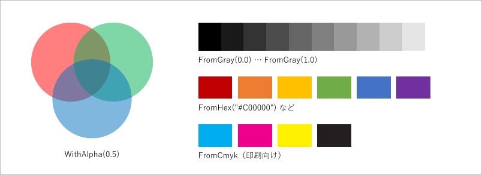

| 作り方 | 例 |
| --- | --- |
| RGB（0〜255） | `PdfColor.FromRgb(46, 117, 182)` |
| RGB（0〜1） | `PdfColor.FromRgb(0.2, 0.5, 0.7)` |
| 16 進数 | `PdfColor.FromHex("#2E75B6")`、`"#2E75B680"`（末尾 2 桁は透明度） |
| グレー（0 = 黒、1 = 白） | `PdfColor.FromGray(0.9)` |
| CMYK（0〜1） | `PdfColor.FromCmyk(0, 0.5, 1, 0)` |
| 透明度 | `PdfColor.Red.WithAlpha(0.3)` |
| 名前付きの色 | `Black`、`White`、`Gray`、`LightGray`、`DarkGray`、`Red`、`Green`、`Blue`、`Navy`、`Orange`、`Yellow`、`Transparent` |

### 7.3 回転・拡大縮小・クリップ

座標変換は、それ以降に描くすべての図形と文字に適用されます。変換の前に `SaveState()` を、描き終えたら `RestoreState()` を呼んで、元の状態に戻します。

```csharp
var pdf = new PdfDocument();
var g = pdf.AddPage(new PageSize(Unit.Mm(170), Unit.Mm(70))).Graphics;
var style = new TextStyle(font, 10);

// 回転：点 (cx, cy) を中心に、時計回りを正とする角度で回す
double cx = Unit.Mm(35), cy = Unit.Mm(35);
for (int angle = 0; angle < 360; angle += 45)
{
    g.SaveState();
    g.RotateAt(angle, cx, cy);
    g.DrawText($"{angle}°", cx + Unit.Mm(6), cy - 5, style);
    g.RestoreState();
}
g.DrawCircle(null, PdfColor.Red, cx, cy, 2);

// 拡大縮小：Translate で原点を移してから Scale
g.SaveState();
g.Translate(Unit.Mm(75), Unit.Mm(12));
g.Scale(2, 1);                                       // 横に 2 倍
g.DrawText("横 2 倍", 0, 0, style);
g.RestoreState();

// クリップ：円の中だけに画像を描く
var photo = PdfImage.FromFile("photo.jpg");
g.SaveState();
g.SetClip(new PdfPath().AddEllipse(Unit.Mm(120), Unit.Mm(10), Unit.Mm(45), Unit.Mm(45)));
g.DrawImage(photo, Unit.Mm(106.5), Unit.Mm(10), Unit.Mm(72), Unit.Mm(45));
g.RestoreState();
g.DrawText("SetClip", Unit.Mm(142.5), Unit.Mm(58), style, TextAlignment.Center);

pdf.Save("transforms.pdf");
```

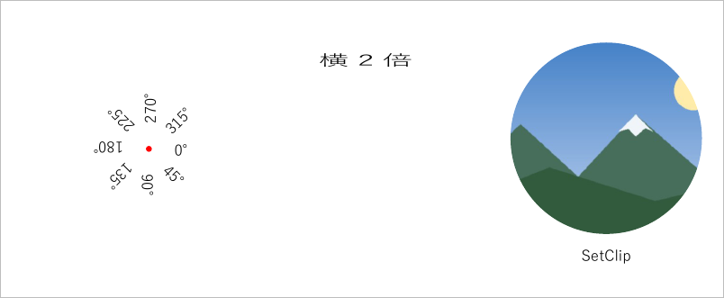

### 7.4 グラフ

自動レイアウトの中に図を入れるときは、`AddDrawing(高さ, 描画処理)` を使います。描画処理の中の座標は、図の左上が (0, 0) です。2 つ目の引数 `rect` から、図の幅と高さを取得できます。

```csharp
var doc = new Document(font, 10.5);
var s = doc.AddSection();
s.AddParagraph("月別売上と構成比").SetFontSize(14).SetBold().SetSpaceAfter(6);

string[] months = { "4月", "5月", "6月", "7月", "8月", "9月" };
double[] sales = { 120, 145, 98, 170, 160, 190 };
var labelStyle = new TextStyle(font, 8);

// 棒グラフ（AddDrawing の (0, 0) は図の左上）
s.AddDrawing(Unit.Mm(55), (g, r) =>
{
    double baseY = r.Height - 14, maxH = r.Height - 30, step = r.Width / months.Length;
    g.DrawLine(new PdfPen(PdfColor.Gray, 0.5), 0, baseY, r.Width, baseY);
    for (int i = 0; i < months.Length; i++)
    {
        double h = sales[i] / 200 * maxH, x = i * step + step * 0.25;
        g.FillRectangle(PdfColor.FromHex("#5B9BD5"), x, baseY - h, step * 0.5, h);
        g.DrawText(sales[i].ToString(), x + step * 0.25, baseY - h - 11, labelStyle, TextAlignment.Center);
        g.DrawText(months[i], x + step * 0.25, baseY + 3, labelStyle, TextAlignment.Center);
    }
});

// 円グラフ（DrawPie の角度は 0 度が右、時計回りが正）
string[] names = { "製品A", "製品B", "製品C", "その他" };
double[] share = { 45, 25, 20, 10 };
string[] colors = { "#5B9BD5", "#ED7D31", "#A5A5A5", "#FFC000" };
s.AddDrawing(Unit.Mm(55), (g, r) =>
{
    double cx = Unit.Mm(30), cy = r.Height / 2, radius = Unit.Mm(24), start = -90;
    for (int i = 0; i < share.Length; i++)
    {
        double sweep = share[i] / 100 * 360;
        g.DrawPie(new PdfPen(PdfColor.White, 1), PdfColor.FromHex(colors[i]), cx, cy, radius, start, sweep);
        double mid = (start + sweep / 2) * Math.PI / 180;
        g.DrawText($"{share[i]}%", cx + Math.Cos(mid) * radius * 0.65, cy + Math.Sin(mid) * radius * 0.65 - 4,
            labelStyle, TextAlignment.Center);
        g.FillRectangle(PdfColor.FromHex(colors[i]), Unit.Mm(65), Unit.Mm(12 + i * 8), Unit.Mm(4), Unit.Mm(4));
        g.DrawText(names[i], Unit.Mm(71), Unit.Mm(11.5 + i * 8), labelStyle);
        start += sweep;
    }
});

doc.Save("charts.pdf");
```

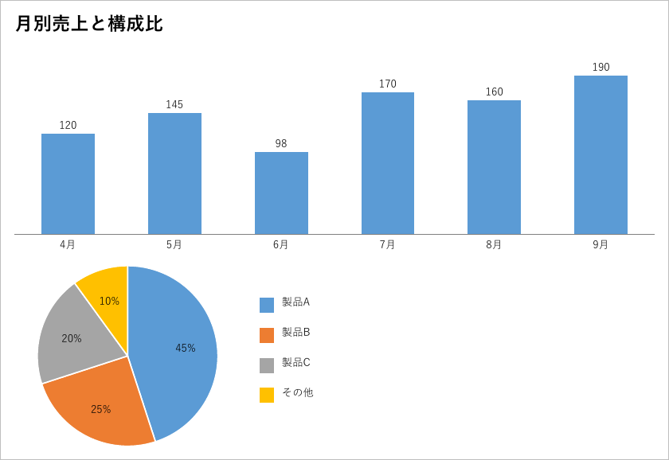

---

## 8. 座標を指定して描く帳票

この章の帳票は、画面の上で部品を並べてデザインし、同じ PDF を作る C# のコードとして出力することもできます（[ChohyoPdf Designer](designer.md)）。

### 8.1 1 行の文字

`DrawText(文字列, x, y, スタイル, 揃え)` は、折り返さずに 1 行で描きます（改行文字では改行します）。y は文字の上端です。揃えによって x の意味が変わります。

```csharp
var pdf = new PdfDocument();
var g = pdf.AddPage(new PageSize(Unit.Mm(160), Unit.Mm(45))).Graphics;
var style = new TextStyle(font, 12);
var mark = new PdfPen(PdfColor.Red, 0.5);
double y = Unit.Mm(10);

void Cross(double x) { g.DrawLine(mark, x - 4, y, x + 4, y); g.DrawLine(mark, x, y - 4, x, y + 4); }

// y は文字の上端。揃えによって x の意味が変わる（赤い十字が (x, y)）
Cross(Unit.Mm(10));
g.DrawText("Left：x が左端", Unit.Mm(10), y, style);
Cross(Unit.Mm(80));
g.DrawText("Center：x が中央", Unit.Mm(80), y, style, TextAlignment.Center);
Cross(Unit.Mm(150));
g.DrawText("Right：x が右端", Unit.Mm(150), y, style, TextAlignment.Right);

// 戻り値は描いた幅。続けて書くときに使う
double width = g.DrawText("金額：", Unit.Mm(10), Unit.Mm(25), style);
g.DrawText("12,345 円", Unit.Mm(10) + width, Unit.Mm(25), new TextStyle(font, 12) { Bold = true, Underline = true });

pdf.Save("draw-text.pdf");
```

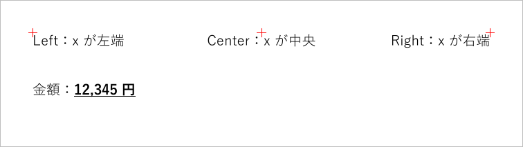

### 8.2 テキストボックス

`DrawTextBox` は、矩形の中で折り返して描きます。禁則処理も行います。

```csharp
var pdf = new PdfDocument();
var g = pdf.AddPage(new PageSize(Unit.Mm(170), Unit.Mm(48))).Graphics;
var style = new TextStyle(font, 10);
var frame = new PdfPen(PdfColor.Gray, 0.5);
string text = "DrawTextBox は矩形の中で折り返して描きます。";

var aligns = new[] { VerticalAlignment.Top, VerticalAlignment.Middle, VerticalAlignment.Bottom };
for (int i = 0; i < aligns.Length; i++)
{
    var rect = new PdfRect(Unit.Mm(8 + i * 54), Unit.Mm(10), Unit.Mm(48), Unit.Mm(30));
    g.DrawRectangle(frame, rect.X, rect.Y, rect.Width, rect.Height);
    g.DrawText(aligns[i].ToString(), rect.X, rect.Y - 11, new TextStyle(font, 8) { Color = PdfColor.Gray });
    g.DrawTextBox(text, rect.Deflate(3, 3, 3, 3), style, new TextBoxOptions
    {
        VerticalAlignment = aligns[i],
        Alignment = TextAlignment.Center,
    });
}

pdf.Save("text-boxes.pdf");
```

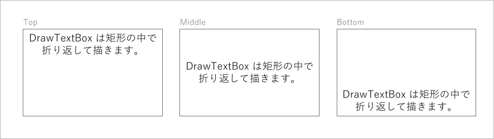

`TextBoxOptions` で指定できる項目は次のとおりです。

| プロパティ | 既定値 | 内容 |
| --- | --- | --- |
| `Alignment` | `Left` | 水平方向の揃え（均等割り付けも可） |
| `VerticalAlignment` | `Top` | 垂直方向の揃え |
| `LineSpacing` | 1.2 | 行送り（文字の大きさに対する倍率） |
| `LineSpacingRule` | `Multiple` | 行送りの指定方法 |
| `ShrinkToFit` | false | 入りきらないとき、文字を縮小して全体を収める |
| `MinFontSize` | 4 | 縮小するときの最小の文字の大きさ |
| `Wrap` | true | 折り返すか |
| `DrawOverflow` | false | 入りきらない行も、矩形の外にはみ出して描く |
| `TabStops` | なし | タブ位置（[3.9](#39-タブ位置とリーダー)）。矩形の左端からの位置 |
| `DefaultTabStop` | なし | 既定のタブ間隔 |

### 8.3 縮小して収める

氏名や住所の欄のように枠の大きさが決まっているときは、`ShrinkToFit` で文字を縮小して収めます。戻り値の `TextBoxResult` で、実際の文字の大きさや、入りきらなかったかどうかを確認できます。

```csharp
var pdf = new PdfDocument();
var g = pdf.AddPage(new PageSize(Unit.Mm(170), Unit.Mm(30))).Graphics;
var style = new TextStyle(font, 11);
var frame = new PdfPen(PdfColor.Gray, 0.5);
var note = new TextStyle(font, 7.5) { Color = PdfColor.Red };
string text = "株式会社サンプルホールディングス 営業企画部";

var options = new[]
{
    new TextBoxOptions(),                                        // そのまま（入りきらない行は描かない）
    new TextBoxOptions { ShrinkToFit = true },                   // 縮小して全体を収める
    new TextBoxOptions { ShrinkToFit = true, Wrap = false },     // 折り返さず 1 行に縮小
};
for (int i = 0; i < options.Length; i++)
{
    var rect = new PdfRect(Unit.Mm(8 + i * 54), Unit.Mm(8), Unit.Mm(48), Unit.Mm(10));
    g.DrawRectangle(frame, rect.X, rect.Y, rect.Width, rect.Height);
    options[i].VerticalAlignment = VerticalAlignment.Middle;
    TextBoxResult result = g.DrawTextBox(text, rect.Deflate(2, 1, 2, 1), style, options[i]);
    g.DrawText($"{result.FontSize:0.#}pt / {result.LinesDrawn}/{result.TotalLines} 行 / Overflowed={result.Overflowed}",
        rect.X, rect.Bottom + 3, note);
}

pdf.Save("shrink-to-fit.pdf");
```

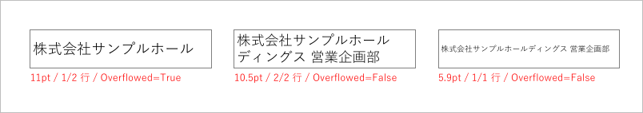

左の枠では 2 行目が入りきらないため、1 行目だけを描いて `Overflowed` が `True` になっています。

### 8.4 申込書の例

罫線・均等割り付けの項目名・縮小する記入欄・チェックボックスを組み合わせた例です。

```csharp
var pdf = new PdfDocument();
var page = pdf.AddPage(PageSize.A5.Landscape);
var g = page.Graphics;
var label = new TextStyle(font, 10);
var value = new TextStyle(font, 12);
var thin = new PdfPen(PdfColor.Black, 0.5);
var gray = PdfColor.FromGray(0.92);

g.DrawText("申 込 書", page.Width / 2, Unit.Mm(12), new TextStyle(font, 20) { Bold = true }, TextAlignment.Center);
g.DrawText("2026 年 10 月 19 日", page.Width - Unit.Mm(15), Unit.Mm(24), label, TextAlignment.Right);

string[] labels = { "氏名", "フリガナ", "住所", "電話番号" };
string[] values = { "山田 太郎", "ヤマダ タロウ", "東京都千代田区千代田 1-1-1 サンプルマンション 1001 号室", "03-1234-5678" };
double x = Unit.Mm(15), y = Unit.Mm(32), labelW = Unit.Mm(30), w = page.Width - Unit.Mm(30), h = Unit.Mm(12);
for (int i = 0; i < labels.Length; i++)
{
    double top = y + i * h;
    g.DrawRectangle(thin, gray, x, top, labelW, h);
    g.DrawRectangle(thin, x + labelW, top, w - labelW, h);
    // 項目名は均等割り付け、記入欄は収まらなければ縮小
    g.DrawTextBox(labels[i], new PdfRect(x + Unit.Mm(4), top, labelW - Unit.Mm(8), h), label,
        new TextBoxOptions { Alignment = TextAlignment.Distribute, VerticalAlignment = VerticalAlignment.Middle });
    g.DrawTextBox(values[i], new PdfRect(x + labelW + Unit.Mm(3), top, w - labelW - Unit.Mm(6), h), value,
        new TextBoxOptions { VerticalAlignment = VerticalAlignment.Middle, ShrinkToFit = true, Wrap = false });
}

// チェックボックス
double cy = y + labels.Length * h + Unit.Mm(8);
string[] plans = { "ライト", "スタンダード", "プレミアム" };
for (int i = 0; i < plans.Length; i++)
{
    double bx = x + i * Unit.Mm(40);
    g.DrawRectangle(thin, bx, cy, Unit.Mm(4), Unit.Mm(4));
    if (i == 1) g.DrawPolyline(new PdfPen(PdfColor.Red, 1.5), bx + 2, cy + 6, bx + 5, cy + 10, bx + 11, cy + 1);
    g.DrawText(plans[i], bx + Unit.Mm(6), cy - 1, label);
}

pdf.Save("form.pdf");
```

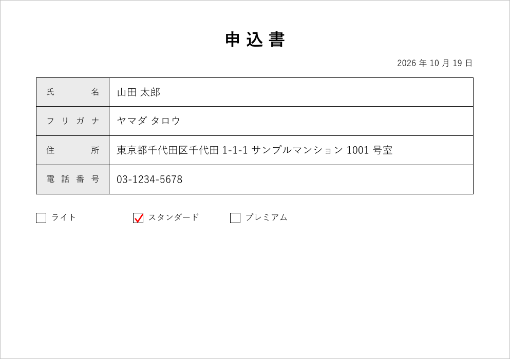

### 8.5 自動レイアウトの結果に描き足す

`Document.Render()` は、自動レイアウトの結果を `PdfDocument` として返します。そのページの `Graphics` を使うと、座標を指定して描き足せます。

```csharp
var doc = new Document(font, 10.5);
var s = doc.AddSection();
s.AddParagraph("稟議書").SetFontSize(20).SetBold().SetAlignment(TextAlignment.Center).SetSpaceAfter(10);
s.AddParagraph("件名：新しい会計システムの導入について");
s.AddParagraph(Filler(4));

// 自動レイアウトの結果を PdfDocument として受け取り、座標指定で描き足す
PdfDocument pdf = doc.Render();
var g = pdf.Pages[0].Graphics;
double cx = pdf.Pages[0].Width - Unit.Mm(35), cy = Unit.Mm(17);
var red = PdfColor.FromHex("#D00000");
g.DrawCircle(new PdfPen(red, 1.5), null, cx, cy, Unit.Mm(10));
g.DrawLine(new PdfPen(red, 0.8), cx - Unit.Mm(9.5), cy - 2, cx + Unit.Mm(9.5), cy - 2);
g.DrawText("承認", cx, cy - Unit.Mm(7), new TextStyle(font, 9) { Color = red }, TextAlignment.Center);
g.DrawText("10.19", cx, cy + 1, new TextStyle(font, 8) { Color = red }, TextAlignment.Center);
pdf.Save("render-then-draw.pdf");
```


### 8.6 段落と箇条書きを描く

`DrawTextBox` は 1 つの文字列を 1 つの書式で描きます。文字の一部だけを上付き・下付きにしたり、ルビを付けたりした段落（[3.8](#38-上付き下付き)、[3.11](#311-ルビ振り仮名)）や、箇条書き（[3.10](#310-箇条書きと番号付きリスト)）を座標を指定して描くときは、`DrawBlocks(ブロック, 矩形, スタイル, オプション)` を使います。自動レイアウトと同じ `Paragraph`・`ListBlock`・`Table` などを、矩形の中に上から順に並べて描きます。

```csharp
var pdf = new PdfDocument();
var g = pdf.AddPage(new PageSize(Unit.Mm(170), Unit.Mm(52))).Graphics;
var style = new TextStyle(font, 10);
var frame = new PdfPen(PdfColor.Gray, 0.5);

// 文字の一部だけを上付き・下付きにしたり、ルビを付けたりした段落
var left = new PdfRect(Unit.Mm(8), Unit.Mm(8), Unit.Mm(74), Unit.Mm(36));
g.DrawRectangle(frame, left.X, left.Y, left.Width, left.Height);
var paragraph = new Paragraph("床面積は 120 m").AddSuperscript("2").AddText("、二酸化炭素は CO").AddSubscript("2")
    .AddText("。").AddRuby("帳票", "ちょうひょう").AddText("の文字も描けます。");
g.DrawBlocks(paragraph, left.Deflate(3, 3, 3, 3), style, new TextBoxOptions { LineSpacing = 1.6 });

// 箇条書き。縦の揃えや縮小は DrawTextBox と同じように指定できる
var right = new PdfRect(Unit.Mm(88), Unit.Mm(8), Unit.Mm(74), Unit.Mm(36));
g.DrawRectangle(frame, right.X, right.Y, right.Width, right.Height);
var list = new ListBlock { Kind = ListKind.Numbered };
list.AddItem("申込書に記入する");
list.AddItem("本人確認の書類を添える");
list.AddSubList(ListKind.Bullet).AddItem("運転免許証など、写真付きのもの");
list.AddItem("窓口に提出する");
g.DrawBlocks(list, right.Deflate(3, 3, 3, 3), style, new TextBoxOptions
{
    VerticalAlignment = VerticalAlignment.Middle,
    ShrinkToFit = true,
});

pdf.Save("block-boxes.pdf");
```

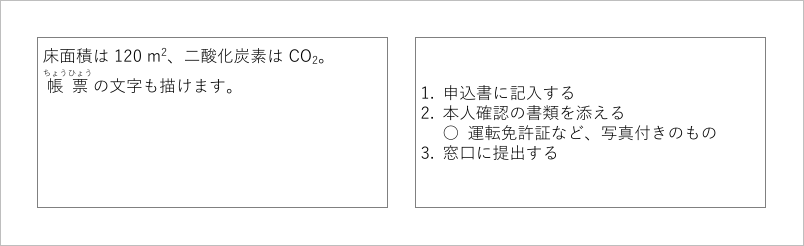

- 3 番目の引数のスタイルは、既定の文字スタイル（`Document.DefaultTextStyle` にあたる）です。`TextBoxOptions` の `Alignment`・`LineSpacingRule`・`LineSpacing`・`TabStops`・`DefaultTabStop` は既定の段落書式になり、段落やリストの書式で上書きできます。行送りの既定値は `DrawTextBox` と同じ 1.2 倍です。
- `VerticalAlignment`・`Wrap`・`DrawOverflow` は `DrawTextBox` と同じ動作です。`DrawOverflow` が false なら、矩形に入るところまでを描きます。
- `ShrinkToFit` では、内容全体を同じ倍率で縮めて矩形に収めます（文字の大きさ・行送り・記号の幅などがそろって縮みます）。`MinFontSize` は、既定の文字スタイルの文字サイズに対する下限です。
- 戻り値の `BlockBoxResult` で、描いた高さ（`Height`）、全体の高さ（`TotalHeight`）、収まりきらなかったか（`Overflowed`）、縮めた倍率（`Scale`）が分かります。
- 改ページと段区切りは無視します。脚注・目次・ページ参照・名前付きスタイルは使えません（`InvalidOperationException` になります）。
- アンカー（`SetAnchor` / `AddAnchor`）は `PdfDocument` の飛び先になり、同じ `PdfDocument` に描いた文書内リンク（`AddInternalLink`）から飛べます。別のページの `DrawBlocks` で描いたアンカーにも飛べます。
- ページ番号のフィールドは、そのページが `PdfDocument` の何ページ目かを表示します。総ページ数は、描いた時点のページ数です。

---

## 9. まとまったサンプル

[samples/ChohyoPdf.Samples/Program.cs](../samples/ChohyoPdf.Samples/Program.cs) には、実務に近い 3 つのサンプルがあります。次のコマンドで PDF を出力できます。

```
dotnet run --project samples/ChohyoPdf.Samples -f net8.0 -- 出力先フォルダ
```

### 9.1 請求書

宛先と発行元を罫線のない表で並べ、36 行の明細を 2 ページに分けています。2 ページ目の先頭にも明細の見出しを表示し、小計・消費税・合計の行は同じページにまとめています。

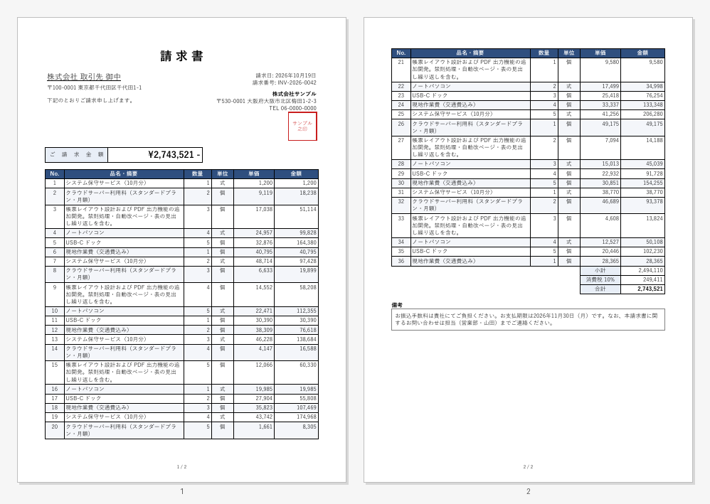

### 9.2 レポート

名前付きスタイル、禁則処理と両端揃え、セルを結合した表、PNG 画像、棒グラフと円グラフ、長い表の自動改ページを使っています。

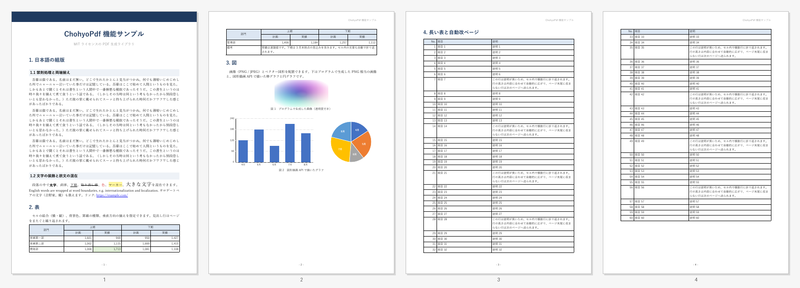

### 9.3 受領書

座標指定の API だけで作った A5 横の帳票です。

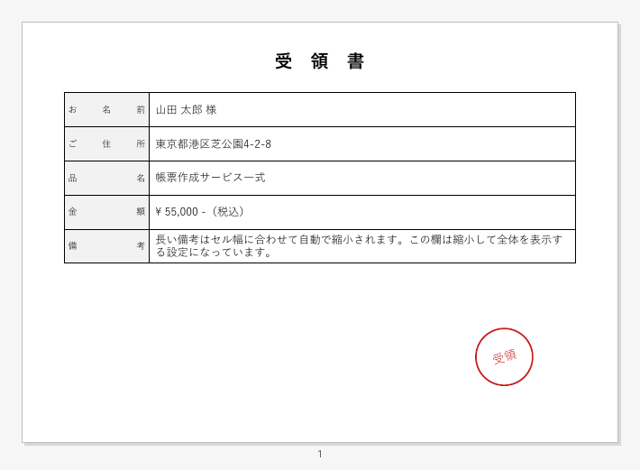

---

## 10. 困ったときは

### 10.1 フォントが見つからない

`PdfFont.FromSystem` は、次のフォルダを探します。

- Windows：`C:\Windows\Fonts`、ユーザーごとのフォントフォルダ
- macOS：`/System/Library/Fonts`、`/Library/Fonts`、`~/Library/Fonts`
- Linux：`/usr/share/fonts`、`/usr/local/share/fonts`、`~/.fonts`、`~/.local/share/fonts`

見つからないときは、ファイルを直接指定します。TTC ファイル（複数のフォントを 1 つにまとめたファイル）では、番号か名前でフォントを選びます。

```csharp
// TTC ファイルの中のフォント名を調べ、名前で選んで読み込む
foreach (string name in PdfFont.GetFaceNames(@"C:\Windows\Fonts\msgothic.ttc"))
    Console.WriteLine(name);                     // MS Gothic、MS UI Gothic、MS PGothic
var pgothic = PdfFont.FromFile(@"C:\Windows\Fonts\msgothic.ttc", "MS PGothic");

// 候補を順に探す（サーバーなど、環境によってフォントが違うとき）
if (!PdfFont.TryFromSystem(out var gothic, "Yu Gothic Regular", "Meiryo", "Noto Sans JP", "IPAexGothic"))
    throw new InvalidOperationException("日本語フォントがありません");

// 文字があるかを調べる。サロゲートペアの文字はコードポイントにしてから渡す
Console.WriteLine(gothic!.HasGlyph('あ'));                    // True
Console.WriteLine(gothic.HasGlyph(char.ConvertToUtf32("𠮷", 0))); // True
Console.WriteLine(gothic.HasGlyph(0x265A));                   // False（♚ は游ゴシックにない）
```

アプリケーションにフォントファイルを同梱する場合は、`PdfFont.FromStream` や `PdfFont.FromBytes` でも読み込めます。

### 10.2 文字が細い・太さが違う

可変フォント（例: Windows 11 の `NotoSansJP-VF.ttf`）は、フォントの既定の太さで描かれます。NotoSansJP-VF の既定は最も細い Thin です。Regular や Bold など、太さごとに分かれたフォントファイルを使ってください。`PdfFont.IsVariableFont` で可変フォントかどうかを確認できます。

### 10.3 フォントを読み込めない

| 例外 | 原因と対処 |
| --- | --- |
| `NotSupportedException`（CFF） | .otf 形式のうち、CFF アウトラインのフォント（Source Han Sans、Noto Sans CJK の OTF 版など）には対応していません。同じフォントの TTF 版を使ってください |
| `NotSupportedException`（埋め込み禁止） | フォントのライセンス情報で埋め込みが禁止されています。別のフォントを使ってください |
| `FileNotFoundException` | `FromSystem` に渡した名前のフォントが見つかりません |

PDF にフォントを埋め込んで配布してよいかは、フォントごとのライセンスで決まります。利用するフォントのライセンスを確認してください。

### 10.4 文字が □ になる・表示されない

フォントにその文字がありません。`HasGlyph` で確認できます（[10.1](#101-フォントが見つからない) の例を参照）。代替フォントを指定すると、その文字だけ別のフォントで描けます（[3.5](#35-特殊な文字と代替フォント)）。

### 10.5 ヘッダーと本文が重なる

ヘッダーとフッターの高さは、本文の位置に影響しません。`PageSetup.Margins` の上下の値を大きくしてください（[4.2](#42-ヘッダーとフッター)）。

### 10.6 表がページからはみ出す

縦に結合したセルのまとまりと、高さを固定した行（`RowHeightRule.Exactly`）は、ページの途中で分割しません。1 ページより高くなると、ページからはみ出して描かれます。結合する行数を減らすか、行の高さの指定を `AtLeast` にしてください。

### 10.7 対応していない機能

次の機能には対応していません。

- 縦書き
- 合字やカーニングなどの OpenType のレイアウト機能（GSUB / GPOS）、アラビア文字などの複雑な文字体系、右から左に書く文字
- 異体字セレクタ（IVS）。無視して、基底の文字の字形で描きます
- CFF 形式の OpenType フォント（[10.3](#103-フォントを読み込めない)）
- 文末脚注（後注）
- 段組みの最後のページで、段の高さをそろえること
- 暗号化、電子署名、PDF/A、タグ付き PDF、フォーム（入力欄）
- PDF の読み込みと編集（PDF を作るためのライブラリです）

各機能の細かい動作と制限は、それぞれの節にまとめています。

---

## 11. API の一覧

主なクラスとメンバーを、用途ごとにまとめています。すべての型とメンバーの説明は [API リファレンス](https://ringoacid.github.io/ChohyoPdf/api/) にあります。

### 11.1 自動レイアウト

| クラス | 主なメンバー |
| --- | --- |
| `Document` | `AddSection()`、`FootnoteStyle`、`FootnoteFormat`、`FootnoteNumberFormat`、`FootnoteSymbols`、`FootnoteSeparator`、`FootnoteSeparatorLength`、`FootnoteSpacing`、`CreateBookmarks`、`ShowBookmarkPane`、`Styles`、`DefaultTextStyle`、`DefaultParagraphFormat`、`Info`、`Save()`、`ToArray()`、`Render()` |
| `PageSetup` / `PageContext` | `PageSetup.Size`、`Margins`、`HeaderDistance`、`FooterDistance`、`ColumnCount`、`ColumnSpacing`、`ColumnSeparator`、`ColumnWidth`、`ContentWidth`、`ContentHeight`、`PageContext.ContentArea`、`ColumnCount`、`ColumnAreas` |
| `Section` | `PageSetup`、`Header`、`Footer`、`DifferentOddEven`、`EvenHeader`、`EvenFooter`、`DifferentFirstPage`、`FirstPageHeader`、`FirstPageFooter`、`PageNumberStart`、`PageNumberFormat`、`FootnoteNumbering`、`PageBackground`、`PageForeground`、`AddParagraph()`、`AddTable()`、`AddImage()`、`AddDrawing()`、`AddPageBreak()`、`AddColumnBreak()`、`AddSpacer()`、`AddHorizontalLine()`、`AddTableOfContents()`、`AddList()`、`AddBulletList()`、`AddNumberedList()` |
| `Paragraph` | `AddText()`、`AddBold()`、`AddLink()`、`AddLineBreak()`、`AddSuperscript()`、`AddSubscript()`、`AddTab()`、`AddTabStop()`、`AddRuby()`、`AddMonoRuby()`、`AddRubyMarkup()`、`RubyStyle`、`SetRubyStyle()`、`AddPageNumber()`、`AddPageCount()`、`AddField()`、`SetAnchor()`、`AddAnchor()`、`AddInternalLink()`、`AddPageRef()`、`AddFootnote()`、`SetOutline()`、`OutlineTitle`、`SetFontSize()`、`SetBold()`、`SetColor()`、`SetAlignment()`、`SetLineSpacing()`、`SetIndent()`、`SetSpaceBefore()`、`SetSpaceAfter()`、`SetDefaultTabStop()`、`SetKeepWithNext()`、`SetKeepTogether()`、`SetPageBreakBefore()`、`SetBackground()`、`SetBorder()` |
| `ParagraphFormat` | `Alignment`、`LineSpacing`、`LineSpacingRule`、`FirstLineIndent`、`LeftIndent`、`RightIndent`、`SpaceBefore`、`SpaceAfter`、`KeepTogether`、`KeepWithNext`、`PageBreakBefore`、`WidowControl`、`Background`、`Border`、`Padding`、`TabStops`、`DefaultTabStop`、`AddTabStop()`、`OutlineLevel` |
| `ListBlock` / `ListBlockItem` | `Kind`（`ListKind`）、`Bullet`、`NumberFormat`、`Prefix`、`Suffix`、`StartNumber`、`MarkerWidth`、`MarkerGap`、`MarkerAlignment`、`MarkerStyle`、`Indent`、`ItemSpacing`、`Style`、`Format`、`AddItem()`、`AddSubList()`、`ListBlockItem.Number`、および `ListBlockItem` は `Section` と同じ `Add〜` メソッド |
| `TabStop` | `Position`、`Alignment`（`TabAlignment`）、`Leader`（`TabLeader`） |
| `TableOfContents` | `Title`、`TitleStyleName`、`TitleStyle`、`TitleFormat`、`TitleOutlineLevel`、`MinLevel`、`MaxLevel`、`IndentPerLevel`、`Leader`、`ShowPageNumbers`、`Hyperlinks`、`PageNumberFormat`、`EntryStyleName`、`LevelStyleNames`、`EntryStyle`、`EntryFormat` |
| `Footnote` / `FootnoteRun` | `Footnote`（`Section` と同じ `Add〜` メソッド）、`FootnoteRun.Footnote`、`FootnoteNumbering`（`Continuous` / `Restart`） |
| `TextRun` / `RubyRun` / `AnchorRun` / `FieldRun` | `RubyRun.BaseText`、`RubyRun.RubyText`、`RubyRun.RubyStyle`、`TextRun.Link`、`TextRun.LinkAnchor`、`AnchorRun.Name`、`FieldRun.Field`（`FieldType.PageRef` など）、`FieldRun.Anchor`、`FieldRun.Format` |
| `Table` | `AddColumn()`、`AddRelativeColumn()`、`AddAutoColumn()`、`AddAutoColumns()`、`AutoFitColumns`、`AddColumns()`、`AddHeaderRow()`、`AddRow()`、`Borders`、`CellPadding`、`HeaderBackground`、`HeaderStyle`、`AlternateRowBackground`、`VerticalAlignment`、`Alignment` |
| `Column` | `Width`、`RelativeWidth`、`AutoFit`、`WidthMode`（`ColumnWidthMode`）、`Alignment`、`Background` |
| `Row` | `Height`、`HeightRule`、`Background`、`Style`、`VerticalAlignment`、`AllowBreakAcrossPages`、`KeepWithNext` |
| `Cell` | `Merge()`、`SetText()`、`SetBackground()`、`SetAlignment()`、`Borders`、`Padding`、`Style`、および `Section` と同じ `Add〜` メソッド |

### 11.2 座標指定

| クラス | 主なメンバー |
| --- | --- |
| `PdfDocument` | `AddPage()`、`Pages`、`Info`、`AddBookmark()`、`Bookmarks`、`ShowBookmarkPane`、`Save()`、`ToArray()` |
| `PdfBookmark` | `Title`、`Page`、`Y`、`IsOpen`、`Children`、`AddChild()` |
| `PdfPage` | `Graphics`、`Width`、`Height`、`AddLink()`（URL または別のページへ）、`AddBookmark()` |
| `PdfGraphics` | `DrawText()`、`DrawTextBox()`、`DrawBlocks()`、`MeasureText()`、`MeasureTextHeight()`、`DrawLine()`、`DrawPolyline()`、`DrawPolygon()`、`DrawRectangle()`、`FillRectangle()`、`DrawRoundedRectangle()`、`DrawEllipse()`、`DrawCircle()`、`DrawPie()`、`DrawPath()`、`DrawImage()`、`DrawImageFit()`、`SaveState()`、`RestoreState()`、`Translate()`、`Scale()`、`Rotate()`、`RotateAt()`、`SetClip()`、`AddLink()`（URL または別のページへ） |
| `PdfPath` | `MoveTo()`、`LineTo()`、`CurveTo()`、`QuadraticTo()`、`Arc()`、`Close()`、`AddRectangle()`、`AddRoundedRectangle()`、`AddEllipse()`、`AddPolygon()` |

### 11.3 共通

| クラス | 主なメンバー |
| --- | --- |
| `PdfFont` | `FromSystem()`、`TryFromSystem()`、`FromFile()`、`FromStream()`、`FromBytes()`、`GetFaceNames()`、`BoldVariant`、`ItalicVariant`、`HasGlyph()`、`MeasureText()`、`IsVariableFont` |
| `PdfImage` | `FromFile()`、`FromStream()`、`FromBytes()`（いずれも、JPEG の EXIF の向きを反映するかを指定する `bool` の引数を持つオーバーロードあり）、`FromRawPixels()`、`PixelWidth`、`PixelHeight`、`Width`、`Height`、`HasAlpha`、`ExifOrientation`、`OrientationApplied` |
| `TextStyle` | `Font`、`FontSize`、`Color`、`Bold`、`Italic`、`Underline`、`Strikeout`、`CharacterSpacing`、`BackgroundColor`、`BaselineShift`、`FallbackFonts` |
| `PdfColor` | `FromRgb()`、`FromHex()`、`FromGray()`、`FromCmyk()`、`WithAlpha()` |
| `PdfPen` | `Color`、`Width`、`DashPattern`、`LineCap`、`LineJoin`、`Dashed()`、`Dotted()` |
| `Unit` | `Mm()`、`Cm()`、`Inch()`、`ToMm()` |
| `PageNumberFormatter` | `Format()`（番号を `PageNumberFormat` の書式の文字列にする） |

各メンバーの詳しい説明は、ソースコードの XML ドキュメントコメントにあります。Visual Studio などの IntelliSense でも表示されます。
